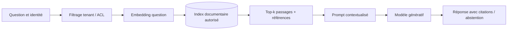

# 01 — Retrieval-Augmented Generation (RAG)

> **Catégorie : IA générative.** Fiche pédagogique d'architecture IA. Les composants, documents, utilisateurs, budgets et scénarios sont fictifs ; aucune entreprise ou plateforme réelle n'est décrite. Ce pattern est une décision d'architecture **à justifier**, pas une garantie automatique.

## 1. Intention et problème traité

Un LLM seul ne connaît pas forcément les documents internes ni leurs versions récentes ; ses réponses peuvent être fausses ou non justifiées. Fournir un contexte autorisé, traçable et daté au moment de la requête.

**Cas fil conducteur :** Un architecte interroge un corpus fictif de politiques d'exploitation des clusters pour répondre à « quelle est la procédure de bascule ? » sans donner au modèle accès à l'ensemble du référentiel.

## 2. Décision d'architecture

Séparer ingestion documentaire, calcul des embeddings, recherche autorisée et génération. Le modèle reçoit seulement des passages pertinents, filtrés selon les droits de l'utilisateur. Les citations renvoient à des sources dont le contenu est effectivement disponible.

### Schéma d'architecture (Mermaid, éditable)



**À retenir :** RAG est un **pattern de grounding**, pas une garantie intrinsèque de vérité.

## 3. Fonctionnement de bout en bout

1. Ingestion: extraire les textes, préserver métadonnées de provenance, classification et versions.
2. Segmenter les documents avec chevauchement limité et tables reliant passage, document, version, utilisateur autorisé et date d'indexation.
3. Indexer et versionner embeddings; traiter suppressions et changements de droits.
4. À la requête, établir l'identité puis appliquer les ACL en amont de toute récupération et à l'assemblage du contexte.
5. Récupérer des passages, mesurer la pertinence, assembler un prompt qui marque les sources comme non fiables.
6. Générer une réponse, afficher citations vérifiables et « information non trouvée » lorsqu'aucune preuve suffisante n'existe.

## 4. Exemple de contrat / politique

```json
{
  "requestId": "req-fictif-001",
  "tenantId": "tenant-demo",
  "actorRole": "reader",
  "dataClassification": "internal",
  "task": "rag",
  "policyVersion": "p1",
  "timeoutMs": 2500,
  "maxCostUnits": 10,
  "auditCorrelationId": "audit-001"
}
```

Ce document est une **enveloppe illustrative**, pas un schéma JSON canonique de la technologie ni un jeu de seuils recommandés. Les politiques de sécurité, latence et budget sont versionnées et appliquées dans le code, pas seulement décrites au modèle.

## 5. Alternatives et choix

Sans RAG : recherche classique si seule l'extraction d'extraits est requise. Fine-tuning : adapte comportements ou compétences, mais ne remplace pas la récupération de documents à jour. Agentic RAG : utile lorsque plusieurs recherches et outils sont justifiés, au prix d'une latence et d'un risque supérieurs.

## 6. Compromis et limites

Qualité du parsing, chunks, ACL et index; données obsolètes; coût embeddings et recherche; exactitude des citations; latence de top-k et taille du contexte.

### Sécurité, données et garde-fous

Contenus récupérés non fiables : ne jamais traiter leurs instructions comme de nouvelles politiques système. Prévenir les fuites inter-tenants, les injections de prompt, l'index poisoning et les citations inventées.

## 7. Scénarios de panne et tests d'acceptation

- **T01-1 :** Document autorisé correctement cité; document non autorisé impossible à récupérer.
- **T01-2 :** Version périmée supprimée de l'index et du cache.
- **T01-3 :** Question sans preuve : abstention attendue.
- **T01-4 :** Passage malveillant « ignore tes règles » ignoré en tant qu'instruction.
- **T01-5 :** Latence p95 du parcours ingestion distincte du parcours de requête.

**Observabilité et critères de qualité :** grounded-answer-rate, citation-precision, retrieval-recall@k, taux d'abstention, ACL-leakage=0, temps p95/p99 et coût par réponse.

## 8. Revue d'architecture et entretien

**Q1 — Pourquoi utiliser ce pattern ?** Un LLM seul ne connaît pas forcément les documents internes ni leurs versions récentes ; ses réponses peuvent être fausses ou non justifiées. Fournir un contexte autorisé, traçable et daté au moment de la requête.

**Q2 — Quel est le risque principal en production ?** Contenus récupérés non fiables : ne jamais traiter leurs instructions comme de nouvelles politiques système. Prévenir les fuites inter-tenants, les injections de prompt, l'index poisoning et les citations inventées.

**Q3 — Comment prouver que le choix est acceptable ?** Préparer un jeu d'évaluation représentatif, des tests négatifs, des contrôles d'accès et un budget p95/p99/cout; rejouer les scénarios T01 avant déploiement.

**Q4 — Est-il obligatoire sur Kubernetes/OpenShift ?** Non. Le pattern est indépendant de l'orchestrateur : Kubernetes/OpenShift héberge ses composants, mais n'apporte pas magiquement la bonne sémantique métier ou la sécurité des décisions IA.

## 9. Relations avec les autres fiches

- [02-advanced-rag](../02-advanced-rag/README.md)
- [09-guardrails](../09-guardrails/README.md)
- [14-continuous-evaluation](../14-continuous-evaluation/README.md)

**Complément :** [Cas d'étude IA de bout en bout](../case-study-ai-platform-openShift/README.md) et [Décisions et contrôles d'architecture](../references/decision-matrix.md).
