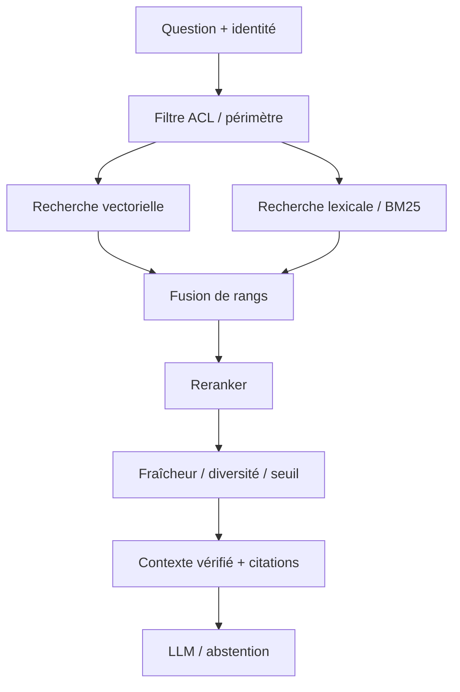

# 02 — Advanced RAG — hybride, reranking, filtres

> **Catégorie : IA générative.** Fiche pédagogique d'architecture IA. Les composants, documents, utilisateurs, budgets et scénarios sont fictifs ; aucune entreprise ou plateforme réelle n'est décrite. Ce pattern est une décision d'architecture **à justifier**, pas une garantie automatique.

## 1. Intention et problème traité

Une simple recherche vectorielle peut manquer un identifiant exact, un numéro de procédure ou un libellé rare ; elle peut remonter des passages sémantiquement proches mais non pertinents.

**Cas fil conducteur :** Une procédure fictive nommée « PROC-OPS-017 » n'est pas retrouvée en recherche dense seule, mais la recherche lexicale exacte la trouve.

## 2. Décision d'architecture

Combiner recherche sémantique et lexicale, filtres de sécurité et de fraîcheur, reranking, diversification, seuil de confiance et citations contrôlées. Mesurer le gain plutôt que multiplier les étapes systématiquement.

### Schéma d'architecture (Mermaid, éditable)



**À retenir :** Advanced RAG est une **composition de techniques de retrieval** : son intérêt dépend d'un écart de qualité mesuré.

## 3. Fonctionnement de bout en bout

1. Normaliser et classer la requête; préserver termes exacts, sigles et identifiants.
2. Appliquer les droits et les filtres documentaires *avant* la récupération et revalider l'accès avant restitution.
3. Exécuter lexical et vectoriel en parallèle avec budgets de latence distincts.
4. Fusionner les candidats, puis reranker uniquement un ensemble borné.
5. Diversifier les passages d'une même version et refuser les anciennes versions contradictoires si la fraîcheur prime.
6. Évaluer groundedness et pertinence sur un jeu de questions métier annoté.

## 4. Exemple de contrat / politique

```json
{
  "requestId": "req-fictif-001",
  "tenantId": "tenant-demo",
  "actorRole": "reader",
  "dataClassification": "internal",
  "task": "advanced-rag",
  "policyVersion": "p1",
  "timeoutMs": 2500,
  "maxCostUnits": 10,
  "auditCorrelationId": "audit-001"
}
```

Ce document est une **enveloppe illustrative**, pas un schéma JSON canonique de la technologie ni un jeu de seuils recommandés. Les politiques de sécurité, latence et budget sont versionnées et appliquées dans le code, pas seulement décrites au modèle.

## 5. Alternatives et choix

Recherche lexicale seule pour codes exacts; vectoriel seul si corpus simple; RAG hiérarchique pour longues procédures; recherche fédérée seulement si la gouvernance et les latences le permettent.

## 6. Compromis et limites

Coût de reranking, latence, drift des embeddings, erreurs d'identification des versions, dimensionnement de la recherche hybride.

### Sécurité, données et garde-fous

Filtrage avant rerank et citation; isolation tenant/domaine; effacement des index; aucune recherche globale avant contrôle d'autorisation.

## 7. Scénarios de panne et tests d'acceptation

- **T02-1 :** Question par identifiant exact et question par paraphrase.
- **T02-2 :** Corpus avec deux versions dont une obsolète.
- **T02-3 :** Documents avec ACL contradictoires: aucun passage interdit.
- **T02-4 :** Reranker indisponible: parcours dégradé contrôlé et mesuré.

**Observabilité et critères de qualité :** Recall@k, MRR, nDCG, précision citations, taux de documents obsolètes, coût reranking et p95 par étape.

## 8. Revue d'architecture et entretien

**Q1 — Pourquoi utiliser ce pattern ?** Une simple recherche vectorielle peut manquer un identifiant exact, un numéro de procédure ou un libellé rare ; elle peut remonter des passages sémantiquement proches mais non pertinents.

**Q2 — Quel est le risque principal en production ?** Filtrage avant rerank et citation; isolation tenant/domaine; effacement des index; aucune recherche globale avant contrôle d'autorisation.

**Q3 — Comment prouver que le choix est acceptable ?** Préparer un jeu d'évaluation représentatif, des tests négatifs, des contrôles d'accès et un budget p95/p99/cout; rejouer les scénarios T02 avant déploiement.

**Q4 — Est-il obligatoire sur Kubernetes/OpenShift ?** Non. Le pattern est indépendant de l'orchestrateur : Kubernetes/OpenShift héberge ses composants, mais n'apporte pas magiquement la bonne sémantique métier ou la sécurité des décisions IA.

## 9. Relations avec les autres fiches

- [01-rag](../01-rag/README.md)
- [04-semantic-cache](../04-semantic-cache/README.md)
- [14-continuous-evaluation](../14-continuous-evaluation/README.md)

**Complément :** [Cas d'étude IA de bout en bout](../case-study-ai-platform-openShift/README.md) et [Décisions et contrôles d'architecture](../references/decision-matrix.md).
