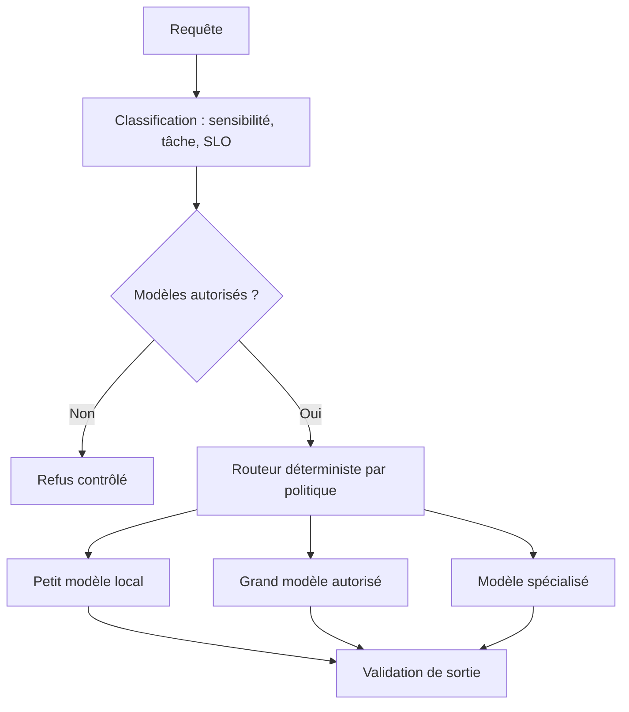

# 03 — Model Router — sélection sous contraintes

> **Catégorie : IA générative.** Fiche pédagogique d'architecture IA. Les composants, documents, utilisateurs, budgets et scénarios sont fictifs ; aucune entreprise ou plateforme réelle n'est décrite. Ce pattern est une décision d'architecture **à justifier**, pas une garantie automatique.

## 1. Intention et problème traité

Un modèle unique est parfois trop coûteux ou trop lent pour toutes les demandes, mais une sélection aléatoire entre modèles compromet qualité et gouvernance.

**Cas fil conducteur :** Une requête simple de classification de ticket peut utiliser un petit modèle local ; une analyse documentaire longue exige un modèle plus performant, si les données y sont autorisées.

## 2. Décision d'architecture

Router selon classe de données, tâche, budget, qualité validée, région, capacité et disponibilité. L'ordre est : politique de sécurité **avant** optimisation du coût.

### Schéma d'architecture (Mermaid, éditable)



**À retenir :** Le Model Router arbitre **qualité, coût, latence et gouvernance**, sans réécrire les règles d'autorisation.

## 3. Fonctionnement de bout en bout

1. Définir catalogue versionné de modèles avec régions, licences, catégories de données, capacités et coût.
2. Classifier la requête sans envoyer les données hors de leur périmètre.
3. Éliminer tous les modèles non autorisés par confidentialité ou réglementation.
4. Calculer un choix explicable sur score qualité, latence estimée, saturation, taille de contexte et prix.
5. Associer un modelVersion et policyVersion à chaque trace et éviter les changements silencieux de comportement.
6. Mesurer les erreurs de routage, gérer fallback compatible et faire canary avant changement de règles.

## 4. Exemple de contrat / politique

```json
{
  "requestId": "req-fictif-001",
  "tenantId": "tenant-demo",
  "actorRole": "reader",
  "dataClassification": "internal",
  "task": "model-router",
  "policyVersion": "p1",
  "timeoutMs": 2500,
  "maxCostUnits": 10,
  "auditCorrelationId": "audit-001"
}
```

Ce document est une **enveloppe illustrative**, pas un schéma JSON canonique de la technologie ni un jeu de seuils recommandés. Les politiques de sécurité, latence et budget sont versionnées et appliquées dans le code, pas seulement décrites au modèle.

## 5. Alternatives et choix

Un seul modèle si faible volume; routage fixe par produit/tenant; routeur fondé sur classification légère ou seuils déterministes plutôt que second LLM.

## 6. Compromis et limites

Complexité d'exploitation, tests combinatoires, hétérogénéité des outputs, versionning et monitoring multi-modèles.

### Sécurité, données et garde-fous

Jamais de bascule vers un modèle situé hors du périmètre autorisé. L'optimisation économique ne doit pas provoquer d'exfiltration de données ou contourner une politique.

## 7. Scénarios de panne et tests d'acceptation

- **T03-1 :** Donnée confidentielle toujours routée vers environnement conforme.
- **T03-2 :** Modèle choisi indisponible : fallback même niveau de politique.
- **T03-3 :** Classe simple routée au petit modèle seulement si qualité évaluée.
- **T03-4 :** Traçabilité du choix et des versions.

**Observabilité et critères de qualité :** routing-policy-violations=0, accuracy/quality par classe, coût moyen/1k requêtes, p95, saturation GPU, taux de fallback.

## 8. Revue d'architecture et entretien

**Q1 — Pourquoi utiliser ce pattern ?** Un modèle unique est parfois trop coûteux ou trop lent pour toutes les demandes, mais une sélection aléatoire entre modèles compromet qualité et gouvernance.

**Q2 — Quel est le risque principal en production ?** Jamais de bascule vers un modèle situé hors du périmètre autorisé. L'optimisation économique ne doit pas provoquer d'exfiltration de données ou contourner une politique.

**Q3 — Comment prouver que le choix est acceptable ?** Préparer un jeu d'évaluation représentatif, des tests négatifs, des contrôles d'accès et un budget p95/p99/cout; rejouer les scénarios T03 avant déploiement.

**Q4 — Est-il obligatoire sur Kubernetes/OpenShift ?** Non. Le pattern est indépendant de l'orchestrateur : Kubernetes/OpenShift héberge ses composants, mais n'apporte pas magiquement la bonne sémantique métier ou la sécurité des décisions IA.

## 9. Relations avec les autres fiches

- [13-model-fallback](../13-model-fallback/README.md)
- [11-ai-gateway](../11-ai-gateway/README.md)
- [14-continuous-evaluation](../14-continuous-evaluation/README.md)

**Complément :** [Cas d'étude IA de bout en bout](../case-study-ai-platform-openShift/README.md) et [Décisions et contrôles d'architecture](../references/decision-matrix.md).
