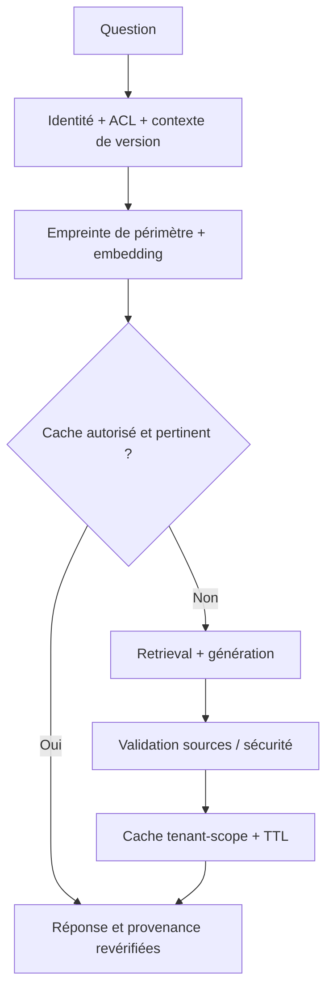

# 04 — Semantic Cache — réponses réutilisables

> **Catégorie : IA générative.** Fiche pédagogique d'architecture IA. Les composants, documents, utilisateurs, budgets et scénarios sont fictifs ; aucune entreprise ou plateforme réelle n'est décrite. Ce pattern est une décision d'architecture **à justifier**, pas une garantie automatique.

## 1. Intention et problème traité

Des demandes presque identiques génèrent des coûts d'inférence et des délais élevés. Mais un cache approximatif non isolé peut renvoyer des informations sensibles, obsolètes ou erronées.

**Cas fil conducteur :** Deux questions reformulées sur une procédure publique peuvent partager une réponse validée, mais deux utilisateurs aux habilitations différentes ne doivent jamais partager un résultat protégé.

## 2. Décision d'architecture

Utiliser un cache **scopé** (tenant, classe de données, autorisations, version corpus/prompt/modèle et politique), avec seuil de similarité calibré, TTL et invalidation explicite.

### Schéma d'architecture (Mermaid, éditable)



**À retenir :** Le Semantic Cache est **une optimisation facultative**, jamais une source autoritative.

## 3. Fonctionnement de bout en bout

1. Séparer cache de réponses publiques et cache limité par classe de données/tenant.
2. Construire une clé composée de scope, versions de prompt, corpus, règles et modèle.
3. Faire une recherche de similarité avec seuil adapté aux mauvaises correspondances sémantiques.
4. Sur hit, revérifier la validité des sources et les droits de l'utilisateur.
5. N'enregistrer que les réponses dont l'usage en cache est autorisé, avec TTL, métriques et invalidation sur retrait de documents.
6. Exclure les actions transactionnelles, réponses personnelles ou sensibles tant que les garanties ne sont pas démontrées.

## 4. Exemple de contrat / politique

```json
{
  "requestId": "req-fictif-001",
  "tenantId": "tenant-demo",
  "actorRole": "reader",
  "dataClassification": "internal",
  "task": "semantic-cache",
  "policyVersion": "p1",
  "timeoutMs": 2500,
  "maxCostUnits": 10,
  "auditCorrelationId": "audit-001"
}
```

Ce document est une **enveloppe illustrative**, pas un schéma JSON canonique de la technologie ni un jeu de seuils recommandés. Les politiques de sécurité, latence et budget sont versionnées et appliquées dans le code, pas seulement décrites au modèle.

## 5. Alternatives et choix

Cache exact par clé pour requêtes paramétrées; CDN uniquement pour ressources statiques; aucun cache pour décisions financières dynamiques.

## 6. Compromis et limites

Taux de hit, faux positifs sémantiques, TTL, coût de la recherche dans le cache, invalidations complexes.

### Sécurité, données et garde-fous

Cache cross-tenant = risque de fuite critique; filtrage par habilitation, anti-poisoning, purge complète après retrait des droits, pas d'informations personnelles en clair.

## 7. Scénarios de panne et tests d'acceptation

- **T04-1 :** Mêmes mots avec montants différents : cache miss.
- **T04-2 :** Même question autre tenant : cache miss.
- **T04-3 :** Document révoqué : entrée invalidée.
- **T04-4 :** Réponse obsolète : TTL/revalidation force une mise à jour.

**Observabilité et critères de qualité :** cache-hit-rate, wrong-hit-rate (objectif proche de 0), p95 gagné, coût économisé, stale-answer-rate et test fuite inter-tenant.

## 8. Revue d'architecture et entretien

**Q1 — Pourquoi utiliser ce pattern ?** Des demandes presque identiques génèrent des coûts d'inférence et des délais élevés. Mais un cache approximatif non isolé peut renvoyer des informations sensibles, obsolètes ou erronées.

**Q2 — Quel est le risque principal en production ?** Cache cross-tenant = risque de fuite critique; filtrage par habilitation, anti-poisoning, purge complète après retrait des droits, pas d'informations personnelles en clair.

**Q3 — Comment prouver que le choix est acceptable ?** Préparer un jeu d'évaluation représentatif, des tests négatifs, des contrôles d'accès et un budget p95/p99/cout; rejouer les scénarios T04 avant déploiement.

**Q4 — Est-il obligatoire sur Kubernetes/OpenShift ?** Non. Le pattern est indépendant de l'orchestrateur : Kubernetes/OpenShift héberge ses composants, mais n'apporte pas magiquement la bonne sémantique métier ou la sécurité des décisions IA.

## 9. Relations avec les autres fiches

- [01-rag](../01-rag/README.md)
- [09-guardrails](../09-guardrails/README.md)
- [14-continuous-evaluation](../14-continuous-evaluation/README.md)

**Complément :** [Cas d'étude IA de bout en bout](../case-study-ai-platform-openShift/README.md) et [Décisions et contrôles d'architecture](../references/decision-matrix.md).
