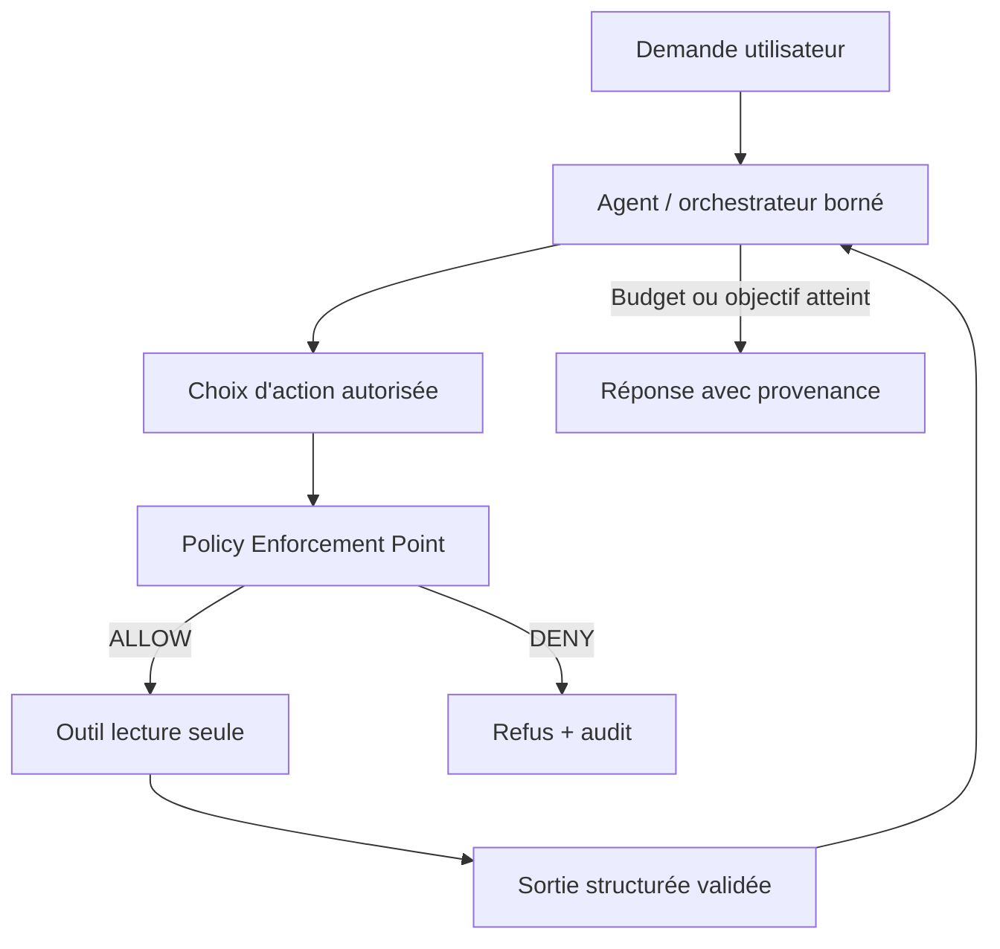

# 05 — ReAct / Tool Calling — agent à outils

> **Catégorie : IA agentique.** Fiche pédagogique d'architecture IA. Les composants, documents, utilisateurs, budgets et scénarios sont fictifs ; aucune entreprise ou plateforme réelle n'est décrite. Ce pattern est une décision d'architecture **à justifier**, pas une garantie automatique.

## 1. Intention et problème traité

Une demande complexe exige l'accès à des outils externes. Le modèle doit choisir l'outil, interpréter son résultat puis continuer, tout en restant sous une enveloppe d'autorisations explicites.

**Cas fil conducteur :** Un assistant d'exploitation répond « quels workloads sont en échec dans mon cluster de laboratoire ? » en utilisant une API de supervision **lecture seule**, jamais une commande de suppression.

## 2. Décision d'architecture

Orchestrer une boucle limitée observation → décision → appel d'outil autorisé → validation de résultat → réponse. ReAct décrit un raisonnement/agir par étapes; Tool Calling est un mécanisme d'invocation structurée. Ils ne sont pas strictement synonymes.

### Schéma d'architecture (Mermaid, éditable)



**À retenir :** Le LLM **propose** une action; seul un exécuteur doté de politiques décide si elle est réellement permise.

## 3. Fonctionnement de bout en bout

1. Rédiger un catalogue d'outils autorisés avec schémas d'entrée/sortie, scope et impact.
2. Donner au modèle une liste filtrée en fonction des habilitations réelles, jamais des credentials généraux.
3. Faire valider les paramètres par le code applicatif, hors du prompt.
4. Imposer limite d'étapes, budget tokens, timeout global et gestion des erreurs.
5. Traiter les réponses d'outil comme données non fiables, appliquer sanitization et contrôles de schéma.
6. Pour toute action sensible, exiger approbation humaine liée à l'action concrète avant l'exécution.

## 4. Exemple de contrat / politique

```json
{
  "requestId": "req-fictif-001",
  "tenantId": "tenant-demo",
  "actorRole": "reader",
  "dataClassification": "internal",
  "task": "react-tool-calling",
  "policyVersion": "p1",
  "timeoutMs": 2500,
  "maxCostUnits": 10,
  "auditCorrelationId": "audit-001"
}
```

Ce document est une **enveloppe illustrative**, pas un schéma JSON canonique de la technologie ni un jeu de seuils recommandés. Les politiques de sécurité, latence et budget sont versionnées et appliquées dans le code, pas seulement décrites au modèle.

## 5. Alternatives et choix

Workflow déterministe lorsque les étapes sont connues; simple RAG pour consultation documentaire; Plan–Executor pour plans structurés de longue durée.

## 6. Compromis et limites

Coûts de tokens par itération, boucles, dérives d'objectif, observabilité des outils, autorisation dynamique.

### Sécurité, données et garde-fous

Injection de prompt dans la sortie outil, outils sur-privilégiés, SSRF et exfiltration; limiter l'egress, sandboxer et filtrer les arguments.

## 7. Scénarios de panne et tests d'acceptation

- **T05-1 :** Une sortie outil malveillante ne donne pas de privilège supplémentaire.
- **T05-2 :** Appel hors scope rejeté par le moteur de politiques, indépendamment du modèle.
- **T05-3 :** Boucle bornée après N étapes ou délai total.
- **T05-4 :** Outil indisponible : réponse partielle fidèle plutôt qu'action inventée.

**Observabilité et critères de qualité :** tool-call-success, tool-policy-deny, task-completion, taux d'hallucination d'action, étapes/requête, coût et p95.

## 8. Revue d'architecture et entretien

**Q1 — Pourquoi utiliser ce pattern ?** Une demande complexe exige l'accès à des outils externes. Le modèle doit choisir l'outil, interpréter son résultat puis continuer, tout en restant sous une enveloppe d'autorisations explicites.

**Q2 — Quel est le risque principal en production ?** Injection de prompt dans la sortie outil, outils sur-privilégiés, SSRF et exfiltration; limiter l'egress, sandboxer et filtrer les arguments.

**Q3 — Comment prouver que le choix est acceptable ?** Préparer un jeu d'évaluation représentatif, des tests négatifs, des contrôles d'accès et un budget p95/p99/cout; rejouer les scénarios T05 avant déploiement.

**Q4 — Est-il obligatoire sur Kubernetes/OpenShift ?** Non. Le pattern est indépendant de l'orchestrateur : Kubernetes/OpenShift héberge ses composants, mais n'apporte pas magiquement la bonne sémantique métier ou la sécurité des décisions IA.

## 9. Relations avec les autres fiches

- [06-planner-executor](../06-planner-executor/README.md)
- [09-guardrails](../09-guardrails/README.md)
- [10-human-in-the-loop](../10-human-in-the-loop/README.md)

**Complément :** [Cas d'étude IA de bout en bout](../case-study-ai-platform-openShift/README.md) et [Décisions et contrôles d'architecture](../references/decision-matrix.md).
