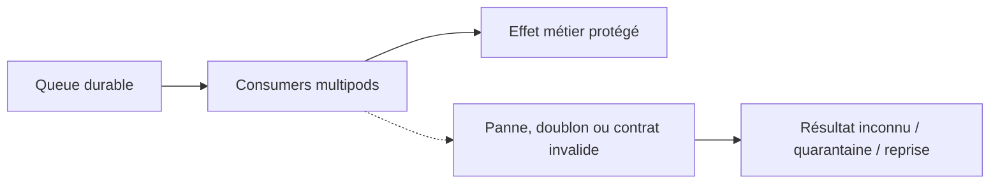
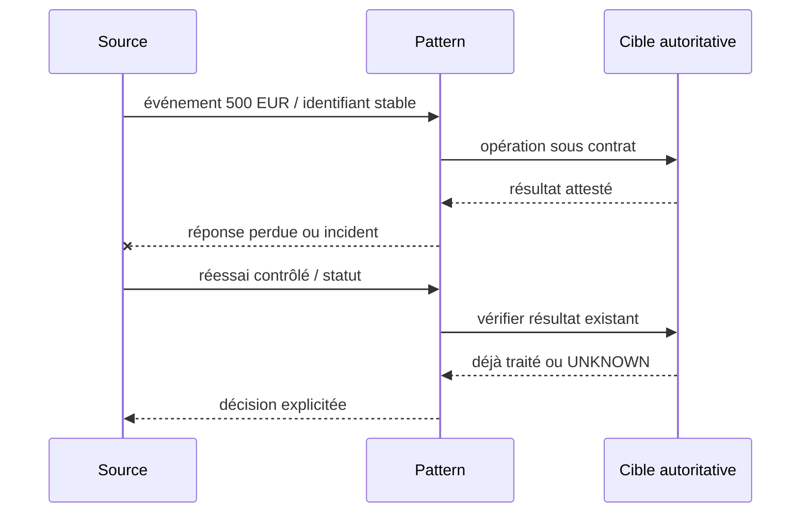
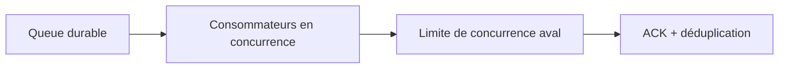
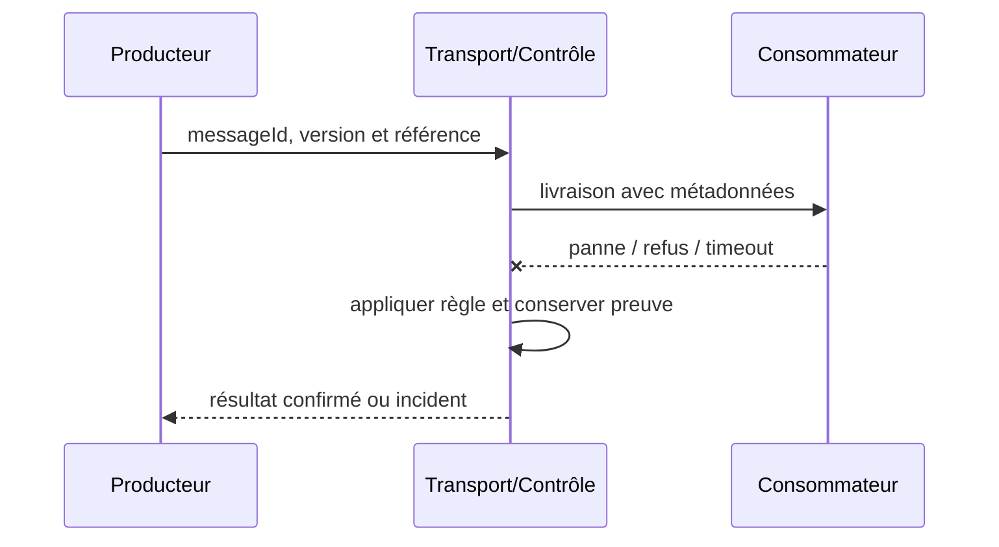

# Cours 100 — Competing Consumers · Enterprise Integration Patterns

> Cas pédagogique bancaire fictif : virement SEPA 500 EUR. Corrigé théorique, **quiz individuel non encore validé**.

## 1. Problème et intention
La banque doit gérer **Competing Consumers** lorsque les messages, traitements et contrats évoluent indépendamment. Un accusé de transport n'est pas un règlement financier.

**Contrat métier :** référence stable de l'ordre, messageId, correlationId, schemaVersion, deadline métier et propriétaire de chaque étape.

## 2. Scénario et HLD

**Choix architecturaux :** préciser unités de travail, rétention, idempotence, décision sur délai dépassé, ACL et observabilité.

## 3. Séquence de qualification

## 4. Invariants et risques
1. Deux workers : une même clé métier doit être traitée une seule fois.
2. La propriété de la source autoritative ne se déduit pas de la présence de Kafka, d'IBM MQ ou d'un adaptateur.
3. Pour une commande, garantir absence de double effet avec un identifiant métier durable jusqu'au point d'exécution.
4. Pour les données ou événements, tester contrats, versions et identité du producteur.
5. Prévoir backlog, métriques, rejets, purge et preuve de reprise sans divulguer les données de paiement.

## 5. Tests
- Nominal : Effet métier protégé, avec preuve observable.
- Panne : Deux workers : une même clé métier doit être traitée une seule fois.
- Redélivrance et concurrence : aucune seconde opération non voulue.
- Sécurité : refus du message non autorisé et absence de fuite dans la DLQ.
- Migration : même signification des statuts avant et après versionnement.

## 6. QCM corrigé
**Quelle conception répond correctement à Competing Consumers dans notre banque ?**

- **A.** Supposer que Competing Consumers rend le paiement exactly-once sans autre contrôle.
- **B.** Utiliser Competing Consumers avec Consumers multipods et prouver la propriété Effet métier protégé.
- **C.** Acquitter systématiquement un message avant son traitement pour éviter toute reprise.

**Bonne réponse : B.** Deux workers : une même clé métier doit être traitée une seule fois. Le résultat doit être prouvé et les limites du pattern explicitées.

## 7. Fiche technique détaillée déjà présente dans le référentiel
[Ouvrir la source originale](https://github.com/zdmooc/enterprise-architecture-patterns-handbook/blob/main/18-enterprise-integration-patterns/07-competing-consumers/README.md)

**Enterprise Integration Pattern complémentaire**, document de référence synthétique.

#### Contexte

Des traitements indépendants doivent absorber des pics avec plusieurs workers. Il faut maîtriser les frontières de fiabilité, d'identité, de version et de rétention.

#### Architecture

#### Séquence de test

#### Invariant

La même tâche est exécutée au plus une fois au niveau effet métier, pas nécessairement délivrée une fois.

#### Implémentation

Régler prefetch, visibility timeout, concurrence totale et quota aval; limiter la montée d'échelle. Protéger les métadonnées tenant, chiffrer les charges sensibles, fixer un TTL et tracer correlationId sans divulguer de secret.

#### Tests obligatoires

1. **Injection d'incident** : Stopper un worker après prise en charge : livraison et reprise sur un autre.
2. **Reprise ou sécurité** : Doubler réplicas au-delà de la DB : backpressure empêche épuisement du pool.
3. Contrôle CI : schéma invalide ou non autorisé doit échouer de façon explicite.

#### Compromis et exploitation

L'ordre global n'est pas garanti avec plusieurs consumers ; partitionner si nécessaire. Mesurer backlog, âge, lag, saturation DB et taux de retries. Un ACK ne prouve pas que la décision métier est validée.

#### Question d'entretien

Comment limiter les effets de bord et prouver une reprise cohérente si le message est en doublon, perdu ou incompatible ?

[Catalogue](https://github.com/zdmooc/enterprise-architecture-patterns-handbook/blob/main/18-enterprise-integration-patterns/README.md) · [EDA existante](https://github.com/zdmooc/enterprise-architecture-patterns-handbook/blob/main/01-integration-patterns/04-event-driven-architecture/README.md)

[Retour à l'index](README.md)
