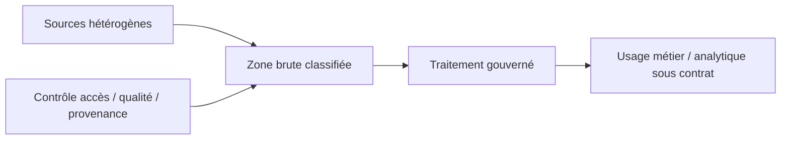
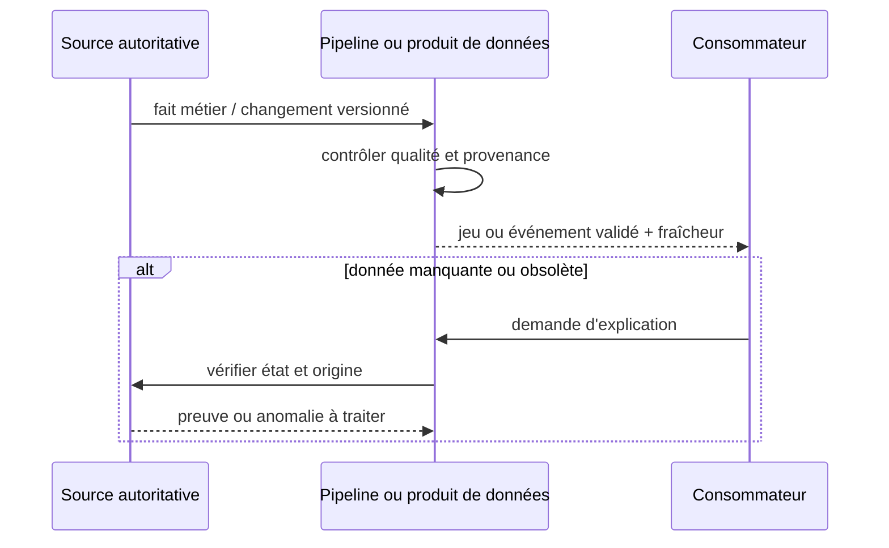

# Cours 104 — Data Lake · Architecture des données

> Banque fictive · reporting sur des paiements SEPA de 500 EUR. **Corrigé théorique, quiz individuel non encore validé.**

## 1. Problème et résultat attendu
Plusieurs applications et systèmes analytiques réutilisent les données de paiements. Notre architecture doit produire une information fiable **sans confondre vue dérivée et source autoritative**.

Avec **Data Lake**, nous cherchons à obtenir : traitement gouverné.

## 2. Schéma fonctionnel

**Invariant principal :** Sans catalogue, ACL ni rétention, la donnée devient un risque.

## 3. Contrats à définir
1. **Ownership** : qui est propriétaire de chaque fait, qui le corrige et qui autorise sa consommation ?
2. **Schéma** : identifiants, grain, type, contraintes d'unicité, sémantique des statuts et évolution des versions.
3. **Qualité** : contrôles de complétude, unicité, validité, cohérence temporelle et règles de rejet.
4. **Fraîcheur et SLA/SLO** : délai de publication mesuré, corrections tardives et indication d'obsolescence.
5. **Sécurité** : classification, masquage, limitation de finalité, contrôle par sujet et période de rétention.
6. **Provenance** : source et transformations, version du calcul, responsable et traçabilité des rectifications.

## 4. Séquence illustrative

## 5. Tests et décisions
- Test nominal : les données publiées conservent un sens métier vérifié et une provenance.
- Test de schéma : un changement incompatible provoque erreur ou version contrôlée.
- Test de retard : la source est plus récente que la projection ; la fraîcheur est visible et la décision critique consulte l'autorité.
- Test sécurité : un utilisateur non autorisé ne peut lire ni ligne sensible, ni donnée brute.
- Test de qualité : doublons, champs manquants et valeurs invalides sont mesurés et traités explicitement.
- Test de reprise : pipeline interrompu puis relancé sans double comptage ni perte indétectée.

## 6. QCM corrigé
**Quelle décision prendre pour appliquer Data Lake ?**
- **A.** Mettre en œuvre Data Lake en préservant ownership, qualité, fraîcheur et traçabilité.
- **B.** Utiliser une vue analytique pour déclencher un règlement sans vérifier la source.
- **C.** Supprimer les contrôles de provenance et d'accès aux données clients.

**Réponse : A.** Sans catalogue, ACL ni rétention, la donnée devient un risque. Les preuves incluent qualité, contrat de données et lignée, pas simplement une exécution réussie du job.

## 7. Fiche technique détaillée du référentiel
[Consulter la fiche d'origine](https://github.com/zdmooc/enterprise-architecture-patterns-handbook/blob/main/12-data-architecture-patterns/03-data-lake/README.md)

> **Famille : Architecture de données** · SI fictif · Pattern conceptuel, à valider par contrats et tests. Aucun établissement réel n'est décrit.

#### 1. Problème et contexte

Les données semi-structurées et historiques ne rentrent pas aisément dans un modèle BI fixe.

**Solution :** Conserver données brutes gouvernées avec catalogue, qualité, ACL, zones de confiance et cycle de vie.

#### 2. Architecture — diagramme logique

~~~mermaid
flowchart LR
    A["Fichiers / événements"] --> B["Zone brute gouvernée"] --> C["Traitements / modèles"]
~~~

#### Exemple métier

Des logs de service fictifs sont conservés dans un bucket et analysés sans affecter les systèmes sources.

**Non-garantie :** Un data lake sans catalogage devient data swamp.

#### 3. Séquence nominale et frontières

~~~mermaid
sequenceDiagram
    actor U as Acteur métier fictif
    participant A as Fichiers / événements
    participant B as Zone brute gouvernée
    participant C as Traitements / modèles
    U->>A: Requête ou besoin métier
    A->>B: Contrat et référence stable
    B->>C: Traitement et résultat autorisé
    C-->>B: Réponse / état connu
    B-->>A: Résultat contrôlé
    A-->>U: Information justifiée
~~~

Le diagramme est volontairement **logique** : dans une implémentation réelle, certaines transitions sont asynchrones, et un accusé technique ne vaut pas validation financière.

#### 4. Méthode d'implémentation

1. Définir les responsabilités de chaque composant et la source de vérité des données.
2. Spécifier contrats d'entrée/sortie, clés, sémantique des statuts, ownership et versions.
3. Séparer règles métier, déploiement, stockage et infrastructures ; documenter la transaction locale.
4. Préparer un cas nominal et deux défaillances : crash entre écriture et réponse, puis données obsolètes/incohérentes.
5. Valider migration, réversibilité, coût, latence p99, exploitation et protection des informations.

#### 5. Décisions et compromis

- **Quand choisir :** lorsque le problème suivant est réel : Les données semi-structurées et historiques ne rentrent pas aisément dans un modèle BI fixe.
- **Invariant à protéger :** Chaque dataset a owner, schéma, droits, rétention et indicateur qualité.
- **Alternative :** privilégier une architecture monolithique simple ou un modèle de données direct si le coût du pattern dépasse son intérêt.
- **Anti-pattern :** Un data lake sans catalogage devient data swamp.
- **Architecture d'intégration :** pour les messages répétés, prévoir Outbox et consommateur idempotent si le contrat le justifie ; ne pas inventer d'exactly-once métier.

#### 6. Modes de panne — diagnostic et actions

| Injection | Comportement attendu |
|---|---|
| Réponse perdue après traitement | Interroger le statut via une référence stable, aucune mutation supplémentaire aveugle |
| Changement de contrat incompatible | Contract tests bloquent la promotion ; conserver version compatible |
| Donnée de référence ancienne | Marquer la fraîcheur et consulter la source autoritative pour décisions critiques |
| Consommateur temporairement hors service | Backpressure/rejeu selon rétention, sans doublon d'effet métier |

#### 7. Plan de qualification et preuve

- Test domaine : valider l'invariant indépendamment du réseau et du framework.
- Test contrat : démontrer compatibilité et versionnement des interfaces et événements.
- Test concurrence : deux requêtes simultanées sur la même référence ne contournent pas les règles.
- Test reprise : isoler panne locale, stockage et consommateur externe ; vérifier que les états restent explicables.
- Test qualité/sécurité : ACL, minimisation, conservation, chiffrement et observabilité.
- **Preuve d'acceptation :** Chaque dataset a owner, schéma, droits, rétention et indicateur qualité.

#### 8. Question d'entretien

**Quand « Data Lake » est-il pertinent, et quel risque ne règle-t-il pas ?**

Réponse : Conserver données brutes gouvernées avec catalogue, qualité, ACL, zones de confiance et cycle de vie. Toutefois, un data lake sans catalogage devient data swamp.

#### 9. Liens de navigation

- [Index de la famille](https://github.com/zdmooc/enterprise-architecture-patterns-handbook/blob/main/12-data-architecture-patterns/README.md)
- [Cas d'étude inter-domaines](https://github.com/zdmooc/enterprise-architecture-patterns-handbook/blob/main/12-data-architecture-patterns/CASE_STUDY.md)
- [Matrice de choix](https://github.com/zdmooc/enterprise-architecture-patterns-handbook/blob/main/12-data-architecture-patterns/DECISION_MATRIX.md)
- [Patterns d'intégration déjà documentés](https://github.com/zdmooc/enterprise-architecture-patterns-handbook/blob/main/01-integration-patterns/01-request-response/README.md)

[Retour au programme](README.md)
