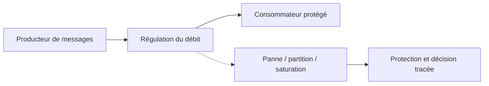
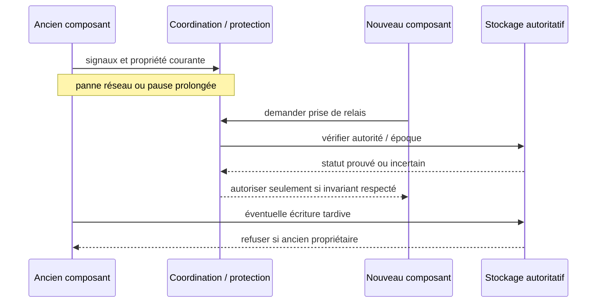

# Cours 120 — Backpressure · Résilience et systèmes distribués

> Banque fictive, virement SEPA de 500 EUR · corrigé théorique, **exercice individuel non encore validé**.

## 1. Objectif et scénario de panne
Concevoir **Backpressure** lorsque des pods, liens, bases de données ou sites peuvent devenir indisponibles sans avertissement fiable. Le système doit préserver une autorité métier cohérente, même quand le réseau rend le résultat incertain.

## 2. Schéma d'architecture

**Invariant :** La mémoire ne doit pas croître sans borne en saturation.

## 3. Hypothèses et NFR
1. **RTO** : durée maximale de reprise visée, mesurée dans le périmètre choisi.
2. **RPO** : perte de données admissible et preuve de réplication ou de restauration.
3. **Propriété d'écriture** : règle d'exclusivité, fencing ou quorum lorsque requis.
4. **Concurrence** : tester l'ancien et le nouveau nœud simultanément, et l'ordre d'arrivée des messages.
5. **Sens financier** : distinguer appel reçu, accepté, soumis et paiement effectivement réglé.
6. **Exploitation** : probes, alertes, backlog, p95/p99, limites de retries et procédure d'investigation.

## 4. Séquence d'incident

## 5. Plan de tests
- Nominal : définir l'état initial, l'écrivain autorisé et les mesures observées.
- Panne d'un pod : comportement mesuré et continuité selon SLO.
- Partition réseau : absence de double autorité et de divergence silencieuse.
- Retard de réponse : pas de deuxième virement exécuté sans recherche de statut.
- Relance après crash : état durable et référence conservés.
- Exploitation : mesurer RTO, RPO, alerte et rollback selon protocole du système.
- Sécurité : prouver l'autorisation minimale et l'absence de fuite de données.

## 6. Exercice corrigé
**Pour le scénario de Backpressure, quelle démarche retiens-tu ?**
- **A.** Considérer la disponibilité des pods comme une garantie de paiement exactly-once.
- **B.** Déployer Backpressure avec les invariants de propriétaire, de cohérence et de reprise explicités.
- **C.** Promouvoir deux writers simultanément après un simple timeout.

**Bonne réponse : B.** La mémoire ne doit pas croître sans borne en saturation. La preuve de résilience exige un test injecté, pas simplement « pod Ready ».

## 7. Fiche technique détaillée déjà présente
[Consulter la fiche source](https://github.com/zdmooc/enterprise-architecture-patterns-handbook/blob/main/13-resilience-distributed-systems-patterns/07-backpressure/README.md)

> **Famille : Systèmes distribués et résilience** · Modèle de référence, exemples fictifs sans attribution à une entreprise.

#### 1. Problème et exigence

Un producteur rapide écrase la capacité du consommateur et provoque des queues infinies.

**Solution proposée :** Contrôler débit/admission et demander au producteur de ralentir ou bufferiser dans des limites explicites.

#### 2. Schéma d'architecture

~~~mermaid
flowchart LR
    A["Production rapide"] --> B["Quota de queue / crédit"] --> C["Consommateur borné"]
~~~

Le chemin de décision représente des responsabilités : il ne présuppose ni fournisseur, ni protocole, ni disponibilité prouvée. Chaque flèche doit recevoir un contrat et des mesures de sécurité.

#### 3. Séquence et preuve

~~~mermaid
sequenceDiagram
    actor Owner as Responsable autorisé
    participant A as Production rapide
    participant B as Quota de queue / crédit
    participant C as Consommateur borné
    Owner->>A: Demander opération selon politique
    A->>B: Contrat, identité et référence
    B->>C: Décision/transition contrôlée
    C-->>B: Preuve ou résultat incertain
    B-->>A: État attesté, erreur ou investigation
    A-->>Owner: Résultat sans invention d'effet
~~~

**Exemple illustratif :** Une file de demandes analytiques refuse ou ralentit la production sous saturation.

#### 4. Choix architecturaux

1. Identifier actifs, propriétaires, menace/panne de référence et hypothèses de déploiement.
2. Définir frontières, identité métier stable, requêtes et réponses autoritatives.
3. Écrire l'invariant avant la technologie : **Sous charge 3x, mémoire et queue age restent bornés.**
4. Choisir mécanisme de stockage et d'accès, autorisations minimales et observabilité.
5. Prévoir fail-safe / fail-closed selon obligations, sans confondre indisponibilité et rejet financier.
6. Documenter coût, latence p99, capacité et modèle de responsabilité d'astreinte.

#### 5. Compromis et non-garanties

- **À privilégier** quand le scénario déclenche réellement : Un producteur rapide écrase la capacité du consommateur et provoque des queues infinies.
- **Attention :** L'accumulation indéfinie cache une panne et crée des commandes expirées.
- **Non-garantie :** Contrôler débit/admission et demander au producteur de ralentir ou bufferiser dans des limites explicites. Le résultat doit encore être **prouvé par test** sur les ressources et sources de vérité concernées.
- **Alternative à évaluer :** simplifier le nombre de composants, utiliser un mécanisme géré déjà disponible ou réduire le rayon d'impact si les NFR le permettent.

#### 6. Scénarios d'échec et attaques

| Injection contrôlée | Comportement attendu |
|---|---|
| L'appelant perd la réponse après l'effet | Conserver la même référence, retrouver état ou investigation |
| Nœud, lien ou instance indisponible | Pas de divergence silencieuse ni décision sans preuve |
| Identité invalide / token expiré | Refus au point de contrôle concerné, audit sans secret |
| Modification de configuration risquée | Gate CI/policy ou ADR et rollback technique contrôlé |

#### 7. Plan de qualification

- Vérifier **Sous charge 3x, mémoire et queue age restent bornés.** avec scénario reproductible et états avant/après.
- Injecter réseau partitionné ou certificat expiré selon scénario, sans mettre en péril un environnement réel.
- Vérifier observabilité : saturation, latence p95/p99, logs d'audit expurgés, SLI/SLO et alertes.
- Démontrer contrôle d'autorisation avec un acteur ayant **zéro privilège** sur l'objet cible.
- Simuler reprise ou révocation et mesurer temps de convergence, RPO/RTO si pertinent.

#### 8. Question d'entretien

**Quelle est la limite du pattern « Backpressure / Flow Control » ?** L'accumulation indéfinie cache une panne et crée des commandes expirées. La garantie à présenter au comité n'est acquise qu'après tests de sous charge 3x, mémoire et queue age restent bornés.

#### 9. Navigation

- [Les patterns de cette famille](https://github.com/zdmooc/enterprise-architecture-patterns-handbook/blob/main/13-resilience-distributed-systems-patterns/README.md)
- [Architecture transverse, incidents et ADR](https://github.com/zdmooc/enterprise-architecture-patterns-handbook/blob/main/13-resilience-distributed-systems-patterns/CASE_STUDY.md)
- [Matrice de choix](https://github.com/zdmooc/enterprise-architecture-patterns-handbook/blob/main/13-resilience-distributed-systems-patterns/DECISION_MATRIX.md)
- [Invariants financiers existants](https://github.com/zdmooc/enterprise-architecture-patterns-handbook/blob/main/07-case-studies/instant-payments-openshift/ARCHITECTURE_DE_REFERENCE.md)

[Retour à la formation](README.md)
