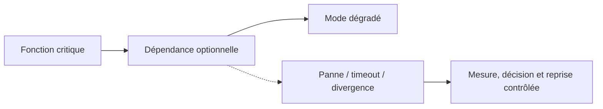
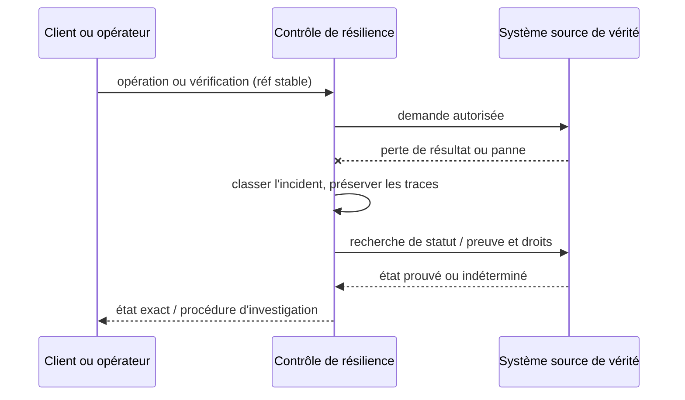

# Cours 123 — Graceful Degradation · Résilience et systèmes distribués

> Formation bancaire fictive : virement 500 EUR. Corrigé théorique ; **exercice individuel non validé en session**.

## 1. Intention
Le pattern **Graceful Degradation** sert à traiter un risque précis de saturation, de perte, de reprise ou de cohérence dans une architecture bancaire répartie.

## 2. Architecture du cas pédagogique

**Invariant de conception :** Ne pas contourner le contrôle antifraude obligatoire.

## 3. Exigences et contrats
- Identifier propriétaire de chaque donnée et de chaque effet financier.
- Définir p95/p99, RTO, RPO, budget d'erreurs et délais métier suivant le service concerné.
- Documenter la politique de reprise : référence stable, ancien/nouveau owner, idempotence, compensation licite.
- Distinguer `RECU`, `ACCEPTE`, `TRANSMIS`, `REGLE` et `UNKNOWN`.
- Protéger secrets, privilèges et données des clients pendant l'incident.
- Produire ADR, runbook et critères GO/NO-GO appuyés par une expérience réplicable.

## 4. Séquence incident et reprise

## 5. Cas de qualification
1. Nominal : comportement et preuve de traitement exact.
2. Panne après commit : aucune répétition incontrôlée du même paiement.
3. Double sollicitation et partition : absence de double autorité.
4. Contrainte d'exploitation : pas de saturation silencieuse ni de rejet fictif.
5. Retour à la normale : critères vérifiables, alerte, traces et responsabilité d'astreinte.

## 6. Exercice corrigé
**Quelle option est correcte pour Graceful Degradation ?**
- **A.** Répéter automatiquement tout virement après un timeout sans vérifier son statut.
- **B.** Appliquer Graceful Degradation avec mesures, invariants et procédure de reprise testée.
- **C.** Remplacer les preuves métier par l'état Running d'un pod.

**Bonne réponse théorique : B.** Ne pas contourner le contrôle antifraude obligatoire.

## 7. Lecture technique approfondie du référentiel
[Source originale](https://github.com/zdmooc/enterprise-architecture-patterns-handbook/blob/main/13-resilience-distributed-systems-patterns/10-graceful-degradation/README.md)

> **Famille : Systèmes distribués et résilience** · Modèle de référence, exemples fictifs sans attribution à une entreprise.

#### 1. Problème et exigence

Une fonction secondaire indisponible empêche toute l'application de fonctionner.

**Solution proposée :** Définir modes dégradés qui ne mentent pas sur les états métier ou les obligations réglementaires.

#### 2. Schéma d'architecture

~~~mermaid
flowchart LR
    A["Dépendance indisponible"] --> B["Politique de dégradation"] --> C["Fonction essentielle préservée"]
~~~

Le chemin de décision représente des responsabilités : il ne présuppose ni fournisseur, ni protocole, ni disponibilité prouvée. Chaque flèche doit recevoir un contrat et des mesures de sécurité.

#### 3. Séquence et preuve

~~~mermaid
sequenceDiagram
    actor Owner as Responsable autorisé
    participant A as Dépendance indisponible
    participant B as Politique de dégradation
    participant C as Fonction essentielle préservée
    Owner->>A: Demander opération selon politique
    A->>B: Contrat, identité et référence
    B->>C: Décision/transition contrôlée
    C-->>B: Preuve ou résultat incertain
    B-->>A: État attesté, erreur ou investigation
    A-->>Owner: Résultat sans invention d'effet
~~~

**Exemple illustratif :** Une notification tombe ; la consultation d'un résultat bancaire attesté demeure possible.

#### 4. Choix architecturaux

1. Identifier actifs, propriétaires, menace/panne de référence et hypothèses de déploiement.
2. Définir frontières, identité métier stable, requêtes et réponses autoritatives.
3. Écrire l'invariant avant la technologie : **Sous panne notifications, aucune deuxième instruction financière n'est émise.**
4. Choisir mécanisme de stockage et d'accès, autorisations minimales et observabilité.
5. Prévoir fail-safe / fail-closed selon obligations, sans confondre indisponibilité et rejet financier.
6. Documenter coût, latence p99, capacité et modèle de responsabilité d'astreinte.

#### 5. Compromis et non-garanties

- **À privilégier** quand le scénario déclenche réellement : Une fonction secondaire indisponible empêche toute l'application de fonctionner.
- **Attention :** Ne pas désactiver silencieusement un contrôle obligatoire de fraude.
- **Non-garantie :** Définir modes dégradés qui ne mentent pas sur les états métier ou les obligations réglementaires. Le résultat doit encore être **prouvé par test** sur les ressources et sources de vérité concernées.
- **Alternative à évaluer :** simplifier le nombre de composants, utiliser un mécanisme géré déjà disponible ou réduire le rayon d'impact si les NFR le permettent.

#### 6. Scénarios d'échec et attaques

| Injection contrôlée | Comportement attendu |
|---|---|
| L'appelant perd la réponse après l'effet | Conserver la même référence, retrouver état ou investigation |
| Nœud, lien ou instance indisponible | Pas de divergence silencieuse ni décision sans preuve |
| Identité invalide / token expiré | Refus au point de contrôle concerné, audit sans secret |
| Modification de configuration risquée | Gate CI/policy ou ADR et rollback technique contrôlé |

#### 7. Plan de qualification

- Vérifier **Sous panne notifications, aucune deuxième instruction financière n'est émise.** avec scénario reproductible et états avant/après.
- Injecter réseau partitionné ou certificat expiré selon scénario, sans mettre en péril un environnement réel.
- Vérifier observabilité : saturation, latence p95/p99, logs d'audit expurgés, SLI/SLO et alertes.
- Démontrer contrôle d'autorisation avec un acteur ayant **zéro privilège** sur l'objet cible.
- Simuler reprise ou révocation et mesurer temps de convergence, RPO/RTO si pertinent.

#### 8. Question d'entretien

**Quelle est la limite du pattern « Graceful Degradation » ?** Ne pas désactiver silencieusement un contrôle obligatoire de fraude. La garantie à présenter au comité n'est acquise qu'après tests de sous panne notifications, aucune deuxième instruction financière n'est émise.

#### 9. Navigation

- [Les patterns de cette famille](https://github.com/zdmooc/enterprise-architecture-patterns-handbook/blob/main/13-resilience-distributed-systems-patterns/README.md)
- [Architecture transverse, incidents et ADR](https://github.com/zdmooc/enterprise-architecture-patterns-handbook/blob/main/13-resilience-distributed-systems-patterns/CASE_STUDY.md)
- [Matrice de choix](https://github.com/zdmooc/enterprise-architecture-patterns-handbook/blob/main/13-resilience-distributed-systems-patterns/DECISION_MATRIX.md)
- [Invariants financiers existants](https://github.com/zdmooc/enterprise-architecture-patterns-handbook/blob/main/07-case-studies/instant-payments-openshift/ARCHITECTURE_DE_REFERENCE.md)

[Retour au programme](README.md)
