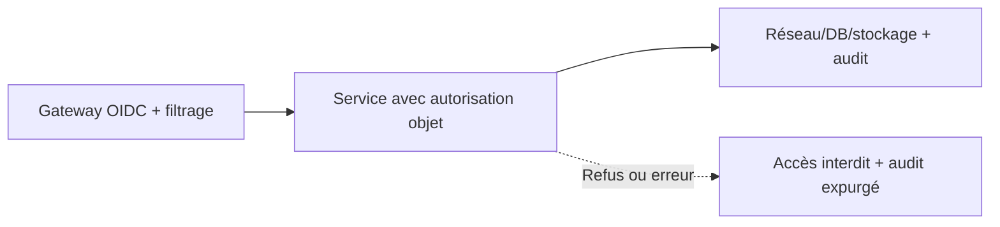
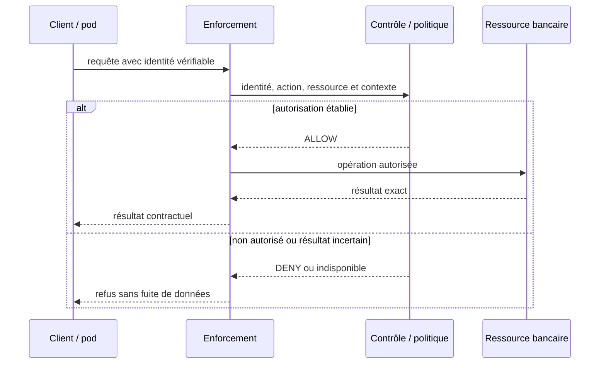

# Cours 131 — Defense in Depth · Sécurité et Zero Trust

> Cas bancaire pédagogique fictif : virement SEPA de 500 EUR, API Java/Spring, IBM MQ et OpenShift. **Cours publié avec corrigé théorique ; évaluation individuelle non réalisée.**

## 1. Problème concret
Un jeton volé ou une faille dans la Gateway ne doit pas livrer accès direct à la base bancaire. Les contrôles indépendants se renforcent.

**Objectif :** Définir barrières indépendantes : validation d'identité, RBAC/ABAC dans le service, politique réseau, compte DB aux privilèges minimum, chiffrement au repos et détection. Ne pas réutiliser la même hypothèse de confiance à tous les étages.

## 2. Modèle de menaces, périmètre de confiance
Le client, le pod OpenShift, la Gateway, le broker IBM MQ et le réseau privé **ne sont jamais réputés sûrs par simple localisation**. Distinguer authentification (qui appelle ?), autorisation (quelle action et quel objet ?) et preuve d'exécution (quel résultat financier a réellement eu lieu ?).

## 3. Acteurs et HLD


**Invariant non négociable :** La suppression d'une barrière dans un test ne doit pas suffire à consulter une donnée sensible sans contrôle supplémentaire.

## 4. Contrat de sécurité (pseudo-code)
```text
admit = gatewayAuthn && serviceObjectAuthz && networkAllowed && databaseLeastPrivilege

if NOT allow:
    deny()
    audit(referencedPolicyVersion, opaqueCorrelationId)
else:
    executeAuthorizedOperation()
```
Le pseudo-code n'est pas un composant Spring exécutable ; les identités, attributs et politiques sont obtenus exclusivement depuis des sources **vérifiées**. Une décision d'accès ne prouve pas le règlement du paiement.

## 5. Séquence nominale et refus


## 6. Tests, contrôles et observabilité
1. **Test nominal :** un appelant muni de droits vérifiables ne peut exécuter que l'action permise.
2. **Test négatif prioritaire :** Contourner la Gateway avec un pod non autorisé : service et base refusent l'accès, alerte et audit enregistrés.
3. **Scénario de défaillance :** Des contrôles superposés mais tous fondés sur le même jeton non validé créent une fausse défense en profondeur.
4. **Révocation :** vérifier que l'accès cesse selon une fenêtre de révocation définie, sans supposer que tous les jetons sont instantanément invalidés.
5. **Cohérence financière :** une erreur d'autorisation ne doit pas se transformer en ordre accepté ou réglé.
6. **Preuves d'exploitation :** Matrice menace→barrière→preuve ; tests négatifs à chaque couche, gestion d'incidents et visibilité sur les bypass.

## 7. Arbitrage et limites
Le nombre de barrières n'est pas une mesure de sécurité ; leur indépendance, leur couverture et leurs preuves comptent.

Documenter l'ADR : menace traitée, points de contrôle, propriétaire de la politique, risque résiduel, disponibilité du service de sécurité, rotation et critères de validation. Privilégier des droits minimaux et une limitation explicite des impacts.

## 8. Exercice corrigé
**Quel choix retenir pour sécuriser le scénario « Defense in Depth » ?**
- **A.** Appliquer Defense in Depth avec un contrôle vérifiable des sujets et des ressources.
- **B.** Considérer qu'un réseau privé suffit à autoriser l'opération.
- **C.** Accepter toute requête si l'autorité de sécurité est momentanément indisponible.

**Bonne réponse théorique : A.** La suppression d'une barrière dans un test ne doit pas suffire à consulter une donnée sensible sans contrôle supplémentaire.

**Attention :** le corrigé sert à l'auto-étude et ne correspond à aucune réponse individuelle de l'apprenant.

## 9. Fiche technique existante et références
[Fiche de référence sur GitHub](https://github.com/zdmooc/enterprise-architecture-patterns-handbook/blob/main/14-security-zero-trust-patterns/03-defense-in-depth/README.md)

> **Famille : Sécurité et Zero Trust** · Modèle de référence, exemples fictifs sans attribution à une entreprise.

#### 1. Problème et exigence

La compromission d'un contrôle unique donne accès à tout le système.

**Solution proposée :** Combiner identité, segmentation, autorisation objet, chiffrement, détection et reprise.

#### 2. Schéma d'architecture

~~~mermaid
flowchart LR
    A["Frontière réseau"] --> B["IAM + API"] --> C["Données + audit"]
~~~

Le chemin de décision représente des responsabilités : il ne présuppose ni fournisseur, ni protocole, ni disponibilité prouvée. Chaque flèche doit recevoir un contrat et des mesures de sécurité.

#### 3. Séquence et preuve

~~~mermaid
sequenceDiagram
    actor Owner as Responsable autorisé
    participant A as Frontière réseau
    participant B as IAM + API
    participant C as Données + audit
    Owner->>A: Demander opération selon politique
    A->>B: Contrat, identité et référence
    B->>C: Décision/transition contrôlée
    C-->>B: Preuve ou résultat incertain
    B-->>A: État attesté, erreur ou investigation
    A-->>Owner: Résultat sans invention d'effet
~~~

**Exemple illustratif :** Un faux jeton ne traverse pas IAM ; un jeton valide sans objet est refusé.

#### 4. Choix architecturaux

1. Identifier actifs, propriétaires, menace/panne de référence et hypothèses de déploiement.
2. Définir frontières, identité métier stable, requêtes et réponses autoritatives.
3. Écrire l'invariant avant la technologie : **Retirer un contrôle en test ne suffit pas à accéder aux données sensibles.**
4. Choisir mécanisme de stockage et d'accès, autorisations minimales et observabilité.
5. Prévoir fail-safe / fail-closed selon obligations, sans confondre indisponibilité et rejet financier.
6. Documenter coût, latence p99, capacité et modèle de responsabilité d'astreinte.

#### 5. Compromis et non-garanties

- **À privilégier** quand le scénario déclenche réellement : La compromission d'un contrôle unique donne accès à tout le système.
- **Attention :** Addition de contrôles non supervisés peut créer une fausse assurance.
- **Non-garantie :** Combiner identité, segmentation, autorisation objet, chiffrement, détection et reprise. Le résultat doit encore être **prouvé par test** sur les ressources et sources de vérité concernées.
- **Alternative à évaluer :** simplifier le nombre de composants, utiliser un mécanisme géré déjà disponible ou réduire le rayon d'impact si les NFR le permettent.

#### 6. Scénarios d'échec et attaques

| Injection contrôlée | Comportement attendu |
|---|---|
| L'appelant perd la réponse après l'effet | Conserver la même référence, retrouver état ou investigation |
| Nœud, lien ou instance indisponible | Pas de divergence silencieuse ni décision sans preuve |
| Identité invalide / token expiré | Refus au point de contrôle concerné, audit sans secret |
| Modification de configuration risquée | Gate CI/policy ou ADR et rollback technique contrôlé |

#### 7. Plan de qualification

- Vérifier **Retirer un contrôle en test ne suffit pas à accéder aux données sensibles.** avec scénario reproductible et états avant/après.
- Injecter réseau partitionné ou certificat expiré selon scénario, sans mettre en péril un environnement réel.
- Vérifier observabilité : saturation, latence p95/p99, logs d'audit expurgés, SLI/SLO et alertes.
- Démontrer contrôle d'autorisation avec un acteur ayant **zéro privilège** sur l'objet cible.
- Simuler reprise ou révocation et mesurer temps de convergence, RPO/RTO si pertinent.

#### 8. Question d'entretien

**Quelle est la limite du pattern « Defense in Depth » ?** Addition de contrôles non supervisés peut créer une fausse assurance. La garantie à présenter au comité n'est acquise qu'après tests de retirer un contrôle en test ne suffit pas à accéder aux données sensibles.

#### 9. Navigation

- [Les patterns de cette famille](https://github.com/zdmooc/enterprise-architecture-patterns-handbook/blob/main/14-security-zero-trust-patterns/README.md)
- [Architecture transverse, incidents et ADR](https://github.com/zdmooc/enterprise-architecture-patterns-handbook/blob/main/14-security-zero-trust-patterns/CASE_STUDY.md)
- [Matrice de choix](https://github.com/zdmooc/enterprise-architecture-patterns-handbook/blob/main/14-security-zero-trust-patterns/DECISION_MATRIX.md)
- [Invariants financiers existants](https://github.com/zdmooc/enterprise-architecture-patterns-handbook/blob/main/07-case-studies/instant-payments-openshift/ARCHITECTURE_DE_REFERENCE.md)

[Programme des 140 cours](README.md) · [Exercices Sécurité 129–140](exercices-et-corriges/cours-129-140.md)
