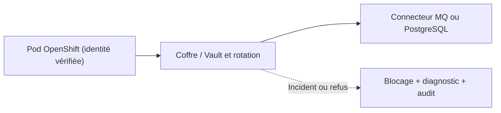
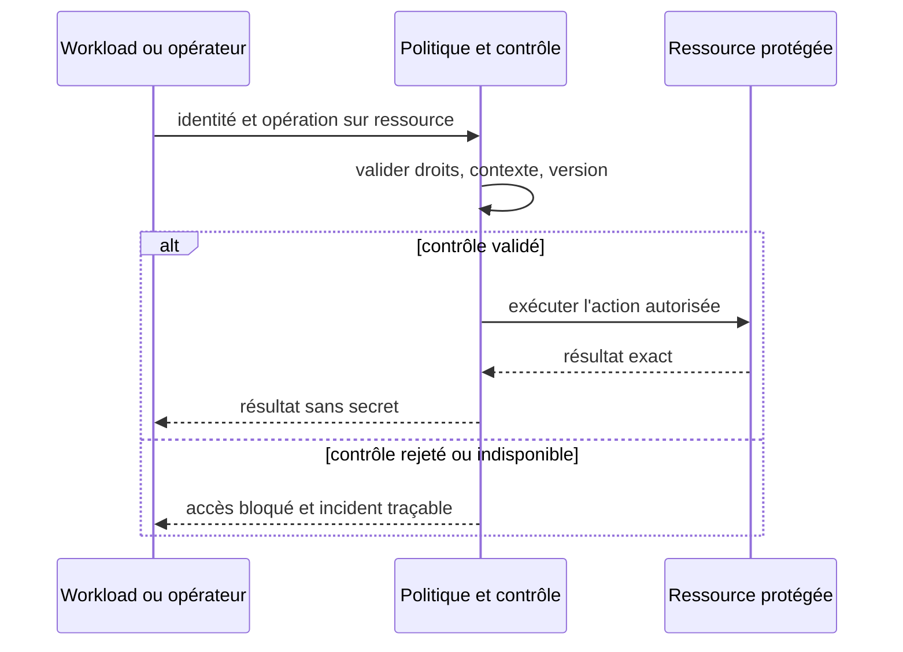

# Cours 135 — Secret Lifecycle / Vault / rotation · Sécurité et Zero Trust

> Banque fictive · virement SEPA de 500 EUR · API Spring, IBM MQ et OpenShift. **Cours publié, corrigé théorique disponible ; exercice individuel non encore validé.**

## 1. Problème et contexte
Un connecteur Spring Boot utilise une identité de service pour IBM MQ et PostgreSQL. Un mot de passe ou token stocké dans un manifest Git, une image ou un journal de logs est une fuite durable.

## 2. Objectif d'architecture et garanties
Émettre les secrets au dernier moment sous une identité workload autorisée ; durée de vie courte, distribution minimale, rotation avec coexistence contrôlée, révocation et audit. Préparer les clients au renouvellement sans redémarrage forcé quand c'est compatible.

**Invariant à démontrer :** Une ancienne crédentiale révoquée ne permet plus une nouvelle session au-delà de la fenêtre de propagation explicitement établie.

## 3. Architecture de référence


### Contrat de contrôle (pseudo-code)
```text
credential = vault.issue(workloadIdentity, targetAudience, ttl); allow = credential.current && scopeIsMinimal && notRevoked

if NOT allow:
    denyAndAudit()
else:
    executeOnlyAuthorizedOperation()
```

Le pseudo-code est conceptuel ; il ne remplace pas le moteur de politique, le coffre ou les contrôles en production.

## 4. Séquence nominale et négative


## 5. Tests de sécurité et de résilience
1. Cas nominal : autorisation accordée uniquement à l'identité et à l'action attendues.
2. **Attaque simulée :** Après rotation, tenter une nouvelle connexion avec l'ancien secret : refus attendu et journal sans secret.
3. **Défaillance ou panne de cycle de vie :** Une rotation coupe tous les consommateurs simultanément parce que les pods n'ont pas repris la nouvelle version ou que l'ancien secret est révoqué trop tôt.
4. Les tests doivent vérifier le comportement en OpenShift (plusieurs pods, renouvellement, perte réseau, chemins directs ou détournés).
5. Les journaux, métriques et traces ne contiennent ni mots de passe, jetons, clés privées ni données bancaires injustifiées.
6. Des contrôles en échec n'autorisent jamais un paiement par défaut ; les états financiers restent exacts.
7. **Exploitation :** SLO renouvellement, ratio de secrets anciens actifs, tests de rotation, journal d'accès expurgé, délai de révocation prouvé et arrêt en panne.

## 6. Compromis, périmètre et ADR
Kubernetes Secret n'est pas un gestionnaire complet du cycle de vie ; le chiffrement au repos ne remplace pas les politiques IAM et les opérations de rotation.

Documenter les responsabilités, la frontière de confiance, le blast radius, les exceptions à durée limitée, les paramètres de refus en cas de panne, le coût et les critères GO/NO-GO.

## 7. QCM corrigé
**Quelle solution convient au besoin de Secret Lifecycle / Vault / rotation ?**
- **A.** Appliquer Secret Lifecycle / Vault / rotation avec des droits minimaux, des preuves de contrôle et des tests de panne.
- **B.** Supposer que le réseau privé ou une seule mesure technique suffit à autoriser la transaction.
- **C.** Désactiver les contrôles lors de l'indisponibilité de la sécurité et déclarer le paiement accepté.

**Bonne réponse : A.** Une ancienne crédentiale révoquée ne permet plus une nouvelle session au-delà de la fenêtre de propagation explicitement établie.

Ce corrigé n'indique pas une réponse déjà obtenue en session.

## 8. Documentation approfondie du catalogue
[Fiche existante dans le dépôt](https://github.com/zdmooc/enterprise-architecture-patterns-handbook/blob/main/14-security-zero-trust-patterns/07-secret-lifecycle/README.md)

> **Famille : Sécurité et Zero Trust** · Modèle de référence, exemples fictifs sans attribution à une entreprise.

#### 1. Problème et exigence

Une clé longue durée fuit à travers images, variables ou logs.

**Solution proposée :** Centraliser émission, distribution minimale, rotation, révocation et audit du secret.

#### 2. Schéma d'architecture

~~~mermaid
flowchart LR
    A["Gestionnaire secrets"] --> B["Identité autorisée / mount"] --> C["Application / rotation"]
~~~

Le chemin de décision représente des responsabilités : il ne présuppose ni fournisseur, ni protocole, ni disponibilité prouvée. Chaque flèche doit recevoir un contrat et des mesures de sécurité.

#### 3. Séquence et preuve

~~~mermaid
sequenceDiagram
    actor Owner as Responsable autorisé
    participant A as Gestionnaire secrets
    participant B as Identité autorisée / mount
    participant C as Application / rotation
    Owner->>A: Demander opération selon politique
    A->>B: Contrat, identité et référence
    B->>C: Décision/transition contrôlée
    C-->>B: Preuve ou résultat incertain
    B-->>A: État attesté, erreur ou investigation
    A-->>Owner: Résultat sans invention d'effet
~~~

**Exemple illustratif :** Une clé de compte technique est renouvelée sans Git commit ni interruption.

#### 4. Choix architecturaux

1. Identifier actifs, propriétaires, menace/panne de référence et hypothèses de déploiement.
2. Définir frontières, identité métier stable, requêtes et réponses autoritatives.
3. Écrire l'invariant avant la technologie : **Ancienne clé est rejetée à l'échéance sans panne durable.**
4. Choisir mécanisme de stockage et d'accès, autorisations minimales et observabilité.
5. Prévoir fail-safe / fail-closed selon obligations, sans confondre indisponibilité et rejet financier.
6. Documenter coût, latence p99, capacité et modèle de responsabilité d'astreinte.

#### 5. Compromis et non-garanties

- **À privilégier** quand le scénario déclenche réellement : Une clé longue durée fuit à travers images, variables ou logs.
- **Attention :** Le stockage chiffré ne résout pas une permission trop large.
- **Non-garantie :** Centraliser émission, distribution minimale, rotation, révocation et audit du secret. Le résultat doit encore être **prouvé par test** sur les ressources et sources de vérité concernées.
- **Alternative à évaluer :** simplifier le nombre de composants, utiliser un mécanisme géré déjà disponible ou réduire le rayon d'impact si les NFR le permettent.

#### 6. Scénarios d'échec et attaques

| Injection contrôlée | Comportement attendu |
|---|---|
| L'appelant perd la réponse après l'effet | Conserver la même référence, retrouver état ou investigation |
| Nœud, lien ou instance indisponible | Pas de divergence silencieuse ni décision sans preuve |
| Identité invalide / token expiré | Refus au point de contrôle concerné, audit sans secret |
| Modification de configuration risquée | Gate CI/policy ou ADR et rollback technique contrôlé |

#### 7. Plan de qualification

- Vérifier **Ancienne clé est rejetée à l'échéance sans panne durable.** avec scénario reproductible et états avant/après.
- Injecter réseau partitionné ou certificat expiré selon scénario, sans mettre en péril un environnement réel.
- Vérifier observabilité : saturation, latence p95/p99, logs d'audit expurgés, SLI/SLO et alertes.
- Démontrer contrôle d'autorisation avec un acteur ayant **zéro privilège** sur l'objet cible.
- Simuler reprise ou révocation et mesurer temps de convergence, RPO/RTO si pertinent.

#### 8. Question d'entretien

**Quelle est la limite du pattern « Secrets Lifecycle / Rotation » ?** Le stockage chiffré ne résout pas une permission trop large. La garantie à présenter au comité n'est acquise qu'après tests de ancienne clé est rejetée à l'échéance sans panne durable.

#### 9. Navigation

- [Les patterns de cette famille](https://github.com/zdmooc/enterprise-architecture-patterns-handbook/blob/main/14-security-zero-trust-patterns/README.md)
- [Architecture transverse, incidents et ADR](https://github.com/zdmooc/enterprise-architecture-patterns-handbook/blob/main/14-security-zero-trust-patterns/CASE_STUDY.md)
- [Matrice de choix](https://github.com/zdmooc/enterprise-architecture-patterns-handbook/blob/main/14-security-zero-trust-patterns/DECISION_MATRIX.md)
- [Invariants financiers existants](https://github.com/zdmooc/enterprise-architecture-patterns-handbook/blob/main/07-case-studies/instant-payments-openshift/ARCHITECTURE_DE_REFERENCE.md)

[Programme des 140 cours](README.md) · [Exercices Sécurité 129–140](exercices-et-corriges/cours-129-140.md)
