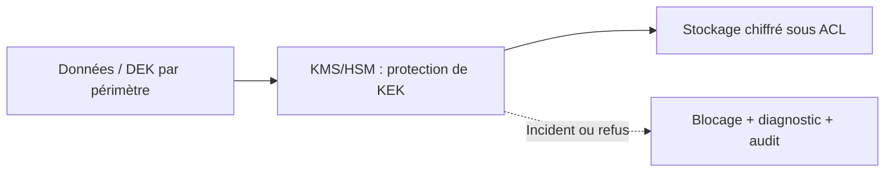
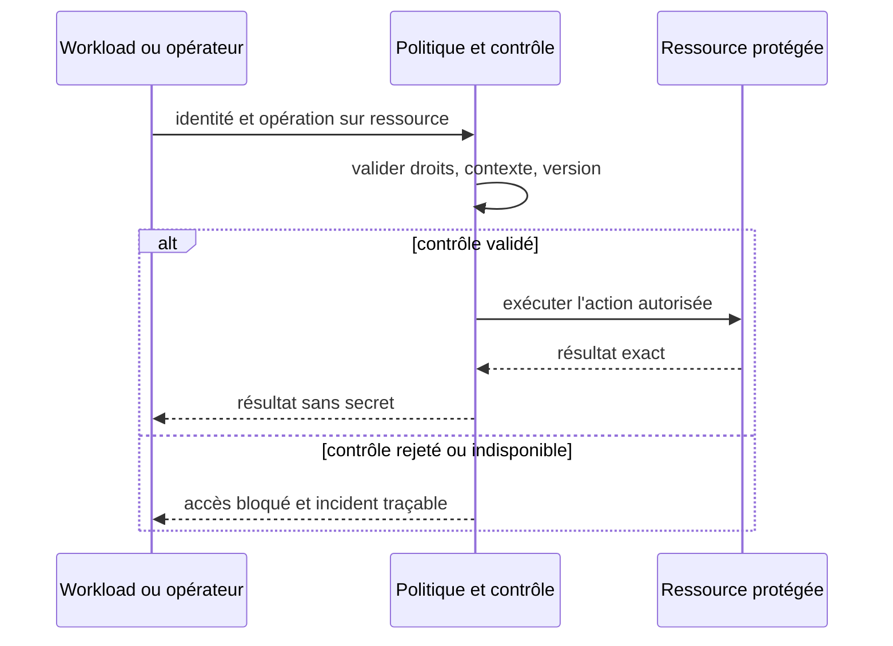

# Cours 138 — Encryption at Rest / KMS / gestion des clés · Sécurité et Zero Trust

> Banque fictive · virement SEPA de 500 EUR · API Spring, IBM MQ et OpenShift. **Cours publié, corrigé théorique disponible ; exercice individuel non encore validé.**

## 1. Problème et contexte
Une base d'ordres et des pièces de dossiers sont chiffrées. Si la clé maîtresse est copiée dans tous les pods, le chiffrement perd une grande partie de son intérêt contre un compte compromis.

## 2. Objectif d'architecture et garanties
Séparer clés d'enveloppe (KEK) et clés de données (DEK) lorsque pertinent, appliquer droits de chiffrement/déchiffrement minimaux, versionnement, rotation, protection des backups et journaux d'utilisation. Définir le modèle de cache et de déchiffrement.

**Invariant à démontrer :** Un service non autorisé ne peut pas demander au KMS de déchiffrer une donnée d'un autre périmètre, même s'il voit le ciphertext.

## 3. Architecture de référence


### Contrat de contrôle (pseudo-code)
```text
allowDecrypt = kmsPolicy(subject, keyResource, 'decrypt') && contextMatches(tenant, purpose, keyVersion)

if NOT allow:
    denyAndAudit()
else:
    executeOnlyAuthorizedOperation()
```

Le pseudo-code est conceptuel ; il ne remplace pas le moteur de politique, le coffre ou les contrôles en production.

## 4. Séquence nominale et négative


## 5. Tests de sécurité et de résilience
1. Cas nominal : autorisation accordée uniquement à l'identité et à l'action attendues.
2. **Attaque simulée :** Retirer le droit decrypt d'une identité workload puis demander un nouveau déchiffrement KMS : refus ; discuter explicitement les clés déjà mises en cache.
3. **Défaillance ou panne de cycle de vie :** L'équipe croit qu'une révocation IAM efface aussitôt des plaintexts ou DEK déjà obtenues par un pod compromis.
4. Les tests doivent vérifier le comportement en OpenShift (plusieurs pods, renouvellement, perte réseau, chemins directs ou détournés).
5. Les journaux, métriques et traces ne contiennent ni mots de passe, jetons, clés privées ni données bancaires injustifiées.
6. Des contrôles en échec n'autorisent jamais un paiement par défaut ; les états financiers restent exacts.
7. **Exploitation :** Inventaire clés, audit KMS, rotation avec ancien ciphertext lisible selon politique, validation de sauvegardes et tests de panne du service KMS.

## 6. Compromis, périmètre et ADR
Le chiffrement au repos protège les données et leurs supports, mais n'évite ni les erreurs métier ni l'exfiltration par un service déjà autorisé.

Documenter les responsabilités, la frontière de confiance, le blast radius, les exceptions à durée limitée, les paramètres de refus en cas de panne, le coût et les critères GO/NO-GO.

## 7. QCM corrigé
**Quelle solution convient au besoin de Encryption at Rest / KMS / gestion des clés ?**
- **A.** Appliquer Encryption at Rest / KMS / gestion des clés avec des droits minimaux, des preuves de contrôle et des tests de panne.
- **B.** Supposer que le réseau privé ou une seule mesure technique suffit à autoriser la transaction.
- **C.** Désactiver les contrôles lors de l'indisponibilité de la sécurité et déclarer le paiement accepté.

**Bonne réponse : A.** Un service non autorisé ne peut pas demander au KMS de déchiffrer une donnée d'un autre périmètre, même s'il voit le ciphertext.

Ce corrigé n'indique pas une réponse déjà obtenue en session.

## 8. Documentation approfondie du catalogue
[Fiche existante dans le dépôt](https://github.com/zdmooc/enterprise-architecture-patterns-handbook/blob/main/14-security-zero-trust-patterns/10-encryption-key-management/README.md)

> **Famille : Sécurité et Zero Trust** · Modèle de référence, exemples fictifs sans attribution à une entreprise.

#### 1. Problème et exigence

Les données chiffrées perdent confidentialité si clés et droits sont exposés.

**Solution proposée :** Gérer clés distinctes par périmètre, rotation, envelope encryption et accès audités.

#### 2. Schéma d'architecture

~~~mermaid
flowchart LR
    A["Donnée sensible"] --> B["Clé contrôlée / KMS"] --> C["Stockage chiffré"]
~~~

Le chemin de décision représente des responsabilités : il ne présuppose ni fournisseur, ni protocole, ni disponibilité prouvée. Chaque flèche doit recevoir un contrat et des mesures de sécurité.

#### 3. Séquence et preuve

~~~mermaid
sequenceDiagram
    actor Owner as Responsable autorisé
    participant A as Donnée sensible
    participant B as Clé contrôlée / KMS
    participant C as Stockage chiffré
    Owner->>A: Demander opération selon politique
    A->>B: Contrat, identité et référence
    B->>C: Décision/transition contrôlée
    C-->>B: Preuve ou résultat incertain
    B-->>A: État attesté, erreur ou investigation
    A-->>Owner: Résultat sans invention d'effet
~~~

**Exemple illustratif :** Une base fictive chiffre les champs sensibles sous une clé rotatable.

#### 4. Choix architecturaux

1. Identifier actifs, propriétaires, menace/panne de référence et hypothèses de déploiement.
2. Définir frontières, identité métier stable, requêtes et réponses autoritatives.
3. Écrire l'invariant avant la technologie : **La révocation de droits empêche déchiffrement par service non autorisé.**
4. Choisir mécanisme de stockage et d'accès, autorisations minimales et observabilité.
5. Prévoir fail-safe / fail-closed selon obligations, sans confondre indisponibilité et rejet financier.
6. Documenter coût, latence p99, capacité et modèle de responsabilité d'astreinte.

#### 5. Compromis et non-garanties

- **À privilégier** quand le scénario déclenche réellement : Les données chiffrées perdent confidentialité si clés et droits sont exposés.
- **Attention :** Exporter le secret maître à tous les services annule les protections.
- **Non-garantie :** Gérer clés distinctes par périmètre, rotation, envelope encryption et accès audités. Le résultat doit encore être **prouvé par test** sur les ressources et sources de vérité concernées.
- **Alternative à évaluer :** simplifier le nombre de composants, utiliser un mécanisme géré déjà disponible ou réduire le rayon d'impact si les NFR le permettent.

#### 6. Scénarios d'échec et attaques

| Injection contrôlée | Comportement attendu |
|---|---|
| L'appelant perd la réponse après l'effet | Conserver la même référence, retrouver état ou investigation |
| Nœud, lien ou instance indisponible | Pas de divergence silencieuse ni décision sans preuve |
| Identité invalide / token expiré | Refus au point de contrôle concerné, audit sans secret |
| Modification de configuration risquée | Gate CI/policy ou ADR et rollback technique contrôlé |

#### 7. Plan de qualification

- Vérifier **La révocation de droits empêche déchiffrement par service non autorisé.** avec scénario reproductible et états avant/après.
- Injecter réseau partitionné ou certificat expiré selon scénario, sans mettre en péril un environnement réel.
- Vérifier observabilité : saturation, latence p95/p99, logs d'audit expurgés, SLI/SLO et alertes.
- Démontrer contrôle d'autorisation avec un acteur ayant **zéro privilège** sur l'objet cible.
- Simuler reprise ou révocation et mesurer temps de convergence, RPO/RTO si pertinent.

#### 8. Question d'entretien

**Quelle est la limite du pattern « Encryption at Rest / Key Management » ?** Exporter le secret maître à tous les services annule les protections. La garantie à présenter au comité n'est acquise qu'après tests de la révocation de droits empêche déchiffrement par service non autorisé.

#### 9. Navigation

- [Les patterns de cette famille](https://github.com/zdmooc/enterprise-architecture-patterns-handbook/blob/main/14-security-zero-trust-patterns/README.md)
- [Architecture transverse, incidents et ADR](https://github.com/zdmooc/enterprise-architecture-patterns-handbook/blob/main/14-security-zero-trust-patterns/CASE_STUDY.md)
- [Matrice de choix](https://github.com/zdmooc/enterprise-architecture-patterns-handbook/blob/main/14-security-zero-trust-patterns/DECISION_MATRIX.md)
- [Invariants financiers existants](https://github.com/zdmooc/enterprise-architecture-patterns-handbook/blob/main/07-case-studies/instant-payments-openshift/ARCHITECTURE_DE_REFERENCE.md)

[Programme des 140 cours](README.md) · [Exercices Sécurité 129–140](exercices-et-corriges/cours-129-140.md)
