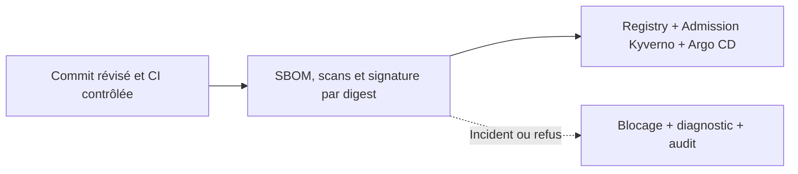
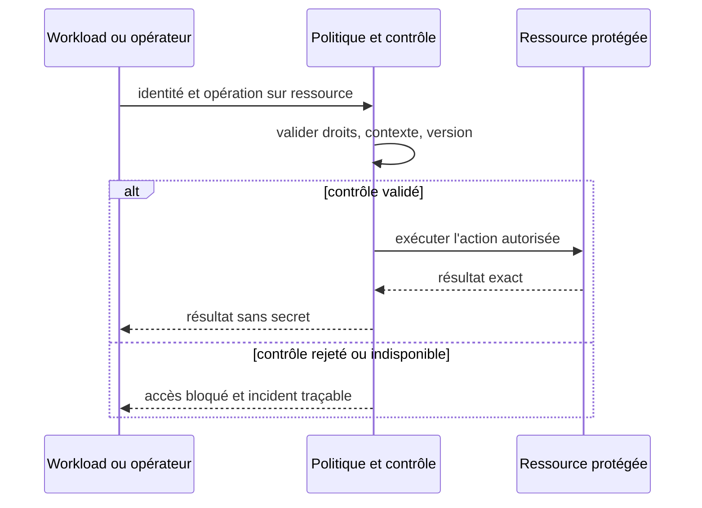

# Cours 139 — Software Supply Chain / SBOM / Cosign / Kyverno · Sécurité et Zero Trust

> Banque fictive · virement SEPA de 500 EUR · API Spring, IBM MQ et OpenShift. **Cours publié, corrigé théorique disponible ; exercice individuel non encore validé.**

## 1. Problème et contexte
La plateforme OpenShift exécute un microservice bancaire Java construit par CI. Une image altérée ou jamais revue ne doit pas pouvoir entrer en production via une mise à jour manuelle du tag.

## 2. Objectif d'architecture et garanties
Construire une image à digest immuable, associer SBOM, attestations de provenance, scans et signature via identité CI maîtrisée ; imposer une admission vérifiant digest, provenance et politique, puis promouvoir l'image identique par GitOps.

**Invariant à démontrer :** Une image non signée, provenant d'un pipeline non approuvé ou portant une violation de politique bloquante n'est pas admise.

## 3. Architecture de référence


### Contrat de contrôle (pseudo-code)
```text
admit = allowedDigest && validSignatureFromTrustedCI && provenanceMatchesCommit && sbomPresent && policyScanPass

if NOT allow:
    denyAndAudit()
else:
    executeOnlyAuthorizedOperation()
```

Le pseudo-code est conceptuel ; il ne remplace pas le moteur de politique, le coffre ou les contrôles en production.

## 4. Séquence nominale et négative


## 5. Tests de sécurité et de résilience
1. Cas nominal : autorisation accordée uniquement à l'identité et à l'action attendues.
2. **Attaque simulée :** Essayer de déployer le même tag pointant vers un digest non signé : refus d'admission, pod non démarré.
3. **Défaillance ou panne de cycle de vie :** L'image est scannée mais un tag mutable est resigné ailleurs ; la politique vérifie le tag au lieu de la provenance et du digest effectif.
4. Les tests doivent vérifier le comportement en OpenShift (plusieurs pods, renouvellement, perte réseau, chemins directs ou détournés).
5. Les journaux, métriques et traces ne contiennent ni mots de passe, jetons, clés privées ni données bancaires injustifiées.
6. Des contrôles en échec n'autorisent jamais un paiement par défaut ; les états financiers restent exacts.
7. **Exploitation :** Gates CI, signatures, digest promu, exceptions documentées et expirantes, analyse des vulnérabilités et stratégie patch/rollback.

## 6. Compromis, périmètre et ADR
Une SBOM n'est qu'un inventaire ; signer une image ne signifie pas qu'elle ne contient aucune vulnérabilité. L'admission et les remédiations doivent être continues.

Documenter les responsabilités, la frontière de confiance, le blast radius, les exceptions à durée limitée, les paramètres de refus en cas de panne, le coût et les critères GO/NO-GO.

## 7. QCM corrigé
**Quelle solution convient au besoin de Software Supply Chain / SBOM / Cosign / Kyverno ?**
- **A.** Supposer que le réseau privé ou une seule mesure technique suffit à autoriser la transaction.
- **B.** Appliquer Software Supply Chain / SBOM / Cosign / Kyverno avec des droits minimaux, des preuves de contrôle et des tests de panne.
- **C.** Désactiver les contrôles lors de l'indisponibilité de la sécurité et déclarer le paiement accepté.

**Bonne réponse : B.** Une image non signée, provenant d'un pipeline non approuvé ou portant une violation de politique bloquante n'est pas admise.

Ce corrigé n'indique pas une réponse déjà obtenue en session.

## 8. Documentation approfondie du catalogue
[Fiche existante dans le dépôt](https://github.com/zdmooc/enterprise-architecture-patterns-handbook/blob/main/14-security-zero-trust-patterns/11-software-supply-chain/README.md)

> **Famille : Sécurité et Zero Trust** · Modèle de référence, exemples fictifs sans attribution à une entreprise.

#### 1. Problème et exigence

Une image non fiable entre en production sans provenance.

**Solution proposée :** Relier build reproductible, inventaire dépendances, signature, scan et admission policy.

#### 2. Schéma d'architecture

~~~mermaid
flowchart LR
    A["Sources révisées"] --> B["CI + SBOM + signature"] --> C["Admission image"]
~~~

Le chemin de décision représente des responsabilités : il ne présuppose ni fournisseur, ni protocole, ni disponibilité prouvée. Chaque flèche doit recevoir un contrat et des mesures de sécurité.

#### 3. Séquence et preuve

~~~mermaid
sequenceDiagram
    actor Owner as Responsable autorisé
    participant A as Sources révisées
    participant B as CI + SBOM + signature
    participant C as Admission image
    Owner->>A: Demander opération selon politique
    A->>B: Contrat, identité et référence
    B->>C: Décision/transition contrôlée
    C-->>B: Preuve ou résultat incertain
    B-->>A: État attesté, erreur ou investigation
    A-->>Owner: Résultat sans invention d'effet
~~~

**Exemple illustratif :** Une image Java fictive n'est admise que si provenance et politique réussies.

#### 4. Choix architecturaux

1. Identifier actifs, propriétaires, menace/panne de référence et hypothèses de déploiement.
2. Définir frontières, identité métier stable, requêtes et réponses autoritatives.
3. Écrire l'invariant avant la technologie : **Image non signée ou licence interdite est refusée.**
4. Choisir mécanisme de stockage et d'accès, autorisations minimales et observabilité.
5. Prévoir fail-safe / fail-closed selon obligations, sans confondre indisponibilité et rejet financier.
6. Documenter coût, latence p99, capacité et modèle de responsabilité d'astreinte.

#### 5. Compromis et non-garanties

- **À privilégier** quand le scénario déclenche réellement : Une image non fiable entre en production sans provenance.
- **Attention :** Un scanner sans provenance ni patch SLA n'est pas suffisant.
- **Non-garantie :** Relier build reproductible, inventaire dépendances, signature, scan et admission policy. Le résultat doit encore être **prouvé par test** sur les ressources et sources de vérité concernées.
- **Alternative à évaluer :** simplifier le nombre de composants, utiliser un mécanisme géré déjà disponible ou réduire le rayon d'impact si les NFR le permettent.

#### 6. Scénarios d'échec et attaques

| Injection contrôlée | Comportement attendu |
|---|---|
| L'appelant perd la réponse après l'effet | Conserver la même référence, retrouver état ou investigation |
| Nœud, lien ou instance indisponible | Pas de divergence silencieuse ni décision sans preuve |
| Identité invalide / token expiré | Refus au point de contrôle concerné, audit sans secret |
| Modification de configuration risquée | Gate CI/policy ou ADR et rollback technique contrôlé |

#### 7. Plan de qualification

- Vérifier **Image non signée ou licence interdite est refusée.** avec scénario reproductible et états avant/après.
- Injecter réseau partitionné ou certificat expiré selon scénario, sans mettre en péril un environnement réel.
- Vérifier observabilité : saturation, latence p95/p99, logs d'audit expurgés, SLI/SLO et alertes.
- Démontrer contrôle d'autorisation avec un acteur ayant **zéro privilège** sur l'objet cible.
- Simuler reprise ou révocation et mesurer temps de convergence, RPO/RTO si pertinent.

#### 8. Question d'entretien

**Quelle est la limite du pattern « Software Supply Chain / SBOM / Signatures » ?** Un scanner sans provenance ni patch SLA n'est pas suffisant. La garantie à présenter au comité n'est acquise qu'après tests de image non signée ou licence interdite est refusée.

#### 9. Navigation

- [Les patterns de cette famille](https://github.com/zdmooc/enterprise-architecture-patterns-handbook/blob/main/14-security-zero-trust-patterns/README.md)
- [Architecture transverse, incidents et ADR](https://github.com/zdmooc/enterprise-architecture-patterns-handbook/blob/main/14-security-zero-trust-patterns/CASE_STUDY.md)
- [Matrice de choix](https://github.com/zdmooc/enterprise-architecture-patterns-handbook/blob/main/14-security-zero-trust-patterns/DECISION_MATRIX.md)
- [Invariants financiers existants](https://github.com/zdmooc/enterprise-architecture-patterns-handbook/blob/main/07-case-studies/instant-payments-openshift/ARCHITECTURE_DE_REFERENCE.md)

[Programme des 140 cours](README.md) · [Exercices Sécurité 129–140](exercices-et-corriges/cours-129-140.md)
