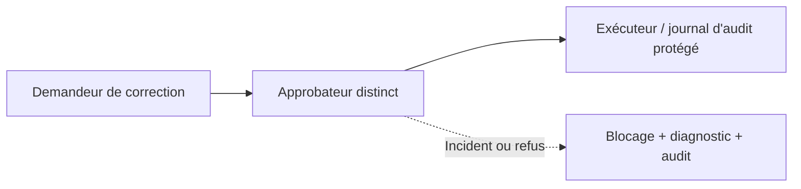
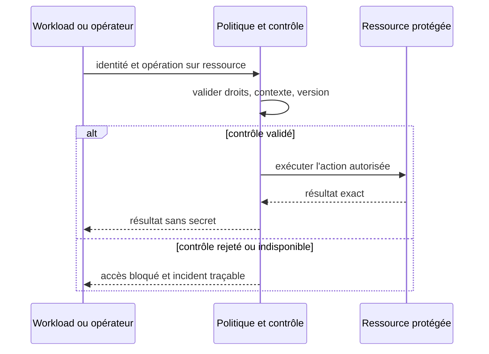

# Cours 140 — Audit Trail / Segregation of Duties (SoD) · Sécurité et Zero Trust

> Banque fictive · virement SEPA de 500 EUR · API Spring, IBM MQ et OpenShift. **Cours publié, corrigé théorique disponible ; exercice individuel non encore validé.**

## 1. Problème et contexte
Une correction manuelle d'un paiement fictif ne doit pas pouvoir être demandée, approuvée, exécutée et effacée par une seule personne ou un seul compte de service.

## 2. Objectif d'architecture et garanties
Séparer fonctions sensibles, imposer approbation indépendante et vérification des conflits de rôles. Tracer identité, opération, référence stable, justification, version des politiques et décision ; protéger les traces contre modification et suppression non autorisées.

**Invariant à démontrer :** Le demandeur ne peut pas approuver sa propre correction, et l'opérateur ne peut pas effacer le journal de cette décision.

## 3. Architecture de référence


### Contrat de contrôle (pseudo-code)
```text
approve = approver.id != request.requesterId && roleAllows(approver,'approve') && conflictCheck(approver,request) && auditSinkAvailable

if NOT allow:
    denyAndAudit()
else:
    executeOnlyAuthorizedOperation()
```

Le pseudo-code est conceptuel ; il ne remplace pas le moteur de politique, le coffre ou les contrôles en production.

## 4. Séquence nominale et négative


## 5. Tests de sécurité et de résilience
1. Cas nominal : autorisation accordée uniquement à l'identité et à l'action attendues.
2. **Attaque simulée :** Créer une demande avec le compte A puis tenter l'approbation avec A : refus contrôlé et tentative auditée.
3. **Défaillance ou panne de cycle de vie :** Le même compte technique partagé possède rôles requester et approver ; un faux double contrôle passe sans séparation réelle.
4. Les tests doivent vérifier le comportement en OpenShift (plusieurs pods, renouvellement, perte réseau, chemins directs ou détournés).
5. Les journaux, métriques et traces ne contiennent ni mots de passe, jetons, clés privées ni données bancaires injustifiées.
6. Des contrôles en échec n'autorisent jamais un paiement par défaut ; les états financiers restent exacts.
7. **Exploitation :** Matrice SoD, preuves d'approbation, contrôle de rétention/intégrité, exercices de correction avec rôles distincts et audit immuable/tamper-evident.

## 6. Compromis, périmètre et ADR
Une simple ligne de log applicatif mutable ne constitue pas une preuve forte. Prévoir intégrité, rétention, accès distincts et export contrôlé.

Documenter les responsabilités, la frontière de confiance, le blast radius, les exceptions à durée limitée, les paramètres de refus en cas de panne, le coût et les critères GO/NO-GO.

## 7. QCM corrigé
**Quelle solution convient au besoin de Audit Trail / Segregation of Duties (SoD) ?**
- **A.** Supposer que le réseau privé ou une seule mesure technique suffit à autoriser la transaction.
- **B.** Désactiver les contrôles lors de l'indisponibilité de la sécurité et déclarer le paiement accepté.
- **C.** Appliquer Audit Trail / Segregation of Duties (SoD) avec des droits minimaux, des preuves de contrôle et des tests de panne.

**Bonne réponse : C.** Le demandeur ne peut pas approuver sa propre correction, et l'opérateur ne peut pas effacer le journal de cette décision.

Ce corrigé n'indique pas une réponse déjà obtenue en session.

## 8. Documentation approfondie du catalogue
[Fiche existante dans le dépôt](https://github.com/zdmooc/enterprise-architecture-patterns-handbook/blob/main/14-security-zero-trust-patterns/12-audit-segregation-duties/README.md)

> **Famille : Sécurité et Zero Trust** · Modèle de référence, exemples fictifs sans attribution à une entreprise.

#### 1. Problème et exigence

Un seul acteur peut demander, approuver, exécuter et effacer la preuve.

**Solution proposée :** Séparer demandeur, approbateur, exécuteur et auditeur, avec événements infalsifiables et rétention.

#### 2. Schéma d'architecture

~~~mermaid
flowchart LR
    A["Demande"] --> B["Approbation indépendante"] --> C["Exécution + audit"]
~~~

Le chemin de décision représente des responsabilités : il ne présuppose ni fournisseur, ni protocole, ni disponibilité prouvée. Chaque flèche doit recevoir un contrat et des mesures de sécurité.

#### 3. Séquence et preuve

~~~mermaid
sequenceDiagram
    actor Owner as Responsable autorisé
    participant A as Demande
    participant B as Approbation indépendante
    participant C as Exécution + audit
    Owner->>A: Demander opération selon politique
    A->>B: Contrat, identité et référence
    B->>C: Décision/transition contrôlée
    C-->>B: Preuve ou résultat incertain
    B-->>A: État attesté, erreur ou investigation
    A-->>Owner: Résultat sans invention d'effet
~~~

**Exemple illustratif :** Une correction fictive nécessite approbation distincte et enregistre référence d'opération.

#### 4. Choix architecturaux

1. Identifier actifs, propriétaires, menace/panne de référence et hypothèses de déploiement.
2. Définir frontières, identité métier stable, requêtes et réponses autoritatives.
3. Écrire l'invariant avant la technologie : **Un approbateur ne peut approuver sa propre demande.**
4. Choisir mécanisme de stockage et d'accès, autorisations minimales et observabilité.
5. Prévoir fail-safe / fail-closed selon obligations, sans confondre indisponibilité et rejet financier.
6. Documenter coût, latence p99, capacité et modèle de responsabilité d'astreinte.

#### 5. Compromis et non-garanties

- **À privilégier** quand le scénario déclenche réellement : Un seul acteur peut demander, approuver, exécuter et effacer la preuve.
- **Attention :** Logs applicatifs non protégés ne constituent pas preuve forte.
- **Non-garantie :** Séparer demandeur, approbateur, exécuteur et auditeur, avec événements infalsifiables et rétention. Le résultat doit encore être **prouvé par test** sur les ressources et sources de vérité concernées.
- **Alternative à évaluer :** simplifier le nombre de composants, utiliser un mécanisme géré déjà disponible ou réduire le rayon d'impact si les NFR le permettent.

#### 6. Scénarios d'échec et attaques

| Injection contrôlée | Comportement attendu |
|---|---|
| L'appelant perd la réponse après l'effet | Conserver la même référence, retrouver état ou investigation |
| Nœud, lien ou instance indisponible | Pas de divergence silencieuse ni décision sans preuve |
| Identité invalide / token expiré | Refus au point de contrôle concerné, audit sans secret |
| Modification de configuration risquée | Gate CI/policy ou ADR et rollback technique contrôlé |

#### 7. Plan de qualification

- Vérifier **Un approbateur ne peut approuver sa propre demande.** avec scénario reproductible et états avant/après.
- Injecter réseau partitionné ou certificat expiré selon scénario, sans mettre en péril un environnement réel.
- Vérifier observabilité : saturation, latence p95/p99, logs d'audit expurgés, SLI/SLO et alertes.
- Démontrer contrôle d'autorisation avec un acteur ayant **zéro privilège** sur l'objet cible.
- Simuler reprise ou révocation et mesurer temps de convergence, RPO/RTO si pertinent.

#### 8. Question d'entretien

**Quelle est la limite du pattern « Audit Trail / Segregation of Duties » ?** Logs applicatifs non protégés ne constituent pas preuve forte. La garantie à présenter au comité n'est acquise qu'après tests de un approbateur ne peut approuver sa propre demande.

#### 9. Navigation

- [Les patterns de cette famille](https://github.com/zdmooc/enterprise-architecture-patterns-handbook/blob/main/14-security-zero-trust-patterns/README.md)
- [Architecture transverse, incidents et ADR](https://github.com/zdmooc/enterprise-architecture-patterns-handbook/blob/main/14-security-zero-trust-patterns/CASE_STUDY.md)
- [Matrice de choix](https://github.com/zdmooc/enterprise-architecture-patterns-handbook/blob/main/14-security-zero-trust-patterns/DECISION_MATRIX.md)
- [Invariants financiers existants](https://github.com/zdmooc/enterprise-architecture-patterns-handbook/blob/main/07-case-studies/instant-payments-openshift/ARCHITECTURE_DE_REFERENCE.md)

[Programme des 140 cours](README.md) · [Exercices Sécurité 129–140](exercices-et-corriges/cours-129-140.md)
