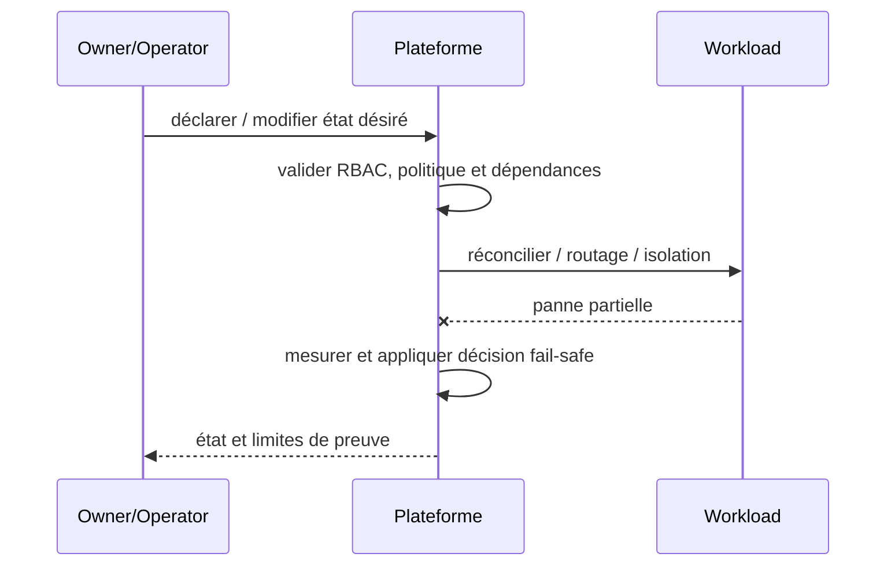

# Cours 216 — Control Plane / Data Plane Separation · Platform Engineering

> Contexte fictif : plateforme OpenShift/Java et services bancaires. **Corrigé théorique, pas de runtime IBM ODM sous licence ni test CRC exécuté dans cette formation.**

## 1. Déclencheur métier / plateforme
Le portail plateforme déclare les capacités, mais les services de paiement doivent continuer à être servis même lorsque Backstage ou Argo CD est momentanément indisponible.

## 2. Architecture et responsabilités
~~~mermaid
flowchart LR
    A["Control Plane / portail et déclarations"] --> B["Reconcilers et politiques"]
    B --> C["Data Plane Payment API"]
    B -. "Refus, version incompatible ou panne" .-> D["Incident documenté / pas d'effet implicite"]
~~~

**Invariant :** La panne du plan de contrôle ne donne pas de nouveau privilège et ne déclare pas un paiement exécuté.

## 3. Contrat et frontière de confiance
1. Identifier les propriétaires des décisions, données et politiques ainsi que les consommateurs et identités techniques.
2. Versionner le contrat, définir les states autoritatifs, la sécurité et les permissions applicables.
3. Décrire impact de panne du plan ou moteur, conditions de retry et comportement si réponse indéterminée.
4. Tracer input, output, version, refus, latence p99, coût et revue d'architecture.
5. **Limite :** Le control plane et data plane ont des SLO et identités distincts ; la séparation n'élimine pas la nécessité de DR.

## 4. Séquence nominale / incident
~~~mermaid
sequenceDiagram
    participant C as Consommateur / opérateur
    participant P as Frontière de politique ou contrat
    participant E as Plan ou moteur cible
    C->>P: requête avec identité et version
    P->>P: vérifier habilitations et invariants
    alt autorisé et résultat démontré
      P->>E: action déclarative / évaluation
      E-->>P: état, décision et provenance
      P-->>C: réponse attestée
    else invalide ou moteur indisponible
      E--xP: timeout ou rejet
      P-->>C: refus ou INDETERMINATE explicite
    end
~~~

## 5. Preuves de Design Authority
- **Test principal :** Couper Argo CD : le service déjà en place reste soumis à ses droits, sans nouvelle configuration non autorisée.
- Tester source/tenant non autorisé, données ou politiques non versionnées, panne et réponse perdue.
- Vérifier le statut métier exact : un ACK, une recommandation ou un contrôle d'admission ne vaut pas règlement bancaire.
- Mesurer disponibilité, SLO, p95/p99, coût, logs expurgés, impact du rollback et réconciliation.
- Fournir ADR avec alternatives, matrice de responsabilités et résultats GO/NO-GO.

## 6. QCM corrigé
**Quelle démarche retiens-tu pour Control Plane / Data Plane Separation ?**
- **A.** Supposer que le framework ou le moteur garantit directement la finalité d'un paiement.
- **B.** Appliquer Control Plane / Data Plane Separation avec contrats, invariants et preuves de test.
- **C.** Ignorer droits, différences de versions et tests de panne pour accélérer la livraison.

**Réponse théorique : B.** La panne du plan de contrôle ne donne pas de nouveau privilège et ne déclare pas un paiement exécuté.

## 7. Fiche existante et approfondissement
[Source du catalogue](https://github.com/zdmooc/enterprise-architecture-patterns-handbook/blob/main/21-platform-engineering-patterns/01-control-plane-data-plane/README.md)

#### Contexte et choix

Le plan de gouvernance et la requête métier ont des disponibilités et droits différents. Ce pattern est un **choix de frontière et de responsabilité** et non un nom de produit.

#### Architecture

#### Séquence de panne

#### Invariant testable

Indisponibilité du control plane n'autorise pas une modification non validée du data plane.

#### Qualification

- **Injection négative :** Échec GitOps/Operator : services métiers existants restent gouvernés selon politique; aucune mutation non autorisée.
- **Limite :** Séparer RBAC, identité runtime et SLO des deux plans.
- Définir compte/propriétaire, SLI/SLO et coût d'exploitation ; tester admission et comportement runtime séparément.
- Mesurer résultat sur Kind/CRC sans extrapoler au multi-site physique ni à la production.

#### Alternatives

Cluster dédié, isolation par namespace, service managé ou contrôle manuel gouverné selon besoins et charge réels. Documenter coûts/licences et condition de rollback dans une ADR.

[Sommaire](https://github.com/zdmooc/enterprise-architecture-patterns-handbook/blob/main/21-platform-engineering-patterns/README.md) · [Patterns OpenShift](https://github.com/zdmooc/enterprise-architecture-patterns-handbook/blob/main/09-containerization-kubernetes-openshift-patterns/README.md)

[Programme](README.md) · [Révisions et preuves de la catégorie](exercices-et-corriges/cours-216-220.md)
