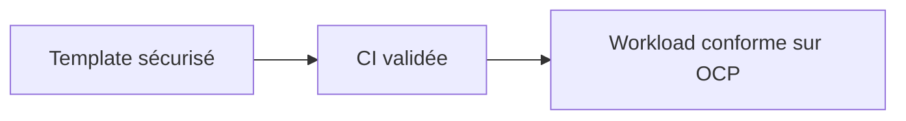
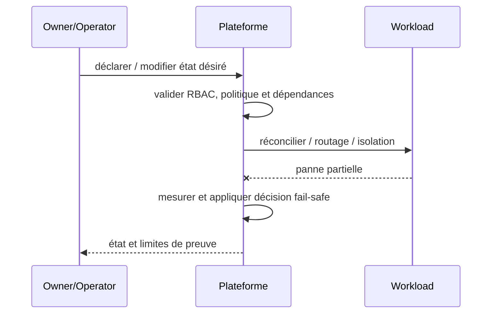

# Cours 217 — Golden Path / Paved Road · Platform Engineering

> Contexte fictif : plateforme OpenShift/Java et services bancaires. **Corrigé théorique, pas de runtime IBM ODM sous licence ni test CRC exécuté dans cette formation.**

## 1. Déclencheur métier / plateforme
Chaque équipe Java produit des pipelines différents ; un chemin standard doit fournir sécurité, observabilité et GitOps par défaut.

## 2. Architecture et responsabilités
~~~mermaid
flowchart LR
    A["Template produit interne"] --> B["Pipeline signé et SBOM"]
    B --> C["Workload conforme OpenShift"]
    B -. "Refus, version incompatible ou panne" .-> D["Incident documenté / pas d'effet implicite"]
~~~

**Invariant :** Un nouveau service issu du template respecte non-root, probes, secrets, image à digest et NetworkPolicy.

## 3. Contrat et frontière de confiance
1. Identifier les propriétaires des décisions, données et politiques ainsi que les consommateurs et identités techniques.
2. Versionner le contrat, définir les states autoritatifs, la sécurité et les permissions applicables.
3. Décrire impact de panne du plan ou moteur, conditions de retry et comportement si réponse indéterminée.
4. Tracer input, output, version, refus, latence p99, coût et revue d'architecture.
5. **Limite :** Un golden path doit rester versionné et personnalisable sous ADR ; il n'est pas obligatoire pour chaque exception justifiée.

## 4. Séquence nominale / incident
~~~mermaid
sequenceDiagram
    participant C as Consommateur / opérateur
    participant P as Frontière de politique ou contrat
    participant E as Plan ou moteur cible
    C->>P: requête avec identité et version
    P->>P: vérifier habilitations et invariants
    alt autorisé et résultat démontré
      P->>E: action déclarative / évaluation
      E-->>P: état, décision et provenance
      P-->>C: réponse attestée
    else invalide ou moteur indisponible
      E--xP: timeout ou rejet
      P-->>C: refus ou INDETERMINATE explicite
    end
~~~

## 5. Preuves de Design Authority
- **Test principal :** Générer un service depuis template puis injecter une image non signée : gate d'admission refuse.
- Tester source/tenant non autorisé, données ou politiques non versionnées, panne et réponse perdue.
- Vérifier le statut métier exact : un ACK, une recommandation ou un contrôle d'admission ne vaut pas règlement bancaire.
- Mesurer disponibilité, SLO, p95/p99, coût, logs expurgés, impact du rollback et réconciliation.
- Fournir ADR avec alternatives, matrice de responsabilités et résultats GO/NO-GO.

## 6. QCM corrigé
**Quelle démarche retiens-tu pour Golden Path / Paved Road ?**
- **A.** Supposer que le framework ou le moteur garantit directement la finalité d'un paiement.
- **B.** Ignorer droits, différences de versions et tests de panne pour accélérer la livraison.
- **C.** Appliquer Golden Path / Paved Road avec contrats, invariants et preuves de test.

**Réponse théorique : C.** Un nouveau service issu du template respecte non-root, probes, secrets, image à digest et NetworkPolicy.

## 7. Fiche existante et approfondissement
[Source du catalogue](https://github.com/zdmooc/enterprise-architecture-patterns-handbook/blob/main/21-platform-engineering-patterns/02-golden-path/README.md)

#### Contexte et choix

Chaque équipe recode sécurité, observabilité, pipeline et manifests différemment. Ce pattern est un **choix de frontière et de responsabilité** et non un nom de produit.

#### Architecture

#### Séquence de panne

#### Invariant testable

Chemin standard donne non-root, probes, SBOM, secrets externalisés et restrictions par défaut.

#### Qualification

- **Injection négative :** Image vulnérable/non signée : gate de promotion refuse.
- **Limite :** Dérogation possible par ADR datée, jamais contournement implicite.
- Définir compte/propriétaire, SLI/SLO et coût d'exploitation ; tester admission et comportement runtime séparément.
- Mesurer résultat sur Kind/CRC sans extrapoler au multi-site physique ni à la production.

#### Alternatives

Cluster dédié, isolation par namespace, service managé ou contrôle manuel gouverné selon besoins et charge réels. Documenter coûts/licences et condition de rollback dans une ADR.

[Sommaire](https://github.com/zdmooc/enterprise-architecture-patterns-handbook/blob/main/21-platform-engineering-patterns/README.md) · [Patterns OpenShift](https://github.com/zdmooc/enterprise-architecture-patterns-handbook/blob/main/09-containerization-kubernetes-openshift-patterns/README.md)

[Programme](README.md) · [Révisions et preuves de la catégorie](exercices-et-corriges/cours-216-220.md)
