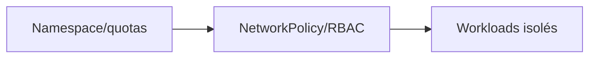
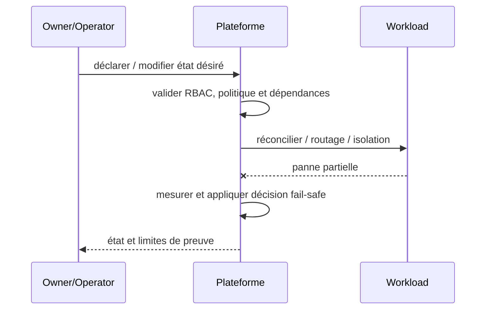

# Cours 218 — Multi-Tenant Isolation / Noisy Neighbor · Platform Engineering

> Contexte fictif : plateforme OpenShift/Java et services bancaires. **Corrigé théorique, pas de runtime IBM ODM sous licence ni test CRC exécuté dans cette formation.**

## 1. Déclencheur métier / plateforme
Les namespaces Paiements, Analytics et IA partagent un cluster ; la saturation ou compromission de l'un ne doit pas exposer l'autre.

## 2. Architecture et responsabilités
~~~mermaid
flowchart LR
    A["Tenants / namespace + serviceAccounts"] --> B["RBAC + Quotas + NetworkPolicy"]
    B --> C["Pods isolés"]
    B -. "Refus, version incompatible ou panne" .-> D["Incident documenté / pas d'effet implicite"]
~~~

**Invariant :** Tenant B ne lit pas secret de A et n'épuise pas les quotas réservés à A.

## 3. Contrat et frontière de confiance
1. Identifier les propriétaires des décisions, données et politiques ainsi que les consommateurs et identités techniques.
2. Versionner le contrat, définir les states autoritatifs, la sécurité et les permissions applicables.
3. Décrire impact de panne du plan ou moteur, conditions de retry et comportement si réponse indéterminée.
4. Tracer input, output, version, refus, latence p99, coût et revue d'architecture.
5. **Limite :** Un namespace seul ne garantit pas isolation forte ; selon menaces, cluster dédié ou cells.

## 4. Séquence nominale / incident
~~~mermaid
sequenceDiagram
    participant C as Consommateur / opérateur
    participant P as Frontière de politique ou contrat
    participant E as Plan ou moteur cible
    C->>P: requête avec identité et version
    P->>P: vérifier habilitations et invariants
    alt autorisé et résultat démontré
      P->>E: action déclarative / évaluation
      E-->>P: état, décision et provenance
      P-->>C: réponse attestée
    else invalide ou moteur indisponible
      E--xP: timeout ou rejet
      P-->>C: refus ou INDETERMINATE explicite
    end
~~~

## 5. Preuves de Design Authority
- **Test principal :** Tenant B tente de lire un Secret Paiements et lance une rafale CPU : accès refusé et quotas appliqués.
- Tester source/tenant non autorisé, données ou politiques non versionnées, panne et réponse perdue.
- Vérifier le statut métier exact : un ACK, une recommandation ou un contrôle d'admission ne vaut pas règlement bancaire.
- Mesurer disponibilité, SLO, p95/p99, coût, logs expurgés, impact du rollback et réconciliation.
- Fournir ADR avec alternatives, matrice de responsabilités et résultats GO/NO-GO.

## 6. QCM corrigé
**Quelle démarche retiens-tu pour Multi-Tenant Isolation / Noisy Neighbor ?**
- **A.** Appliquer Multi-Tenant Isolation / Noisy Neighbor avec contrats, invariants et preuves de test.
- **B.** Supposer que le framework ou le moteur garantit directement la finalité d'un paiement.
- **C.** Ignorer droits, différences de versions et tests de panne pour accélérer la livraison.

**Réponse théorique : A.** Tenant B ne lit pas secret de A et n'épuise pas les quotas réservés à A.

## 7. Fiche existante et approfondissement
[Source du catalogue](https://github.com/zdmooc/enterprise-architecture-patterns-handbook/blob/main/21-platform-engineering-patterns/03-multi-tenant-isolation/README.md)

#### Contexte et choix

Des équipes partagent un cluster et peuvent consommer les ressources ou données des autres. Ce pattern est un **choix de frontière et de responsabilité** et non un nom de produit.

#### Architecture

#### Séquence de panne

#### Invariant testable

Tenant A ne peut lire secret de B ni ouvrir un flux est-ouest non autorisé.

#### Qualification

- **Injection négative :** Tester token A vers service B, RBAC et ressources saturées.
- **Limite :** Le namespace seul n'est pas une garantie de sécurité ni de quota.
- Définir compte/propriétaire, SLI/SLO et coût d'exploitation ; tester admission et comportement runtime séparément.
- Mesurer résultat sur Kind/CRC sans extrapoler au multi-site physique ni à la production.

#### Alternatives

Cluster dédié, isolation par namespace, service managé ou contrôle manuel gouverné selon besoins et charge réels. Documenter coûts/licences et condition de rollback dans une ADR.

[Sommaire](https://github.com/zdmooc/enterprise-architecture-patterns-handbook/blob/main/21-platform-engineering-patterns/README.md) · [Patterns OpenShift](https://github.com/zdmooc/enterprise-architecture-patterns-handbook/blob/main/09-containerization-kubernetes-openshift-patterns/README.md)

[Programme](README.md) · [Révisions et preuves de la catégorie](exercices-et-corriges/cours-216-220.md)
