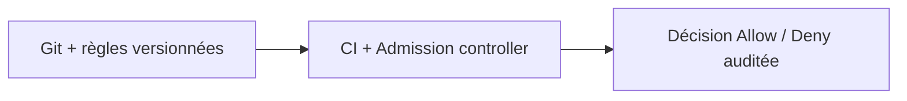
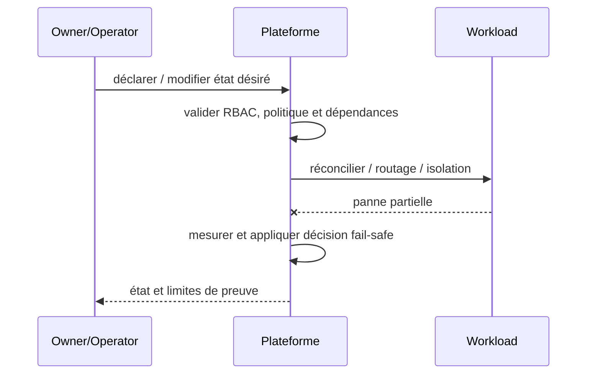

# Cours 219 — Policy as Code / Admission Guardrails · Platform Engineering

> Contexte fictif : plateforme OpenShift/Java et services bancaires. **Corrigé théorique, pas de runtime IBM ODM sous licence ni test CRC exécuté dans cette formation.**

## 1. Déclencheur métier / plateforme
Les règles de sécurité OpenShift sont inscrites dans des PDF mais ne bloquent pas un Deployment privileged.

## 2. Architecture et responsabilités
~~~mermaid
flowchart LR
    A["Politiques Git versionnées"] --> B["CI puis admission Kyverno"]
    B --> C["Workload autorisé seulement"]
    B -. "Refus, version incompatible ou panne" .-> D["Incident documenté / pas d'effet implicite"]
~~~

**Invariant :** Un Pod privileged ou image de provenance interdite est refusé à l'admission.

## 3. Contrat et frontière de confiance
1. Identifier les propriétaires des décisions, données et politiques ainsi que les consommateurs et identités techniques.
2. Versionner le contrat, définir les states autoritatifs, la sécurité et les permissions applicables.
3. Décrire impact de panne du plan ou moteur, conditions de retry et comportement si réponse indéterminée.
4. Tracer input, output, version, refus, latence p99, coût et revue d'architecture.
5. **Limite :** Éviter divergence de versions de règles, exceptions implicites et faux positifs non suivis.

## 4. Séquence nominale / incident
~~~mermaid
sequenceDiagram
    participant C as Consommateur / opérateur
    participant P as Frontière de politique ou contrat
    participant E as Plan ou moteur cible
    C->>P: requête avec identité et version
    P->>P: vérifier habilitations et invariants
    alt autorisé et résultat démontré
      P->>E: action déclarative / évaluation
      E-->>P: état, décision et provenance
      P-->>C: réponse attestée
    else invalide ou moteur indisponible
      E--xP: timeout ou rejet
      P-->>C: refus ou INDETERMINATE explicite
    end
~~~

## 5. Preuves de Design Authority
- **Test principal :** Injecter tag latest, escalade privilège, registry non approuvée et vérifier refus CI + admission.
- Tester source/tenant non autorisé, données ou politiques non versionnées, panne et réponse perdue.
- Vérifier le statut métier exact : un ACK, une recommandation ou un contrôle d'admission ne vaut pas règlement bancaire.
- Mesurer disponibilité, SLO, p95/p99, coût, logs expurgés, impact du rollback et réconciliation.
- Fournir ADR avec alternatives, matrice de responsabilités et résultats GO/NO-GO.

## 6. QCM corrigé
**Quelle démarche retiens-tu pour Policy as Code / Admission Guardrails ?**
- **A.** Supposer que le framework ou le moteur garantit directement la finalité d'un paiement.
- **B.** Appliquer Policy as Code / Admission Guardrails avec contrats, invariants et preuves de test.
- **C.** Ignorer droits, différences de versions et tests de panne pour accélérer la livraison.

**Réponse théorique : B.** Un Pod privileged ou image de provenance interdite est refusé à l'admission.

## 7. Fiche existante et approfondissement
[Source du catalogue](https://github.com/zdmooc/enterprise-architecture-patterns-handbook/blob/main/21-platform-engineering-patterns/04-policy-as-code/README.md)

#### Contexte et choix

Des règles d'architecture sont écrites mais ne bloquent aucun déploiement risqué. Ce pattern est un **choix de frontière et de responsabilité** et non un nom de produit.

#### Architecture

#### Séquence de panne

#### Invariant testable

La même politique et sa version sont évaluées en CI et sur admission quand techniquement possible.

#### Qualification

- **Injection négative :** Pod privileged, latest tag et droits élevés doivent échouer selon profil applicable.
- **Limite :** Réduire faux positifs et documenter exception bornée; pas de mode permissif caché.
- Définir compte/propriétaire, SLI/SLO et coût d'exploitation ; tester admission et comportement runtime séparément.
- Mesurer résultat sur Kind/CRC sans extrapoler au multi-site physique ni à la production.

#### Alternatives

Cluster dédié, isolation par namespace, service managé ou contrôle manuel gouverné selon besoins et charge réels. Documenter coûts/licences et condition de rollback dans une ADR.

[Sommaire](https://github.com/zdmooc/enterprise-architecture-patterns-handbook/blob/main/21-platform-engineering-patterns/README.md) · [Patterns OpenShift](https://github.com/zdmooc/enterprise-architecture-patterns-handbook/blob/main/09-containerization-kubernetes-openshift-patterns/README.md)

[Programme](README.md) · [Révisions et preuves de la catégorie](exercices-et-corriges/cours-216-220.md)
