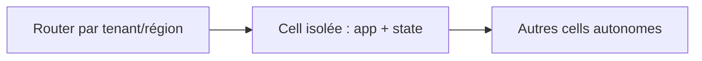
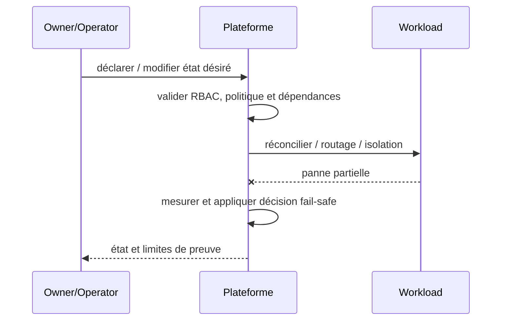

# Cours 220 — Cell-Based Architecture / Fault Containment · Platform Engineering

> Contexte fictif : plateforme OpenShift/Java et services bancaires. **Corrigé théorique, pas de runtime IBM ODM sous licence ni test CRC exécuté dans cette formation.**

## 1. Déclencheur métier / plateforme
Une plateforme multi-équipes concentre trop de workloads critiques ; des cells indépendantes limitent l'impact d'une zone ou d'un tenant.

## 2. Architecture et responsabilités
~~~mermaid
flowchart LR
    A["Routeur tenant / partition"] --> B["Cells autonomes app + état"]
    B --> C["Contamination de panne limitée"]
    B -. "Refus, version incompatible ou panne" .-> D["Incident documenté / pas d'effet implicite"]
~~~

**Invariant :** Une panne complète de Cell A n'affecte pas les transactions de Cell B et ne crée pas deux writers pour A.

## 3. Contrat et frontière de confiance
1. Identifier les propriétaires des décisions, données et politiques ainsi que les consommateurs et identités techniques.
2. Versionner le contrat, définir les states autoritatifs, la sécurité et les permissions applicables.
3. Décrire impact de panne du plan ou moteur, conditions de retry et comportement si réponse indéterminée.
4. Tracer input, output, version, refus, latence p99, coût et revue d'architecture.
5. **Limite :** Les cells augmentent coût et complexité opérationnelle ; ownership des données et routage stable sont indispensables.

## 4. Séquence nominale / incident
~~~mermaid
sequenceDiagram
    participant C as Consommateur / opérateur
    participant P as Frontière de politique ou contrat
    participant E as Plan ou moteur cible
    C->>P: requête avec identité et version
    P->>P: vérifier habilitations et invariants
    alt autorisé et résultat démontré
      P->>E: action déclarative / évaluation
      E-->>P: état, décision et provenance
      P-->>C: réponse attestée
    else invalide ou moteur indisponible
      E--xP: timeout ou rejet
      P-->>C: refus ou INDETERMINATE explicite
    end
~~~

## 5. Preuves de Design Authority
- **Test principal :** Isoler Cell A, vérifier la continuité de B et refuser une écriture A depuis un second owner non autorisé.
- Tester source/tenant non autorisé, données ou politiques non versionnées, panne et réponse perdue.
- Vérifier le statut métier exact : un ACK, une recommandation ou un contrôle d'admission ne vaut pas règlement bancaire.
- Mesurer disponibilité, SLO, p95/p99, coût, logs expurgés, impact du rollback et réconciliation.
- Fournir ADR avec alternatives, matrice de responsabilités et résultats GO/NO-GO.

## 6. QCM corrigé
**Quelle démarche retiens-tu pour Cell-Based Architecture / Fault Containment ?**
- **A.** Supposer que le framework ou le moteur garantit directement la finalité d'un paiement.
- **B.** Ignorer droits, différences de versions et tests de panne pour accélérer la livraison.
- **C.** Appliquer Cell-Based Architecture / Fault Containment avec contrats, invariants et preuves de test.

**Réponse théorique : C.** Une panne complète de Cell A n'affecte pas les transactions de Cell B et ne crée pas deux writers pour A.

## 7. Fiche existante et approfondissement
[Source du catalogue](https://github.com/zdmooc/enterprise-architecture-patterns-handbook/blob/main/21-platform-engineering-patterns/05-cell-based-architecture/README.md)

#### Contexte et choix

Une plateforme partagée possède un blast radius trop grand. Ce pattern est un **choix de frontière et de responsabilité** et non un nom de produit.

#### Architecture

#### Séquence de panne

#### Invariant testable

La panne d'une cell n'affecte pas les transactions d'une autre; ownership et données restent définis.

#### Qualification

- **Injection négative :** Injecter perte de cell A : B répond, aucune double écriture de A.
- **Limite :** L'isolation coûte plus cher : réserver aux domaines exigeant ce niveau de continuité.
- Définir compte/propriétaire, SLI/SLO et coût d'exploitation ; tester admission et comportement runtime séparément.
- Mesurer résultat sur Kind/CRC sans extrapoler au multi-site physique ni à la production.

#### Alternatives

Cluster dédié, isolation par namespace, service managé ou contrôle manuel gouverné selon besoins et charge réels. Documenter coûts/licences et condition de rollback dans une ADR.

[Sommaire](https://github.com/zdmooc/enterprise-architecture-patterns-handbook/blob/main/21-platform-engineering-patterns/README.md) · [Patterns OpenShift](https://github.com/zdmooc/enterprise-architecture-patterns-handbook/blob/main/09-containerization-kubernetes-openshift-patterns/README.md)

[Programme](README.md) · [Révisions et preuves de la catégorie](exercices-et-corriges/cours-216-220.md)
