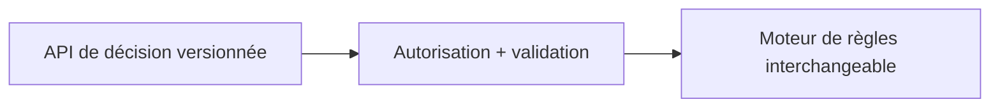
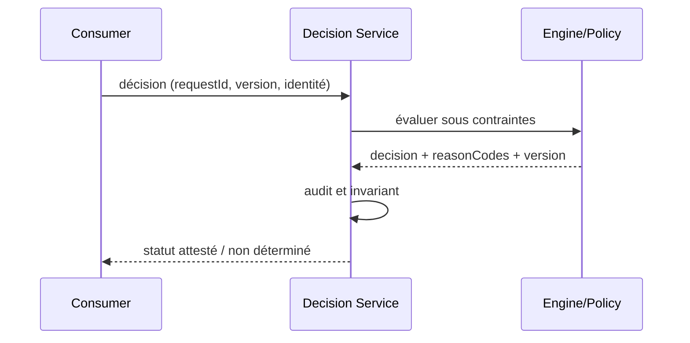

# Cours 221 — Decision Service Boundary · Architecture décisionnelle / ODM (patterns génériques)

> Contexte fictif : plateforme OpenShift/Java et services bancaires. **Corrigé théorique, pas de runtime IBM ODM sous licence ni test CRC exécuté dans cette formation.**

## 1. Déclencheur métier / plateforme
Plusieurs services Spring, batchs et consommateurs COBOL consultent une décision de tarification ; l'API doit avoir un contrat stable, découplé du moteur.

## 2. Architecture et responsabilités
~~~mermaid
flowchart LR
    A["Client Java / API versionnée"] --> B["Service décisionnel et règles d'accès"]
    B --> C["Moteur de règles interchangeable"]
    B -. "Refus, version incompatible ou panne" .-> D["Incident documenté / pas d'effet implicite"]
~~~

**Invariant :** La réponse expose decision, reasonCodes, ruleSetVersion et correlationId, sans fuite entre tenants.

## 3. Contrat et frontière de confiance
1. Identifier les propriétaires des décisions, données et politiques ainsi que les consommateurs et identités techniques.
2. Versionner le contrat, définir les states autoritatifs, la sécurité et les permissions applicables.
3. Décrire impact de panne du plan ou moteur, conditions de retry et comportement si réponse indéterminée.
4. Tracer input, output, version, refus, latence p99, coût et revue d'architecture.
5. **Limite :** Contrat stable n'est pas preuve que deux moteurs ont la même sémantique métier.

## 4. Séquence nominale / incident
~~~mermaid
sequenceDiagram
    participant C as Consommateur / opérateur
    participant P as Frontière de politique ou contrat
    participant E as Plan ou moteur cible
    C->>P: requête avec identité et version
    P->>P: vérifier habilitations et invariants
    alt autorisé et résultat démontré
      P->>E: action déclarative / évaluation
      E-->>P: état, décision et provenance
      P-->>C: réponse attestée
    else invalide ou moteur indisponible
      E--xP: timeout ou rejet
      P-->>C: refus ou INDETERMINATE explicite
    end
~~~

## 5. Preuves de Design Authority
- **Test principal :** Appeler API avec audience invalide et version inconnue : refus ou INDETERMINATE explicite, jamais ALLOW implicite.
- Tester source/tenant non autorisé, données ou politiques non versionnées, panne et réponse perdue.
- Vérifier le statut métier exact : un ACK, une recommandation ou un contrôle d'admission ne vaut pas règlement bancaire.
- Mesurer disponibilité, SLO, p95/p99, coût, logs expurgés, impact du rollback et réconciliation.
- Fournir ADR avec alternatives, matrice de responsabilités et résultats GO/NO-GO.

## 6. QCM corrigé
**Quelle démarche retiens-tu pour Decision Service Boundary ?**
- **A.** Appliquer Decision Service Boundary avec contrats, invariants et preuves de test.
- **B.** Supposer que le framework ou le moteur garantit directement la finalité d'un paiement.
- **C.** Ignorer droits, différences de versions et tests de panne pour accélérer la livraison.

**Réponse théorique : A.** La réponse expose decision, reasonCodes, ruleSetVersion et correlationId, sans fuite entre tenants.

## 7. Fiche existante et approfondissement
[Source du catalogue](https://github.com/zdmooc/enterprise-architecture-patterns-handbook/blob/main/20-decision-management-patterns/01-decision-service-boundary/README.md)

#### Problème

Plusieurs consommateurs invoquent des décisions sans contrat stable. Pattern de référence indépendant d'un éditeur, sans affirmation d'exécution sous licence.

#### Schéma logique

#### Séquence de contrôle

#### Invariant

Contrat de décision indépendant du fournisseur; une décision renseigne résultat, motifs, version et corrélation.

#### Tests et gouvernance

1. Une version de moteur change : les cas métiers historiques gardent les mêmes contrats ou l'écart est expliqué.
2. Service indisponible : pas d'approbation implicite ; statuts indéterminés explicités.
3. Expirer le token ou demander un dossier d'un autre tenant : 401/403 sans exécution du moteur.
4. Tester incident pendant évaluation : aucune nouvelle écriture arbitraire; retour explicitement déterminé/inconnu.

#### Alternatives et décision

Distinguer moteur éditeur, interpréteur libre, règles en code et décisions ML; comparer versions, coûts, licencing, débit et responsabilité de support. Un POC simulé ne prouve ni conformité des licences ODM ni compatibilité runtime éditeur. Documenter ADR, contrat et preuve d'exécution.

[Catalogue décisionnel](https://github.com/zdmooc/enterprise-architecture-patterns-handbook/blob/main/20-decision-management-patterns/README.md) · [Sécurité Zero Trust](https://github.com/zdmooc/enterprise-architecture-patterns-handbook/blob/main/14-security-zero-trust-patterns/README.md)

[Programme](README.md) · [Révisions et preuves de la catégorie](exercices-et-corriges/cours-221-225.md)
