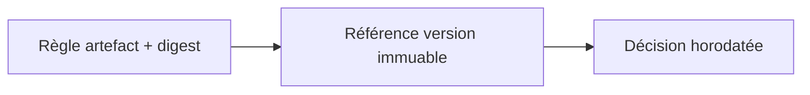
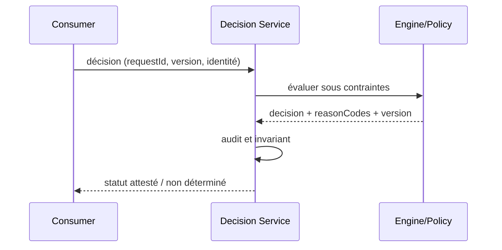

# Cours 223 — Rule Version Pinning / Promotion · Architecture décisionnelle / ODM (patterns génériques)

> Contexte fictif : plateforme OpenShift/Java et services bancaires. **Corrigé théorique, pas de runtime IBM ODM sous licence ni test CRC exécuté dans cette formation.**

## 1. Déclencheur métier / plateforme
Le résultat d'une décision de tarification doit pouvoir être justifié des années après ; la version de la ruleset ne doit pas varier silencieusement.

## 2. Architecture et responsabilités
~~~mermaid
flowchart LR
    A["Ruleset artefact signé / digest"] --> B["Version immuable et promotion"]
    B --> C["Décision horodatée auditée"]
    B -. "Refus, version incompatible ou panne" .-> D["Incident documenté / pas d'effet implicite"]
~~~

**Invariant :** Chaque évaluation lie version de règle, moteur, hash et version des entrées à sa justification.

## 3. Contrat et frontière de confiance
1. Identifier les propriétaires des décisions, données et politiques ainsi que les consommateurs et identités techniques.
2. Versionner le contrat, définir les states autoritatifs, la sécurité et les permissions applicables.
3. Décrire impact de panne du plan ou moteur, conditions de retry et comportement si réponse indéterminée.
4. Tracer input, output, version, refus, latence p99, coût et revue d'architecture.
5. **Limite :** La stabilité exige aussi données d'entrée, dépendances, moteur et paramètres réconciliés.

## 4. Séquence nominale / incident
~~~mermaid
sequenceDiagram
    participant C as Consommateur / opérateur
    participant P as Frontière de politique ou contrat
    participant E as Plan ou moteur cible
    C->>P: requête avec identité et version
    P->>P: vérifier habilitations et invariants
    alt autorisé et résultat démontré
      P->>E: action déclarative / évaluation
      E-->>P: état, décision et provenance
      P-->>C: réponse attestée
    else invalide ou moteur indisponible
      E--xP: timeout ou rejet
      P-->>C: refus ou INDETERMINATE explicite
    end
~~~

## 5. Preuves de Design Authority
- **Test principal :** Déployer N+1 puis revenir N et reconstruire la décision historique avec la même version épinglée.
- Tester source/tenant non autorisé, données ou politiques non versionnées, panne et réponse perdue.
- Vérifier le statut métier exact : un ACK, une recommandation ou un contrôle d'admission ne vaut pas règlement bancaire.
- Mesurer disponibilité, SLO, p95/p99, coût, logs expurgés, impact du rollback et réconciliation.
- Fournir ADR avec alternatives, matrice de responsabilités et résultats GO/NO-GO.

## 6. QCM corrigé
**Quelle démarche retiens-tu pour Rule Version Pinning / Promotion ?**
- **A.** Supposer que le framework ou le moteur garantit directement la finalité d'un paiement.
- **B.** Ignorer droits, différences de versions et tests de panne pour accélérer la livraison.
- **C.** Appliquer Rule Version Pinning / Promotion avec contrats, invariants et preuves de test.

**Réponse théorique : C.** Chaque évaluation lie version de règle, moteur, hash et version des entrées à sa justification.

## 7. Fiche existante et approfondissement
[Source du catalogue](https://github.com/zdmooc/enterprise-architecture-patterns-handbook/blob/main/20-decision-management-patterns/03-rule-version-pinning/README.md)

#### Problème

Deux environnements exécutent des versions divergentes de règles et rendent l'audit ambigu. Pattern de référence indépendant d'un éditeur, sans affirmation d'exécution sous licence.

#### Schéma logique

#### Séquence de contrôle

#### Invariant

Chaque évaluation conserve ruleSetVersion et moteur + hash; déploiement signé et activation explicite.

#### Tests et gouvernance

1. Pendant canary, la même requête avec version épinglée produit le même résultat déterministe.
2. Rollback des règles ne peut effacer les décisions historiques ni leur provenance.
3. Expirer le token ou demander un dossier d'un autre tenant : 401/403 sans exécution du moteur.
4. Tester incident pendant évaluation : aucune nouvelle écriture arbitraire; retour explicitement déterminé/inconnu.

#### Alternatives et décision

Distinguer moteur éditeur, interpréteur libre, règles en code et décisions ML; comparer versions, coûts, licencing, débit et responsabilité de support. Un POC simulé ne prouve ni conformité des licences ODM ni compatibilité runtime éditeur. Documenter ADR, contrat et preuve d'exécution.

[Catalogue décisionnel](https://github.com/zdmooc/enterprise-architecture-patterns-handbook/blob/main/20-decision-management-patterns/README.md) · [Sécurité Zero Trust](https://github.com/zdmooc/enterprise-architecture-patterns-handbook/blob/main/14-security-zero-trust-patterns/README.md)

[Programme](README.md) · [Révisions et preuves de la catégorie](exercices-et-corriges/cours-221-225.md)
