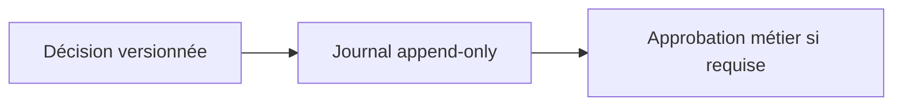
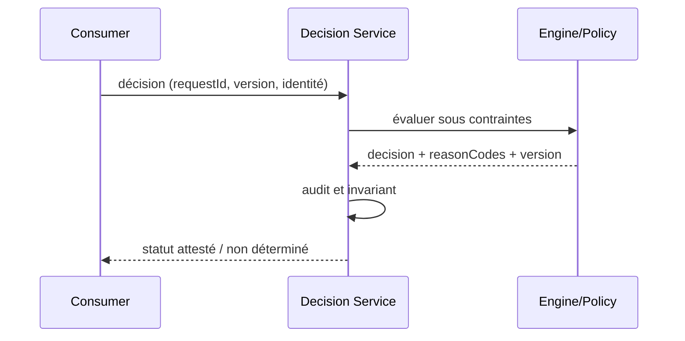

# Cours 225 — Decision Audit & Human Review · Architecture décisionnelle / ODM (patterns génériques)

> Contexte fictif : plateforme OpenShift/Java et services bancaires. **Corrigé théorique, pas de runtime IBM ODM sous licence ni test CRC exécuté dans cette formation.**

## 1. Déclencheur métier / plateforme
Une décision de crédit, tarif ou fraude à fort impact doit être explicable et parfois soumise à contrôle humain indépendant.

## 2. Architecture et responsabilités
~~~mermaid
flowchart LR
    A["Résultat de règles versionné"] --> B["Audit append-only / contrôle SoD"]
    B --> C["Révision humaine et décision autorisée"]
    B -. "Refus, version incompatible ou panne" .-> D["Incident documenté / pas d'effet implicite"]
~~~

**Invariant :** Une approbation est liée au payload exact et à la version de règle ; un agent IA ne peut pas l'accorder.

## 3. Contrat et frontière de confiance
1. Identifier les propriétaires des décisions, données et politiques ainsi que les consommateurs et identités techniques.
2. Versionner le contrat, définir les states autoritatifs, la sécurité et les permissions applicables.
3. Décrire impact de panne du plan ou moteur, conditions de retry et comportement si réponse indéterminée.
4. Tracer input, output, version, refus, latence p99, coût et revue d'architecture.
5. **Limite :** Reason codes facilitent l'audit mais ne remplacent pas conformité réglementaire, droits du sujet et preuves métier.

## 4. Séquence nominale / incident
~~~mermaid
sequenceDiagram
    participant C as Consommateur / opérateur
    participant P as Frontière de politique ou contrat
    participant E as Plan ou moteur cible
    C->>P: requête avec identité et version
    P->>P: vérifier habilitations et invariants
    alt autorisé et résultat démontré
      P->>E: action déclarative / évaluation
      E-->>P: état, décision et provenance
      P-->>C: réponse attestée
    else invalide ou moteur indisponible
      E--xP: timeout ou rejet
      P-->>C: refus ou INDETERMINATE explicite
    end
~~~

## 5. Preuves de Design Authority
- **Test principal :** Modifier une condition après approbation : refus d'exécution, nouvelle validation, trace protégée.
- Tester source/tenant non autorisé, données ou politiques non versionnées, panne et réponse perdue.
- Vérifier le statut métier exact : un ACK, une recommandation ou un contrôle d'admission ne vaut pas règlement bancaire.
- Mesurer disponibilité, SLO, p95/p99, coût, logs expurgés, impact du rollback et réconciliation.
- Fournir ADR avec alternatives, matrice de responsabilités et résultats GO/NO-GO.

## 6. QCM corrigé
**Quelle démarche retiens-tu pour Decision Audit & Human Review ?**
- **A.** Supposer que le framework ou le moteur garantit directement la finalité d'un paiement.
- **B.** Appliquer Decision Audit & Human Review avec contrats, invariants et preuves de test.
- **C.** Ignorer droits, différences de versions et tests de panne pour accélérer la livraison.

**Réponse théorique : B.** Une approbation est liée au payload exact et à la version de règle ; un agent IA ne peut pas l'accorder.

## 7. Fiche existante et approfondissement
[Source du catalogue](https://github.com/zdmooc/enterprise-architecture-patterns-handbook/blob/main/20-decision-management-patterns/05-decision-audit-human-review/README.md)

#### Problème

Une décision sensible exige justification, provenance et éventuelle validation humaine. Pattern de référence indépendant d'un éditeur, sans affirmation d'exécution sous licence.

#### Schéma logique

#### Séquence de contrôle

#### Invariant

Même identité et version de décision doivent être liées à l'approbation; l'IA peut conseiller mais jamais approuver seule.

#### Tests et gouvernance

1. Réutiliser une approbation sur payload modifié : rejet.
2. Le journal protège les données sensibles et la séparation des rôles; rétention explicite.
3. Expirer le token ou demander un dossier d'un autre tenant : 401/403 sans exécution du moteur.
4. Tester incident pendant évaluation : aucune nouvelle écriture arbitraire; retour explicitement déterminé/inconnu.

#### Alternatives et décision

Distinguer moteur éditeur, interpréteur libre, règles en code et décisions ML; comparer versions, coûts, licencing, débit et responsabilité de support. Un POC simulé ne prouve ni conformité des licences ODM ni compatibilité runtime éditeur. Documenter ADR, contrat et preuve d'exécution.

[Catalogue décisionnel](https://github.com/zdmooc/enterprise-architecture-patterns-handbook/blob/main/20-decision-management-patterns/README.md) · [Sécurité Zero Trust](https://github.com/zdmooc/enterprise-architecture-patterns-handbook/blob/main/14-security-zero-trust-patterns/README.md)

[Programme](README.md) · [Révisions et preuves de la catégorie](exercices-et-corriges/cours-221-225.md)
