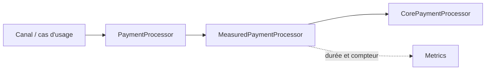
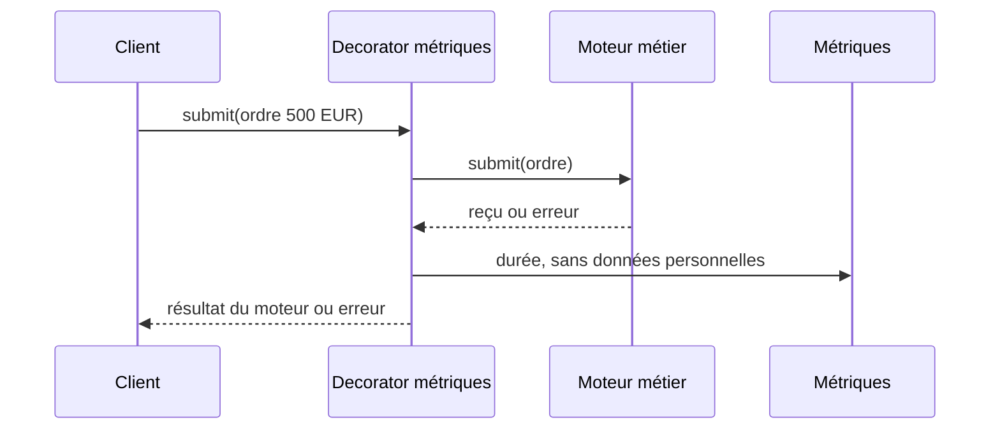

# Cours 59 — Decorator (GoF Java)

> Formation d'architecture bancaire · Banque fictive · Virement SEPA de 500 EUR · **Cours étudié, auto-évaluation individuelle non encore validée.**

## Objectif
Ajouter des responsabilités à un objet **sans modifier sa classe** et en conservant le **même contrat**. Le Decorator est un pattern structurel fondé sur la composition.

## 1. Situation bancaire
Le cas d'usage `PaymentProcessor.submit(order)` traite un ordre fictif de 500 EUR. Nous voulons mesurer sa durée et compter les appels, sans changer les règles métier du moteur et sans multiplier les variantes de la classe métier.

Un décorateur `MeasuredPaymentProcessor` implémente exactement `PaymentProcessor`, délègue le traitement à un `PaymentProcessor` interne, puis enregistre une métrique.

## 2. Structure et responsabilités
- **Component :** `PaymentProcessor`, contrat stable.
- **ConcreteComponent :** `CorePaymentProcessor`, traitement existant.
- **Decorator :** `MeasuredPaymentProcessor`, même interface et délégation.
- **Client :** application bancaire qui dépend du seul contrat `PaymentProcessor`.



Le diagramme montre un enchaînement conceptuel d'appels, et non une double exécution du paiement.

## 3. Exemple Java pédagogique
```java
interface PaymentProcessor {
    SubmissionReceipt submit(PaymentOrder order);
}

interface Metrics {
    void recordDuration(String operation, long nanos);
}

final class MeasuredPaymentProcessor implements PaymentProcessor {
    private final PaymentProcessor next;
    private final Metrics metrics;

    MeasuredPaymentProcessor(PaymentProcessor next, Metrics metrics) {
        this.next = next;
        this.metrics = metrics;
    }

    @Override
    public SubmissionReceipt submit(PaymentOrder order) {
        long begin = System.nanoTime();
        try {
            return next.submit(order); // une seule délégation
        } finally {
            long elapsed = System.nanoTime() - begin;
            try {
                metrics.recordDuration("payment.submit", elapsed);
            } catch (RuntimeException monitoringFailure) {
                // Politique pédagogique : métrique best effort.
                // En production : canal de diagnostic indépendant.
            }
        }
    }
}
```

`PaymentOrder` et `SubmissionReceipt` sont des types métier simplifiés à définir dans l'application. L'exemple n'est pas un traitement bancaire autonome.

## 4. Séquence : appel et incident


Si l'appel métier réussit mais que la collecte métrique échoue, un décorateur de pure observabilité ne doit pas transformer artificiellement la réponse en échec de paiement. L'échec de métrique sera diagnostiqué selon une politique définie. Si l'appel métier échoue, l'exception originale doit rester visible.

## 5. Invariants, limites et arbitrages
1. La délégation au moteur doit se produire **une seule fois** par invocation du décorateur.
2. Un décorateur ne remplace ni l'idempotence au niveau de l'exécution, ni les contrôles réglementaires.
3. Un timeout ou une réponse perdue ne prouve pas que l'ordre n'a pas été exécuté.
4. Les métriques doivent éviter les informations personnelles et les références de paiement sensibles en labels.
5. L'ordre d'empilement de plusieurs décorateurs peut changer la portée des mesures et des erreurs.
6. Attention à ne pas accumuler une chaîne opaque de décorateurs qui masque le flux et augmente la latence.

**Différence :** Adapter change l'interface ; Decorator conserve l'interface et ajoute un comportement ; Proxy conserve également l'interface mais contrôle surtout l'accès à une cible.

## 6. Tests d'architecture
- Réponse nominale : reçu inchangé, un appel métier, une métrique.
- Échec métier : erreur identique à celle du moteur ; aucune conversion en succès.
- Échec de métrique : résultat métier conservé suivant la politique best effort.
- Appel concurrent : absence de stockage partagé de montant ou d'état client.
- Comparaison de latence p95/p99 avant et après décoration.
- Pas de doublon d'ordre créé par le composant d'observabilité.

## 7. Exercice et corrigé
**Question :** comment mesurer les temps d'exécution du moteur sans modifier le code métier ?

- **A.** Envelopper le moteur dans un `PaymentProcessor` qui collecte des métriques et délègue l'appel.
- **B.** Réécrire intégralement les règles de paiement.
- **C.** Dupliquer chaque traitement dans un deuxième moteur.

**Réponse : A — Decorator.** Il enrichit un objet à contrat constant.

## 8. Question d'entretien
**Decorator ou middleware technique ?** Un filtre HTTP ou l'instrumentation automatique peut parfois suffire pour des métriques transverses. Le Decorator est pertinent si la composition explicite, au niveau du contrat du composant, apporte une responsabilité testable.

[Retour à l'index](README.md) · [Exercices 59–62](exercices-et-corriges/cours-59-62.md) · [Référence GoF](../../19-java-design-patterns-gof/05-decorator/README.md)
