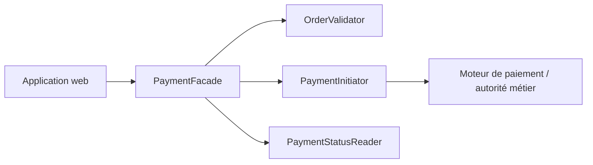
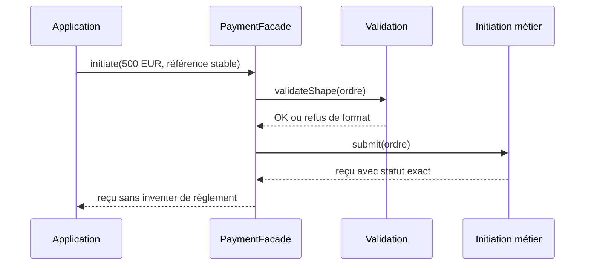

# Cours 60 — Facade (GoF Java)

> Formation d'architecture bancaire · Banque fictive · Virement SEPA de 500 EUR · **Cours étudié, auto-évaluation individuelle non encore validée.**

## Objectif
Fournir un **point d'entrée simplifié** vers un sous-système composé de plusieurs interfaces, sans prétendre remplacer ses règles métier ni supprimer ses frontières de responsabilité.

## 1. Situation bancaire
Une application web veut déposer un ordre SEPA de 500 EUR. Sans Facade, elle doit connaître les contrats des services de validation du format, d'initiation et de suivi. Chaque canal reproduit alors l'ordre de ces appels et leur gestion technique.

Avec `PaymentFacade`, le client appelle `initiate(order)` ; la Facade dirige vers les composants responsables et présente un résultat compréhensible.

## 2. Structure
- **Client :** application web ou BFF.
- **Facade :** `PaymentFacade`, interface simplifiée.
- **Sous-système :** `OrderValidator`, `PaymentInitiator`, `PaymentStatusReader`.
- **Autorité métier :** services du domaine / moteur bancaire ; la Facade n'invente pas les décisions financières.



## 3. Exemple Java simplifié
```java
interface OrderValidator {
    void validateShape(PaymentOrder order);
}
interface PaymentInitiator {
    SubmissionReceipt submit(PaymentOrder order);
}
interface PaymentStatusReader {
    PaymentStatus status(String reference);
}

final class PaymentFacade {
    private final OrderValidator validator;
    private final PaymentInitiator initiator;
    private final PaymentStatusReader statuses;

    PaymentFacade(OrderValidator validator,
                  PaymentInitiator initiator,
                  PaymentStatusReader statuses) {
        this.validator = validator;
        this.initiator = initiator;
        this.statuses = statuses;
    }

    SubmissionReceipt initiate(PaymentOrder order) {
        validator.validateShape(order);
        return initiator.submit(order);
    }

    PaymentStatus consult(String reference) {
        return statuses.status(reference);
    }
}
```

`PaymentOrder`, `SubmissionReceipt` et `PaymentStatus` sont pédagogiques. `validateShape` contrôle ici la forme des données et **non l'ensemble des règles métier**, que le moteur doit toujours vérifier.

## 4. Séquence nominale


Si la validation échoue, la Facade n'appelle pas l'initiation. En cas de timeout après soumission, l'état reste **indéterminé** jusqu'à vérification auprès de l'autorité métier.

## 5. Garanties et limites
1. Ne jamais assimiler `reçu`, `accepté`, `transmis` et `réglé`.
2. Les contrôles de limites, fraude, disponibilité des fonds et droits restent exécutés par les composants autoritatifs concernés.
3. Une Facade **ne crée pas une transaction atomique distribuée** entre plusieurs services.
4. Une seule Facade tentaculaire est un risque de couplage : préférer des façades cohérentes par cas d'usage.
5. En cas de relance, conserver une référence stable et garantir l'idempotence dans le chemin jusqu'au système d'exécution.
6. Pour deux opérations déjà simples et indépendantes, ajouter une Facade peut n'apporter aucune valeur.

**Comparaison :** Facade réduit la complexité d'accès à un sous-système ; Adapter convertit un contrat incompatible ; BFF adapte des interactions à un canal particulier.

## 6. Tests et preuves
- Validation invalide : aucune invocation de `PaymentInitiator`.
- Soumission nominale : exactement un appel d'initiation par invocation, statut inchangé.
- Timeout d'initiation : ne pas conclure à un rejet ni resoumettre aveuglément.
- Consultation : `consult` ne modifie pas le statut.
- Canaux distincts : même sémantique des statuts malgré des représentations différentes.
- Autorisation et règles métier : refus effectif au niveau du service responsable même si la Facade est contournée.

## 7. Exercice corrigé
**Question :** le portail web appelle trois services pour réaliser un cas d'usage simple. Comment réduire son couplage ?

- **A.** Exposer toutes les méthodes internes au portail.
- **B.** Proposer une Facade qui simplifie l'accès aux services sans déplacer leurs règles métier.
- **C.** Dupliquer le moteur bancaire dans le portail.

**Réponse : B — Facade.** Le client utilise une interface plus simple, tout en conservant la spécialisation des services internes.

## 8. Question d'entretien
**Facade ou orchestrateur métier ?** La Facade simplifie une API de sous-système. Un orchestrateur métier porte un workflow, des compensations ou une coordination explicite ; confondre les deux crée un composant trop central et difficile à gouverner.

[Retour à l'index](README.md) · [Exercices 59–62](exercices-et-corriges/cours-59-62.md)
