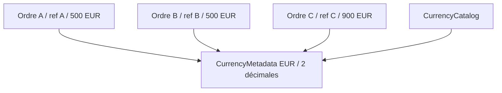
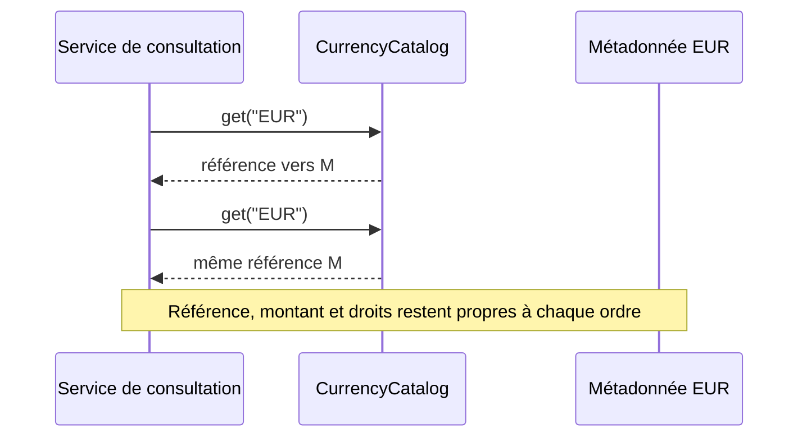

# Cours 61 — Flyweight (GoF Java)

> Formation d'architecture bancaire · Banque fictive · Virements SEPA de 500 EUR · **Cours étudié, auto-évaluation individuelle non encore validée.**

## Objectif
Réduire l'empreinte mémoire en **partageant l'état intrinsèque immuable** commun à de nombreux objets, tout en conservant leur **état extrinsèque propre**.

## 1. Situation bancaire
Un outil de simulation ou de consultation en mémoire parcourt de nombreux ordres SEPA. Chaque ordre possède un identifiant, un montant et un bénéficiaire uniques. En revanche, la définition de la devise EUR (code, nombre de décimales) est identique pour tous.

Plutôt que recréer un objet de métadonnées `EUR` pour chaque ordre, plusieurs ordres référencent une instance immuable de `CurrencyMetadata`.

> Ce cas concerne une représentation **en mémoire**, pas la preuve qu'un million d'ordres financiers doivent être chargés simultanément dans une JVM. Mesurer le besoin avant d'optimiser.

## 2. État intrinsèque et extrinsèque
- **Intrinsèque, partagé :** code `EUR`, nombre de décimales, définition statique.
- **Extrinsèque, propre à chaque ordre :** référence, montant, bénéficiaire, statut et droits.
- **Fabrique / cache :** retourne l'objet partagé correspondant au code demandé.



## 3. Exemple Java simplifié
```java
import java.math.BigDecimal;
import java.util.Map;

record CurrencyMetadata(String code, int fractionDigits) {}

final class CurrencyCatalog {
    private static final Map<String, CurrencyMetadata> METADATA =
        Map.of("EUR", new CurrencyMetadata("EUR", 2));

    static CurrencyMetadata get(String currencyCode) {
        CurrencyMetadata value = METADATA.get(currencyCode);
        if (value == null) {
            throw new IllegalArgumentException("Devise non prise en charge");
        }
        return value;
    }
}

record PaymentView(String reference,
                   BigDecimal amount,
                   CurrencyMetadata currency) {}

// Les deux vues partagent la même métadonnée immuable.
PaymentView a = new PaymentView(
    "A", new BigDecimal("500.00"), CurrencyCatalog.get("EUR"));
PaymentView b = new PaymentView(
    "B", new BigDecimal("900.00"), CurrencyCatalog.get("EUR"));
```

Ces déclarations sont schématiques : le code d'assemblage doit être placé dans une méthode ou un scénario de test. Elles ne décrivent ni calcul comptable ni validation d'un ordre réel.

## 4. Séquence d'utilisation


## 5. Invariants, risques et arbitrages
1. **Jamais d'état client ou transactionnel mutable** dans un Flyweight partagé.
2. L'objet partagé doit être immuable ou maîtriser rigoureusement la concurrence.
3. Une définition de devise ou de règles peut évoluer : prévoir versionnement / invalidation si elle n'est pas réellement statique.
4. Les sommes monétaires utilisent un type décimal approprié, pas `double`.
5. Une référence partagée n'est **ni une transaction**, ni une garantie de cohérence inter-pods OpenShift.
6. Pour quelques codes de devise, un `enum` ou une table constante peut suffire ; ne pas complexifier sans mesure de mémoire.

**Différence :** Singleton contrôle l'unicité dans un périmètre ; Flyweight partage potentiellement **plusieurs objets immuables**, un par valeur intrinsèque, à grande échelle.

## 6. Tests et preuves
- Deux commandes EUR reçoivent la même instance de `CurrencyMetadata` dans le catalogue.
- Le montant, la référence et le bénéficiaire d'un ordre ne sont jamais partagés.
- Devise non prise en charge : refus explicite.
- Chargement concurrent : partage stable, sans mutation ni fuite de données.
- Benchmark `avant/après` : heap, allocations, GC et performances.
- Évolution de métadonnées : gestion de version sans mélange de sens.

## 7. Exercice corrigé
**Question :** un grand nombre de vues de paiement utilise les mêmes métadonnées immuables de devise. Comment éviter leur duplication ?

- **A.** Partager les montants et les références bancaires entre les ordres.
- **B.** Instancier une nouvelle définition EUR pour chaque ordre.
- **C.** Réutiliser un Flyweight `CurrencyMetadata("EUR", 2)` et garder chaque montant propre à son ordre.

**Réponse : C — Flyweight.** Seules les données intrinsèques communes sont partagées.

## 8. Question d'entretien
**Pourquoi ne pas tout mettre en cache ?** Le partage d'état mutable ou sensible peut mélanger les transactions et créer des fuites de données. Flyweight exige de distinguer les invariants partagés de l'état individuel.

[Retour à l'index](README.md) · [Exercices 59–62](exercices-et-corriges/cours-59-62.md)
