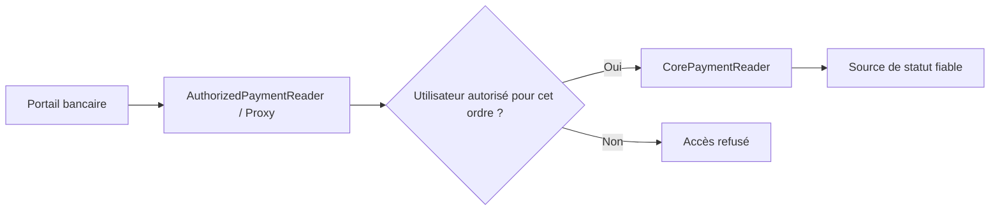
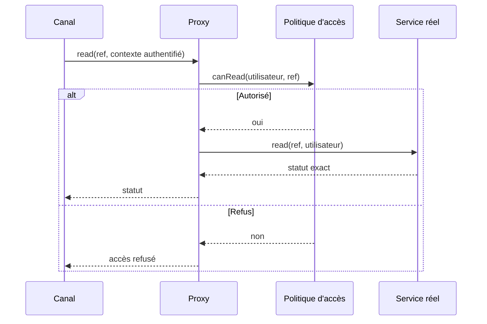

# Cours 62 — Proxy (GoF Java)

> Formation d'architecture bancaire · Banque fictive · Virement SEPA de 500 EUR · **Cours étudié ; exercice transversal répondu A, corrigé B (Proxy).**

## Objectif
Insérer un objet **intermédiaire** qui implémente la même interface que l'objet cible et **contrôle son accès** ou son utilisation : Protection Proxy, Virtual Proxy ou Remote Proxy selon le besoin.

## 1. Situation bancaire
Un utilisateur du portail consulte le statut d'un ordre SEPA de 500 EUR. Le service métier `PaymentReader` retourne les informations autorisées. Nous voulons refuser l'accès avant d'appeler le composant réel si l'utilisateur n'a pas le droit de voir cet ordre.

Un `AuthorizedPaymentReader` est un **Protection Proxy** : même interface, même opération de lecture, contrôle préalable de l'identité et de l'accès à l'objet.

## 2. Structure
- **Subject :** `PaymentReader`, interface partagée.
- **RealSubject :** `CorePaymentReader`, lecture réelle de l'état autoritatif.
- **Proxy :** `AuthorizedPaymentReader`, contrôle d'accès puis délégation.
- **Client :** portail ou cas d'usage.



## 3. Exemple Java pédagogique
```java
interface PaymentReader {
    PaymentStatus read(String reference, UserContext user);
}

interface PaymentAccessPolicy {
    boolean canRead(UserContext user, String reference);
}

final class AuthorizedPaymentReader implements PaymentReader {
    private final PaymentReader target;
    private final PaymentAccessPolicy policy;

    AuthorizedPaymentReader(PaymentReader target,
                            PaymentAccessPolicy policy) {
        this.target = target;
        this.policy = policy;
    }

    @Override
    public PaymentStatus read(String reference, UserContext user) {
        if (!policy.canRead(user, reference)) {
            throw new SecurityException("Accès refusé");
        }
        return target.read(reference, user);
    }
}
```

Types `PaymentStatus` et `UserContext` pédagogiques. `UserContext` doit provenir d'une identité **authentifiée et vérifiée**, jamais d'un identifiant librement fourni par le navigateur. Les permissions objet doivent être évaluées à partir de sources fiables.

## 4. Séquence nominale et refus


## 5. Règles de sécurité et limites
1. Contrôler **l'accès à l'objet**, pas seulement le rôle global de l'utilisateur.
2. Le service réel doit rester protégé contre les contournements : réseau, identité et contrôles au bon niveau de confiance.
3. Un Proxy Java local **ne remplace pas** OAuth2/OIDC, mTLS, IAM, PEP/PDP ni une API Gateway.
4. Un Proxy distant peut masquer un appel réseau : documenter latence, timeout, reprise et sémantique des erreurs.
5. Un refus ne doit pas divulguer si une référence de paiement appartenant à autrui existe.
6. Le statut `reçu` ou `transmis` n'est pas une confirmation de règlement.
7. Un Proxy ne réalise pas l'idempotence financière par sa simple présence.

**Comparaison :** Facade simplifie une interface de sous-système ; Proxy protège/contrôle l'accès à une cible en préservant son contrat ; Decorator ajoute un comportement complémentaire à l'objet enveloppé.

## 6. Tests d'architecture
- Autorisé : une lecture du service réel, statut inchangé.
- Non autorisé : **zéro appel** au service réel et réponse non révélatrice.
- Contexte utilisateur forgé ou absent : rejet.
- Contournement du Proxy : accès bloqué par les protections du service et de la plateforme.
- Panne de la politique : refus par défaut suivant une stratégie de sécurité documentée.
- Latence ajoutée et erreurs : budget et observabilité vérifiés.

## 7. Exercice corrigé
**Question transversale posée en session :** ajouter un contrôle d'accès devant un service de paiement sans modifier son interface.

- **A.** Facade : simplification des appels ; **incorrect** pour cet objectif principal.
- **B.** Proxy : interception et autorisation avant délégation ; **correct**.
- **C.** Flyweight : partage de données pour la mémoire ; **incorrect**.

**Réponse : B — Proxy.** En session, la réponse donnée était A : l'erreur a été corrigée. Cela ne constitue pas une validation du quiz ; le point reste à réviser.

## 8. Question d'entretien
**Un Proxy Java suffit-il pour sécuriser un microservice OpenShift ?** Non : il fait partie d'une défense en profondeur. Le service doit lui-même vérifier l'autorisation et protéger les accès directs ; la sécurité du transport et l'identité restent nécessaires.

[Retour à l'index](README.md) · [Exercices 59–62](exercices-et-corriges/cours-59-62.md) · [Référence GoF](../../19-java-design-patterns-gof/06-proxy/README.md)
