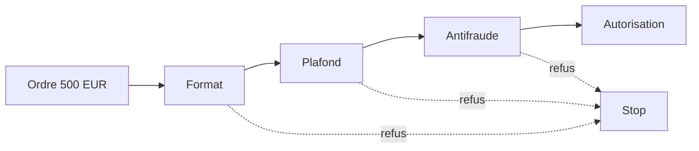
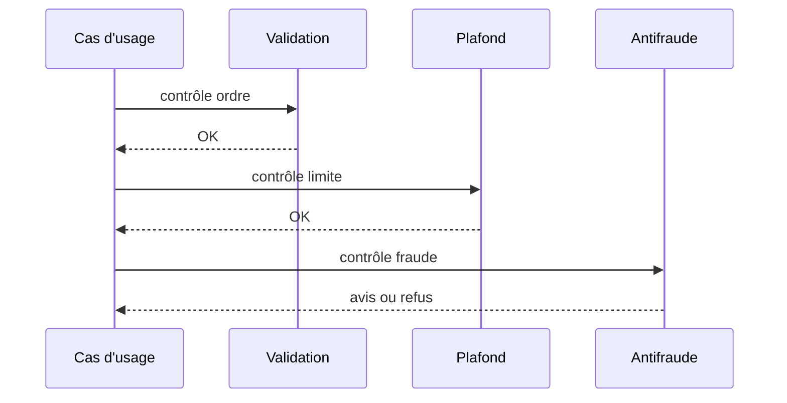

# Cours 63 — Chain of Responsibility (GoF comportemental)

> Parcours architecture bancaire fictif · Exemple de paiement SEPA 500 EUR · **Cours présenté en synthèse ; exercice individuel à valider.**

## 1. Objectif
Faire traverser un ordre par plusieurs handlers, chacun décidant de traiter, de refuser ou de transmettre.

## 2. Situation bancaire
Pour un virement SEPA fictif de 500 EUR : validation syntaxique, plafond, antifraude et autorisation. Le premier refus arrête le parcours ; une acceptation finale nécessite tous les contrôles obligatoires.

## 3. Principe et rôles
Handler (contrat `PaymentCheck`) ; ConcreteHandlers (`FormatCheck`, `LimitCheck`, `FraudCheck`) ; client (cas d'usage) ; chaînage configuré et vérifié.

### Diagramme logique


## 4. Fragment Java pédagogique
```java
interface PaymentCheck {
    void check(PaymentOrder order); // lève un refus métier explicite
}
final class PaymentCheckChain {
    private final List<PaymentCheck> orderedChecks;
    PaymentCheckChain(List<PaymentCheck> orderedChecks) {
        this.orderedChecks = List.copyOf(orderedChecks);
    }
    void validate(PaymentOrder order) {
        for (PaymentCheck check : orderedChecks) {
            check.check(order); // arrêt à la première exception de refus
        }
    }
}
```

**Portée de l'exemple :** les types `PaymentOrder`, `PaymentView`, services, politiques, exceptions, objets de résultat et éventuelles méthodes auxiliaires sont des contrats fictifs à définir selon le cas ; le fragment illustre le pattern, sans être une application bancaire exécutable autonome.

## 5. Séquence d'interaction


## 6. Invariants, limites et arbitrages
1. Les contrôles obligatoires ne peuvent pas être retirés ou réordonnés arbitrairement.
2. La chaîne ne prouve ni réservation des fonds ni règlement ; l'autorité bancaire reste distincte.
3. Si un contrôle externe expire, appliquer une politique documentée plutôt que traiter un inconnu comme un accord.

## 7. Tests et preuves d'architecture
- Ordre conforme : chaque contrôle obligatoire est appelé exactement une fois.
- Plafond refusé : antifraude et autorisation ne sont pas appelées.
- Timeout antifraude : statut indéterminé/traitement suspendu selon la politique, jamais succès implicite.
- Configuration incomplète : démarrage refusé si contrôle obligatoire absent.

## 8. Exercice corrigé
**Question :** quelle proposition correspond à Chain of Responsibility dans le scénario décrit ?

- **A.** Réécrire le moteur pour ajouter un contrôle.
- **B.** Insérer un nouveau maillon au bon endroit de la chaîne.
- **C.** Ignorer les contrôles précédents.

**Bonne réponse théorique : B.** La chaîne rend les handlers interchangeables mais les contrôles obligatoires doivent rester garantis.

**Statut pédagogique :** corrigé disponible pour l'auto-étude, **pas de réponse individuelle utilisateur enregistrée pour ce quiz**.

## 9. Question d'entretien
Qu'est-ce qui distingue cette chaîne d'une orchestration métier ? Une chaîne distribue la responsabilité du traitement de la demande ; une orchestration coordonne un processus et ses étapes métier, éventuellement distribuées.

[Retour à la formation](README.md) · [Exercices GoF 63–73](exercices-et-corriges/cours-63-73.md) · [Catalogue GoF existant](../../19-java-design-patterns-gof/README.md)
