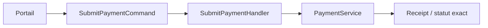
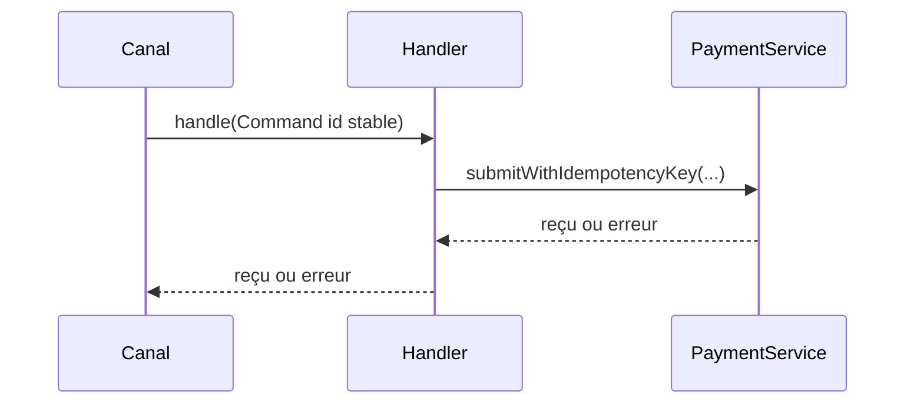

# Cours 64 — Command (GoF comportemental)

> Parcours architecture bancaire fictif · Exemple de paiement SEPA 500 EUR · **Cours présenté en synthèse ; exercice individuel à valider.**

## 1. Objectif
Encapsuler une intention d'action et ses paramètres dans un objet indépendant de l'émetteur.

## 2. Situation bancaire
Le portail crée une intention `SubmitPaymentCommand` contenant l'identifiant de demande, le montant de 500 EUR et les références utiles. Un handler responsable applique les contrôles puis demande l'initiation du paiement.

## 3. Principe et rôles
Command (intention immuable) ; Invoker (canal ou bus interne) ; Handler/Receiver (service métier responsable) ; Result (statut exact).

### Diagramme logique


## 4. Fragment Java pédagogique
```java
record SubmitPaymentCommand(String requestId,
                            String debtorRef,
                            String beneficiaryRef,
                            BigDecimal amount) {}
interface CommandHandler<C, R> { R handle(C command); }
final class SubmitPaymentHandler
        implements CommandHandler<SubmitPaymentCommand, SubmissionReceipt> {
    private final PaymentService payments;
    public SubmissionReceipt handle(SubmitPaymentCommand c) {
        return payments.submitWithIdempotencyKey(
            c.requestId(), c.debtorRef(), c.beneficiaryRef(), c.amount());
    }
}
```

**Portée de l'exemple :** les types `PaymentOrder`, `PaymentView`, services, politiques, exceptions, objets de résultat et éventuelles méthodes auxiliaires sont des contrats fictifs à définir selon le cas ; le fragment illustre le pattern, sans être une application bancaire exécutable autonome.

## 5. Séquence d'interaction


## 6. Invariants, limites et arbitrages
1. La présence d'un objet Command ne garantit pas idempotence, persistance ni exactly-once.
2. Répéter le même identifiant ne doit pas créer un second effet financier ; la garantie appartient au service d'exécution.
3. L'undo d'une commande n'est pas l'annulation d'un paiement déjà réglé.

## 7. Tests et preuves d'architecture
- Commande valide : même contrat, statut retourné inchangé.
- Deux commandes identiques : une seule exécution métier selon la politique d'idempotence.
- Timeout après soumission : rechercher le résultat via l'identifiant stable.
- Commande rejetée : erreur explicite, absence de règlement inventé.

## 8. Exercice corrigé
**Question :** quelle proposition correspond à Command dans le scénario décrit ?

- **A.** Créer un objet de commande et un handler spécialisé.
- **B.** Faire interpréter les commandes uniquement par des vues SQL.
- **C.** Transformer toute commande en ordre réglé sans vérification.

**Bonne réponse théorique : A.** Command dissocie l'intention de l'émetteur et de son exécution.

**Statut pédagogique :** corrigé disponible pour l'auto-étude, **pas de réponse individuelle utilisateur enregistrée pour ce quiz**.

## 9. Question d'entretien
Comment Command se distingue-t-il de CQRS ? Command est un pattern objet ; CQRS sépare modèles de commande et de consultation, éventuellement à l'échelle du système.

[Retour à la formation](README.md) · [Exercices GoF 63–73](exercices-et-corriges/cours-63-73.md) · [Catalogue GoF existant](../../19-java-design-patterns-gof/04-command/README.md)
