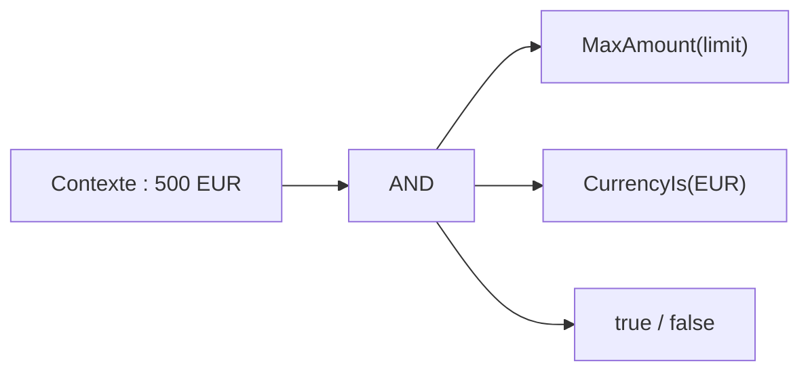
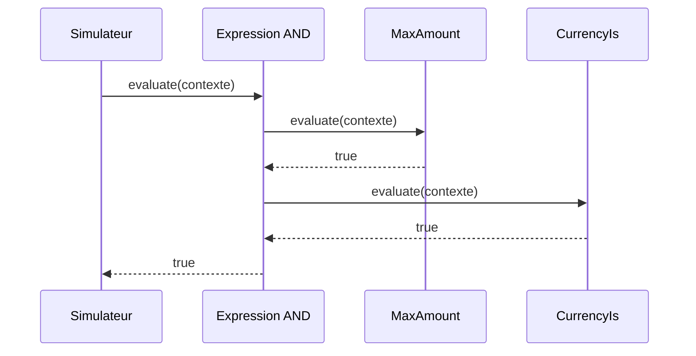

# Cours 65 — Interpreter (GoF comportemental)

> Parcours architecture bancaire fictif · Exemple de paiement SEPA 500 EUR · **Cours présenté en synthèse ; exercice individuel à valider.**

## 1. Objectif
Représenter une petite grammaire par des expressions composables et interpréter ces expressions.

## 2. Situation bancaire
Dans un simulateur pédagogique de validation, une règle simple dit : « montant inférieur ou égal au plafond ET devise EUR ». Une expression syntaxique est évaluée sur le contexte de demande. Ce mécanisme ne remplace pas un moteur réglementaire homologué.

## 3. Principe et rôles
Expression (AST) ; expressions terminales (`BelowLimit`, `IsCurrency`) ; expression composée (`And`) ; contexte métier en lecture.

### Diagramme logique


## 4. Fragment Java pédagogique
```java
record CheckContext(BigDecimal amount, String currency) {}
interface RuleExpression {
    boolean evaluate(CheckContext context);
}
record MaxAmount(BigDecimal limit) implements RuleExpression {
    public boolean evaluate(CheckContext c) {
        return c.amount().compareTo(limit) <= 0;
    }
}
record CurrencyIs(String expected) implements RuleExpression {
    public boolean evaluate(CheckContext c) {
        return expected.equals(c.currency());
    }
}
record And(RuleExpression left, RuleExpression right)
        implements RuleExpression {
    public boolean evaluate(CheckContext c) {
        return left.evaluate(c) && right.evaluate(c);
    }
}
// new And(new MaxAmount(limit), new CurrencyIs("EUR"))
```

**Portée de l'exemple :** les types `PaymentOrder`, `PaymentView`, services, politiques, exceptions, objets de résultat et éventuelles méthodes auxiliaires sont des contrats fictifs à définir selon le cas ; le fragment illustre le pattern, sans être une application bancaire exécutable autonome.

## 5. Séquence d'interaction


## 6. Invariants, limites et arbitrages
1. Grammaire petite et bornée ; ne jamais exécuter de code arbitraire provenant d'une règle utilisateur.
2. Le seuil est une donnée de configuration validée, non une valeur inventée pour la banque.
3. Les règles doivent être versionnées, testées et éventuellement justifiées pour l'audit.
4. Pour un ensemble réglementaire riche, comparer à DMN/ODM plutôt que construire un interpréteur ad hoc.

## 7. Tests et preuves d'architecture
- Montant sous le plafond et devise EUR : vrai.
- Montant au-dessus du plafond : faux.
- Devise non EUR : faux.
- Expression malformée ou trop profonde : rejet avant l'évaluation.
- Version de règle identifiée sur chaque décision simulée.

## 8. Exercice corrigé
**Question :** quelle proposition correspond à Interpreter dans le scénario décrit ?

- **A.** Évaluer une grammaire contrôlée d'expressions métier.
- **B.** Exécuter n'importe quelle expression Java transmise par un client.
- **C.** Remplacer toutes les décisions réglementaires par un `eval` dynamique.

**Bonne réponse théorique : A.** Interpreter correspond à une grammaire explicite et à ses expressions évaluables.

**Statut pédagogique :** corrigé disponible pour l'auto-étude, **pas de réponse individuelle utilisateur enregistrée pour ce quiz**.

## 9. Question d'entretien
Quand éviter Interpreter ? Si un simple `if` suffit ou si la grammaire devient coûteuse, préférer une règle explicite ou un moteur de décision spécialisé.

[Retour à la formation](README.md) · [Exercices GoF 63–73](exercices-et-corriges/cours-63-73.md) · [Catalogue GoF existant](../../19-java-design-patterns-gof/README.md)
