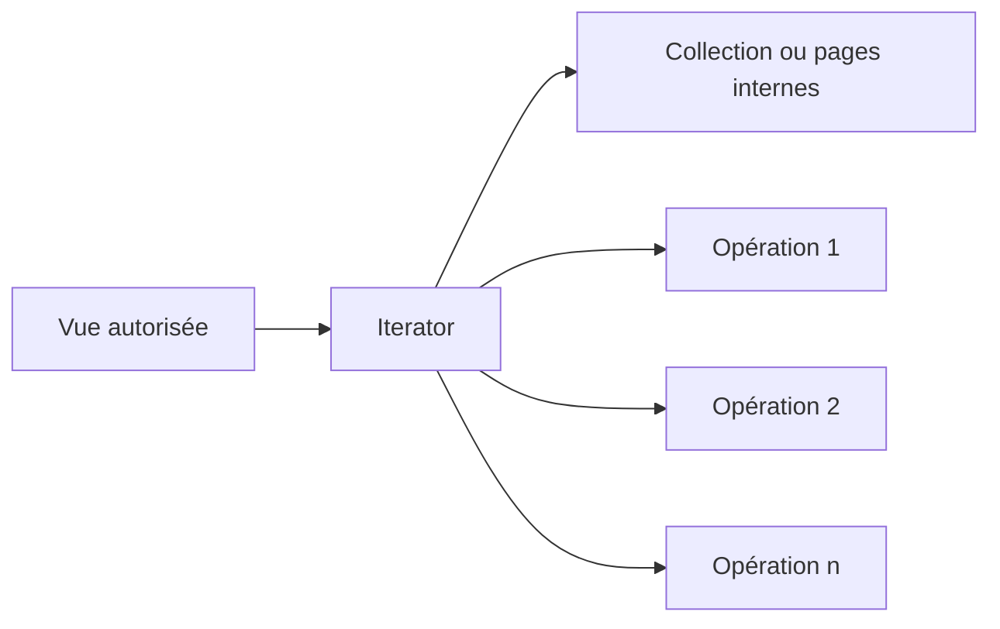
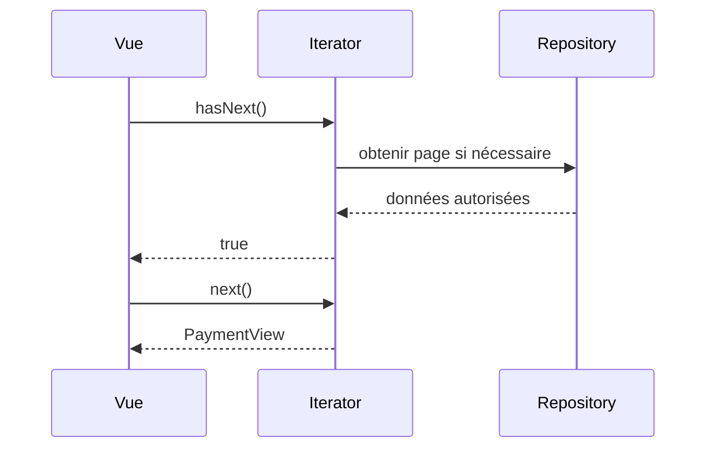

# Cours 66 — Iterator (GoF comportemental)

> Parcours architecture bancaire fictif · Exemple de paiement SEPA 500 EUR · **Cours présenté en synthèse ; exercice individuel à valider.**

## 1. Objectif
Parcourir les éléments d'un agrégat ou d'une collection sans exposer sa représentation interne.

## 2. Situation bancaire
Un outil de consultation parcourt les lignes du relevé d'un client. L'appelant lit les opérations via un `Iterator` sans savoir si elles viennent d'une liste en mémoire ou de pages récupérées auprès d'un dépôt.

## 3. Principe et rôles
Aggregate/collection ; Iterator ; client ; source de lecture protégée par le service compétent.

### Diagramme logique


## 4. Fragment Java pédagogique
```java
interface PaymentHistory {
    Iterator<PaymentView> iteratorFor(AuthorizedUser user);
}
void printLabels(PaymentHistory history, AuthorizedUser user) {
    Iterator<PaymentView> cursor = history.iteratorFor(user);
    while (cursor.hasNext()) {
        PaymentView view = cursor.next();
        render(view); // lecture seule
    }
}
```

**Portée de l'exemple :** les types `PaymentOrder`, `PaymentView`, services, politiques, exceptions, objets de résultat et éventuelles méthodes auxiliaires sont des contrats fictifs à définir selon le cas ; le fragment illustre le pattern, sans être une application bancaire exécutable autonome.

## 5. Séquence d'interaction


## 6. Invariants, limites et arbitrages
1. Le parcours ne doit pas contourner les droits d'accès : filtrage au niveau de la source.
2. Sur une base évolutive, pagination et ordre stable sont essentiels pour éviter sauts/doublons.
3. Iterator n'est pas un protocole de streaming distribué ni une garantie de snapshot cohérent.
4. Un flux très volumineux exige bornage de mémoire et gestion des ressources.

## 7. Tests et preuves d'architecture
- Collection vide : `hasNext()` est faux.
- Trois éléments autorisés : lecture dans l'ordre défini et sans duplication.
- Page suivante : pas de disparition d'élément en pagination stable.
- Utilisateur non autorisé : aucun résultat.
- Ressource DB fermée après parcours ou erreur.

## 8. Exercice corrigé
**Question :** quelle proposition correspond à Iterator dans le scénario décrit ?

- **A.** Forcer chaque client à connaître le schéma de la base.
- **B.** Exposer un Iterator au-dessus de la collection autorisée.
- **C.** Charger sans limite toutes les transactions dans la JVM.

**Bonne réponse théorique : B.** Iterator fournit un parcours encapsulé, indépendant du stockage.

**Statut pédagogique :** corrigé disponible pour l'auto-étude, **pas de réponse individuelle utilisateur enregistrée pour ce quiz**.

## 9. Question d'entretien
Iterator et pagination sont-ils identiques ? Non : Iterator est une interface de parcours ; la pagination est une technique possible d'accès aux données.

[Retour à la formation](README.md) · [Exercices GoF 63–73](exercices-et-corriges/cours-63-73.md) · [Catalogue GoF existant](../../19-java-design-patterns-gof/README.md)
