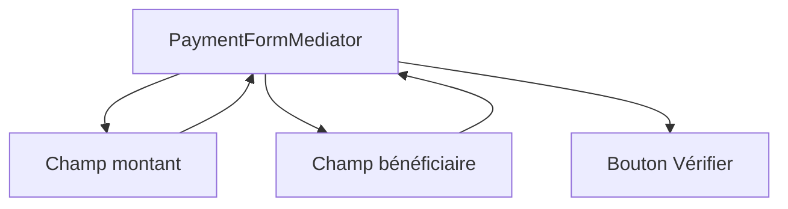
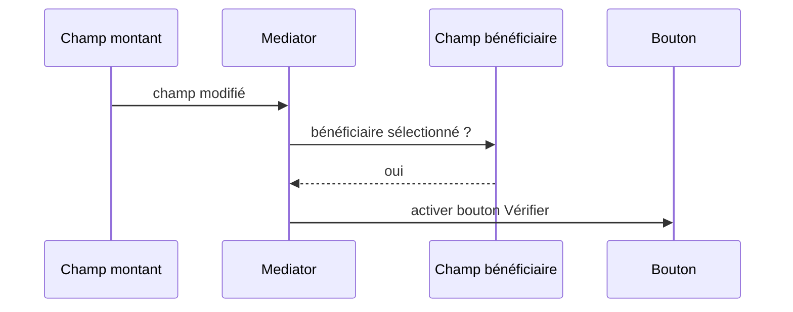

# Cours 67 — Mediator (GoF comportemental)

> Parcours architecture bancaire fictif · Exemple de paiement SEPA 500 EUR · **Cours présenté en synthèse ; exercice individuel à valider.**

## 1. Objectif
Centraliser la coordination des interactions entre plusieurs objets pour éviter qu'ils se connaissent tous.

## 2. Situation bancaire
Dans un formulaire de virement, le champ montant, la sélection du bénéficiaire et le bouton « Vérifier » interagissent. Le médiateur de formulaire actualise les messages et l'état du bouton sans créer un réseau de références entre widgets.

## 3. Principe et rôles
Mediator (`PaymentFormMediator`) ; collègues (`AmountField`, `BeneficiaryField`, `VerifyButton`) ; événements UI.

### Diagramme logique


## 4. Fragment Java pédagogique
```java
interface PaymentFormView {
    BigDecimal amount();
    boolean hasBeneficiary();
    void setVerifyEnabled(boolean enabled);
}
final class PaymentFormMediator {
    private final PaymentFormView view;
    PaymentFormMediator(PaymentFormView view) { this.view = view; }
    void onFieldChanged() {
        boolean ready = view.amount() != null
                     && view.amount().signum() > 0
                     && view.hasBeneficiary();
        view.setVerifyEnabled(ready);
    }
}
```

**Portée de l'exemple :** les types `PaymentOrder`, `PaymentView`, services, politiques, exceptions, objets de résultat et éventuelles méthodes auxiliaires sont des contrats fictifs à définir selon le cas ; le fragment illustre le pattern, sans être une application bancaire exécutable autonome.

## 5. Séquence d'interaction


## 6. Invariants, limites et arbitrages
1. La coordination UI n'est pas une preuve que le paiement est autorisé.
2. Éviter le « God Mediator » qui concentre toutes les règles métier et toutes les interactions.
3. Un Mediator objet ne remplace ni Kafka ni une Saga distribuée.
4. Les contrôles doivent être refaits côté serveur avant toute exécution.

## 7. Tests et preuves d'architecture
- Montant invalide : bouton désactivé.
- Montant positif et bénéficiaire choisi : bouton activé.
- Changement de bénéficiaire : recalcul de la présentation.
- Appel API manuel contournant l'UI : le service refuse les données invalides.
- La logique métier d'autorisation demeure hors du médiateur.

## 8. Exercice corrigé
**Question :** quelle proposition correspond à Mediator dans le scénario décrit ?

- **A.** Mettre chaque widget en dépendance directe de tous les autres.
- **B.** Centraliser la coordination des widgets dans un Mediator.
- **C.** Faire du formulaire la source autoritative des plafonds bancaires.

**Bonne réponse théorique : B.** Mediator réduit le couplage des objets collaborant au sein du même formulaire.

**Statut pédagogique :** corrigé disponible pour l'auto-étude, **pas de réponse individuelle utilisateur enregistrée pour ce quiz**.

## 9. Question d'entretien
Mediator contre Facade : Mediator coordonne les interactions entre collègues, Facade expose une interface simplifiée à un sous-système.

[Retour à la formation](README.md) · [Exercices GoF 63–73](exercices-et-corriges/cours-63-73.md) · [Catalogue GoF existant](../../19-java-design-patterns-gof/README.md)
