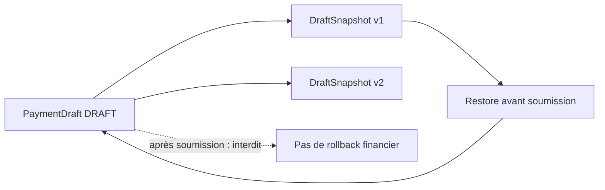
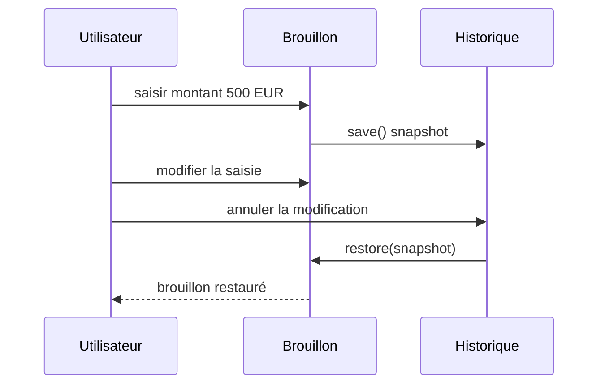

# Cours 68 — Memento (GoF comportemental)

> Parcours architecture bancaire fictif · Exemple de paiement SEPA 500 EUR · **Cours présenté en synthèse ; exercice individuel à valider.**

## 1. Objectif
Capturer un état interne pour pouvoir le restaurer plus tard sans exposer les détails de l'objet.

## 2. Situation bancaire
Un utilisateur remplit un brouillon de virement de 500 EUR. Avant de changer de bénéficiaire, l'interface capture une version du brouillon. Elle peut rétablir cette saisie tant que l'ordre n'a jamais été soumis à exécution.

## 3. Principe et rôles
Originator (`PaymentDraft`) ; Memento (`DraftSnapshot` immuable) ; Caretaker (`DraftHistory`) ; frontière `DRAFT` uniquement.

### Diagramme logique


## 4. Fragment Java pédagogique
```java
record DraftSnapshot(String beneficiaryRef,
                     BigDecimal amount, long version) {}
final class PaymentDraft {
    private String beneficiaryRef;
    private BigDecimal amount;
    private long version;
    private boolean submitted;
    DraftSnapshot save() {
        if (submitted) throw new IllegalStateException("Soumis");
        return new DraftSnapshot(beneficiaryRef, amount, version);
    }
    void restore(DraftSnapshot snapshot) {
        if (submitted) throw new IllegalStateException("Soumis");
        this.beneficiaryRef = snapshot.beneficiaryRef();
        this.amount = snapshot.amount();
        this.version++;
    }
}
```

**Portée de l'exemple :** les types `PaymentOrder`, `PaymentView`, services, politiques, exceptions, objets de résultat et éventuelles méthodes auxiliaires sont des contrats fictifs à définir selon le cas ; le fragment illustre le pattern, sans être une application bancaire exécutable autonome.

## 5. Séquence d'interaction


## 6. Invariants, limites et arbitrages
1. Un snapshot ne restaure que le brouillon, jamais un paiement soumis ou réglé.
2. Les snapshots peuvent porter des données sensibles : limiter la rétention, l'accès et le chiffrement.
3. Contrôler version et concurrence lors de la restauration.
4. Après restauration, les validations doivent être refaites avant soumission.

## 7. Tests et preuves d'architecture
- Sauvegarder puis modifier : restore retrouve les champs du brouillon.
- Snapshot immuable : sa valeur ne change pas quand l'objet évolue.
- Ordre soumis : restauration refusée.
- Snapshot périmé : gestion de version documentée.
- La restauration ne génère aucun ordre ni écriture financière.

## 8. Exercice corrigé
**Question :** quelle proposition correspond à Memento dans le scénario décrit ?

- **A.** Utiliser Memento pour annuler un règlement irrévocable.
- **B.** Capturer une copie immuable d'un brouillon avant sa soumission.
- **C.** Effacer l'historique financier lors de la restauration.

**Bonne réponse théorique : B.** Memento restaure un état applicatif local dans un domaine où cette restauration est permise.

**Statut pédagogique :** corrigé disponible pour l'auto-étude, **pas de réponse individuelle utilisateur enregistrée pour ce quiz**.

## 9. Question d'entretien
Pourquoi Memento n'est pas Event Sourcing ? Memento capture des snapshots d'état ; Event Sourcing conserve les événements métiers comme source de vérité.

[Retour à la formation](README.md) · [Exercices GoF 63–73](exercices-et-corriges/cours-63-73.md) · [Catalogue GoF existant](../../19-java-design-patterns-gof/README.md)
