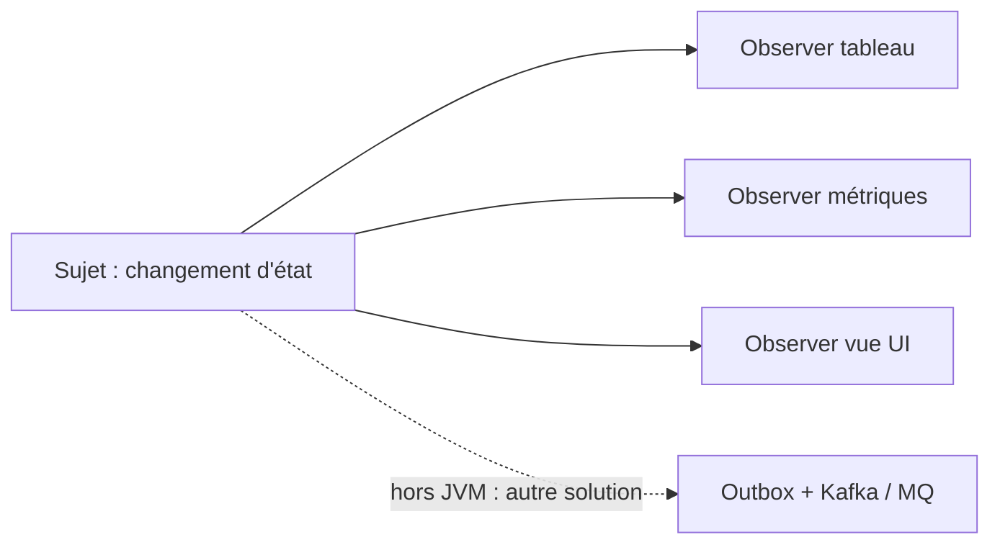
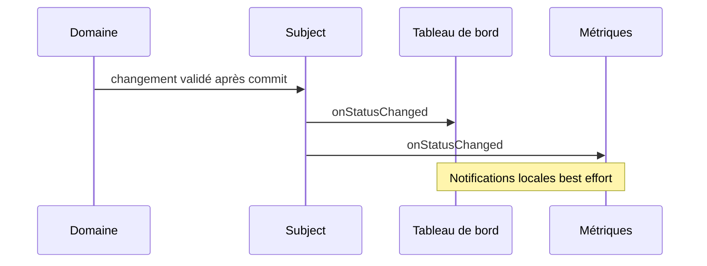

# Cours 69 — Observer (GoF comportemental)

> Parcours architecture bancaire fictif · Exemple de paiement SEPA 500 EUR · **Cours présenté en synthèse ; exercice individuel à valider.**

## 1. Objectif
Faire notifier automatiquement un ou plusieurs objets abonnés lorsqu'un sujet publie un changement.

## 2. Situation bancaire
Après confirmation en base de l'état d'un ordre, une application peut mettre à jour localement son tableau de bord et son compteur d'ordres. Les observers sont des objets du même processus, non des consommateurs Kafka externes.

## 3. Principe et rôles
Subject (source d'événements applicatifs) ; Observer (contrat de rappel) ; abonnés (tableau de bord, métriques) ; événement de changement d'état.

### Diagramme logique


## 4. Fragment Java pédagogique
```java
interface PaymentObserver {
    void onStatusChanged(PaymentStatusChange change);
}
final class PaymentNotifications {
    private final List<PaymentObserver> observers;
    PaymentNotifications(List<PaymentObserver> observers) {
        this.observers = List.copyOf(observers);
    }
    void notifyAfterCommit(PaymentStatusChange change) {
        for (PaymentObserver observer : observers) {
            try { observer.onStatusChanged(change); }
            catch (RuntimeException e) { reportMonitoringFailure(e); }
        }
    }
}
```

**Portée de l'exemple :** les types `PaymentOrder`, `PaymentView`, services, politiques, exceptions, objets de résultat et éventuelles méthodes auxiliaires sont des contrats fictifs à définir selon le cas ; le fragment illustre le pattern, sans être une application bancaire exécutable autonome.

## 5. Séquence d'interaction


## 6. Invariants, limites et arbitrages
1. Ne pas publier des changements d'état considérés définitifs avant la transaction source.
2. Un observer peut échouer ou perdre une notification lors d'une panne de processus.
3. Observer in-process n'offre pas durable delivery ni exactly-once.
4. Pour informer d'autres systèmes avec garantie de reprise, envisager Outbox et broker.

## 7. Tests et preuves d'architecture
- État réellement modifié : chaque abonné local reçoit la notification.
- Transaction annulée : aucune notification de succès définitif.
- Observer fautif : politique d'isolation et diagnostic explicite.
- Redémarrage JVM : les notifications non durables ne sont pas supposées récupérées.
- Aucun observer ne devient source autoritative du règlement.

## 8. Exercice corrigé
**Question :** quelle proposition correspond à Observer dans le scénario décrit ?

- **A.** Observer garantit automatiquement livraison durable entre datacenters.
- **B.** Utiliser Observer pour prévenir plusieurs objets locaux d'un changement.
- **C.** Considérer les vues observer comme registre financier maître.

**Bonne réponse théorique : B.** Observer établit la relation sujet-abonnés, sans fournir une messagerie durable distribuée.

**Statut pédagogique :** corrigé disponible pour l'auto-étude, **pas de réponse individuelle utilisateur enregistrée pour ce quiz**.

## 9. Question d'entretien
Observer vs Publish/Subscribe : mêmes idées de notification, mais l'Observer GoF est d'abord un pattern objet ; pub/sub distribué nécessite broker, contrats et garanties réseau.

[Retour à la formation](README.md) · [Exercices GoF 63–73](exercices-et-corriges/cours-63-73.md) · [Catalogue GoF existant](../../19-java-design-patterns-gof/08-observer/README.md)
