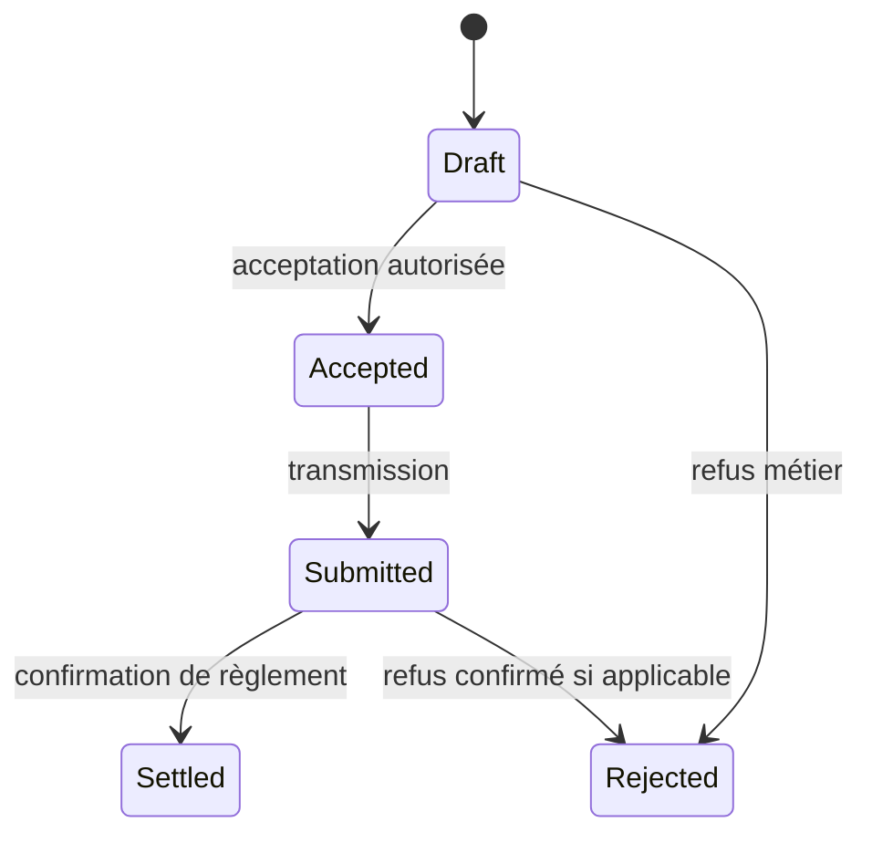
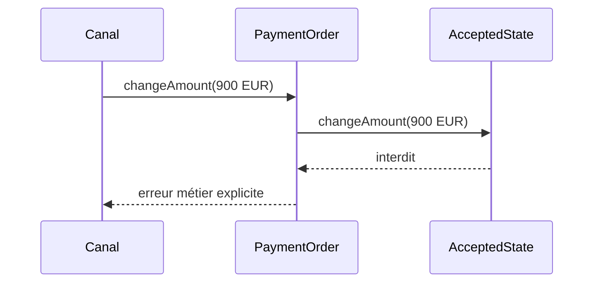

# Cours 70 — State (GoF comportemental)

> Parcours architecture bancaire fictif · Exemple de paiement SEPA 500 EUR · **Cours présenté en synthèse ; exercice individuel à valider.**

## 1. Objectif
Faire varier le comportement d'un objet selon son état interne en déléguant les actions aux objets d'état.

## 2. Situation bancaire
Un ordre SEPA peut être en brouillon, accepté, rejeté ou réglé. Certaines actions sont possibles en brouillon mais impossibles après acceptation. Le pattern State rend ces transitions explicites.

## 3. Principe et rôles
Context (`PaymentOrder`) ; State (`PaymentState`) ; ConcreteState (`DraftState`, `AcceptedState`, etc.) ; transitions validées.

### Diagramme logique


## 4. Fragment Java pédagogique
```java
interface PaymentState {
    PaymentState changeAmount(BigDecimal newAmount);
}
final class DraftState implements PaymentState {
    public PaymentState changeAmount(BigDecimal newAmount) {
        if (newAmount.signum() <= 0)
            throw new IllegalArgumentException("Montant invalide");
        return this; // mise à jour effective gérée par l'agrégat
    }
}
final class AcceptedState implements PaymentState {
    public PaymentState changeAmount(BigDecimal newAmount) {
        throw new IllegalStateException("Ordre accepté, changement interdit");
    }
}
```

**Portée de l'exemple :** les types `PaymentOrder`, `PaymentView`, services, politiques, exceptions, objets de résultat et éventuelles méthodes auxiliaires sont des contrats fictifs à définir selon le cas ; le fragment illustre le pattern, sans être une application bancaire exécutable autonome.

## 5. Séquence d'interaction


## 6. Invariants, limites et arbitrages
1. Les transitions réelles dépendent du rail et du métier ; le diagramme est seulement pédagogique.
2. « Réglé » ne peut être affirmé que par une preuve de règlement de la source compétente.
3. Un simple `enum` peut suffire si les comportements sont peu nombreux.
4. Protéger les transitions concurrentes et les invariants dans l'agrégat et son stockage.

## 7. Tests et preuves d'architecture
- Brouillon : opération de modification admise et montant valide.
- Accepté : changement de montant refusé.
- Transition interdite : statut inchangé.
- Notifications et métriques ne forcent pas une transition de règlement.
- Concurrence : deux transitions concurrentes ne corrompent pas l'état.

## 8. Exercice corrigé
**Question :** quelle proposition correspond à State dans le scénario décrit ?

- **A.** Autoriser tous les changements quel que soit l'état.
- **B.** Mettre la totalité du comportement dans le formulaire UI.
- **C.** Déléguer chaque action à l'état responsable de ses transitions autorisées.

**Bonne réponse théorique : C.** State encapsule le comportement propre à chaque état et évite des conditions dispersées.

**Statut pédagogique :** corrigé disponible pour l'auto-étude, **pas de réponse individuelle utilisateur enregistrée pour ce quiz**.

## 9. Question d'entretien
State ou Strategy ? State évolue avec le cycle de vie de l'objet ; Strategy sélectionne une famille d'algorithmes indépendants de son état.

[Retour à la formation](README.md) · [Exercices GoF 63–73](exercices-et-corriges/cours-63-73.md) · [Catalogue GoF existant](../../19-java-design-patterns-gof/09-state/README.md)
