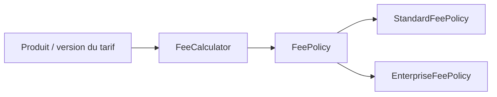
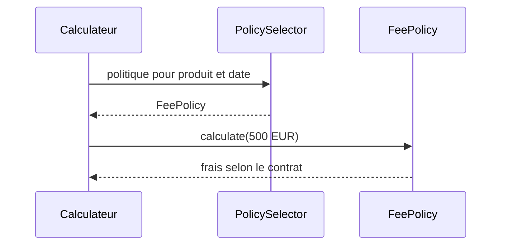

# Cours 71 — Strategy (GoF comportemental)

> Parcours architecture bancaire fictif · Exemple de paiement SEPA 500 EUR · **Cours présenté en synthèse ; exercice individuel à valider.**

## 1. Objectif
Définir une famille d'algorithmes interchangeables sélectionnés en fonction du contexte métier.

## 2. Situation bancaire
Le simulateur de frais présente un produit standard et un produit entreprise. La politique de calcul applicable peut différer, tout en gardant un contrat de calcul commun. Les chiffres fictifs ne constituent pas une tarification réelle.

## 3. Principe et rôles
Strategy (`FeePolicy`) ; ConcreteStrategies (standard, entreprise) ; Context (`FeeCalculator`) ; sélection contrôlée par produit et date de validité.

### Diagramme logique


## 4. Fragment Java pédagogique
```java
interface FeePolicy {
    BigDecimal calculate(BigDecimal amount);
}
final class FixedFeePolicy implements FeePolicy {
    private final BigDecimal fixed;
    FixedFeePolicy(BigDecimal fixed) { this.fixed = fixed; }
    public BigDecimal calculate(BigDecimal amount) { return fixed; }
}
final class FeeCalculator {
    private final FeePolicy policy;
    FeeCalculator(FeePolicy policy) { this.policy = policy; }
    BigDecimal feeFor(BigDecimal amount) {
        return policy.calculate(amount);
    }
}
```

**Portée de l'exemple :** les types `PaymentOrder`, `PaymentView`, services, politiques, exceptions, objets de résultat et éventuelles méthodes auxiliaires sont des contrats fictifs à définir selon le cas ; le fragment illustre le pattern, sans être une application bancaire exécutable autonome.

## 5. Séquence d'interaction


## 6. Invariants, limites et arbitrages
1. Sélectionner uniquement des politiques validées, datées et applicables au produit.
2. Le montant des frais n'est pas inventé par le pattern ; règles métier et autorité tarifaire séparées.
3. Le code de calcul doit utiliser BigDecimal et des règles d'arrondi explicites.
4. Une stratégie interchangeable ne signifie pas changement libre d'algorithme après validation d'un ordre.

## 7. Tests et preuves d'architecture
- Deux produits : politiques distinctes et sélection correcte.
- Montant limite : arrondis et valeurs monétaires exacts.
- Politique absente ou expirée : refus explicite.
- Règles versionnées : reproductibilité d'un calcul passé.
- Algorithme remplacé : interface du client inchangée.

## 8. Exercice corrigé
**Question :** quelle proposition correspond à Strategy dans le scénario décrit ?

- **A.** Sélectionner une implémentation de FeePolicy selon le produit.
- **B.** Modifier la logique de paiement par copier-coller pour chaque produit.
- **C.** Utiliser Memento pour calculer les frais.

**Bonne réponse théorique : A.** Strategy rend les algorithmes interchangeables à travers une interface.

**Statut pédagogique :** corrigé disponible pour l'auto-étude, **pas de réponse individuelle utilisateur enregistrée pour ce quiz**.

## 9. Question d'entretien
Strategy vs Bridge : les deux utilisent la composition, mais Strategy remplace un algorithme ; Bridge sépare deux dimensions structurantes d'évolution.

[Retour à la formation](README.md) · [Exercices GoF 63–73](exercices-et-corriges/cours-63-73.md) · [Catalogue GoF existant](../../19-java-design-patterns-gof/01-strategy/README.md)
