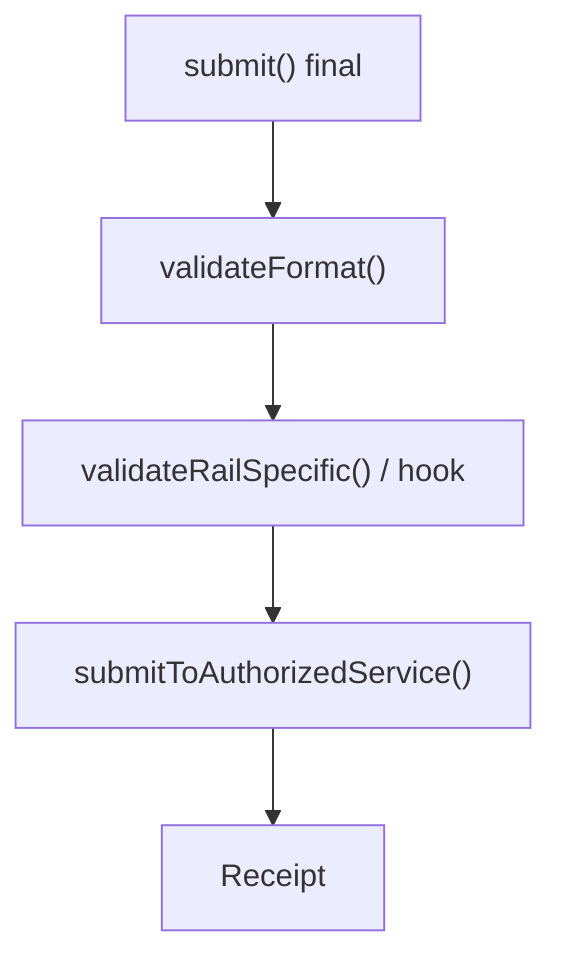
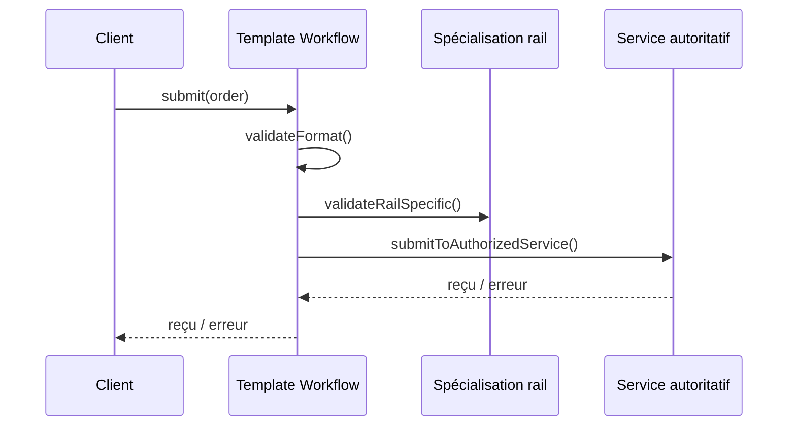

# Cours 72 — Template Method (GoF comportemental)

> Parcours architecture bancaire fictif · Exemple de paiement SEPA 500 EUR · **Cours présenté en synthèse ; exercice individuel à valider.**

## 1. Objectif
Définir dans une classe mère un algorithme commun dont certaines étapes sont spécialisées par les sous-classes.

## 2. Situation bancaire
Un moteur de simulation veut appliquer un squelette commun pour les opérations standard et instantanées : validation structurelle, contrôle spécifique au type, soumission via service compétent et retour exact du reçu.

## 3. Principe et rôles
AbstractClass (`PaymentWorkflow`) avec méthode `final` ; hooks spécialisés ; ConcreteClass pour rail standard / instantané ; service autoritatif inchangé.

### Diagramme logique


## 4. Fragment Java pédagogique
```java
abstract class PaymentWorkflow {
    final SubmissionReceipt submit(PaymentOrder order) {
        validateFormat(order);
        validateRailSpecific(order);
        return submitToAuthorizedService(order);
    }
    private void validateFormat(PaymentOrder order) {
        if (order == null) throw new IllegalArgumentException("Ordre absent");
    }
    protected abstract void validateRailSpecific(PaymentOrder order);
    protected abstract SubmissionReceipt submitToAuthorizedService(
        PaymentOrder order);
}
final class InstantPaymentWorkflow extends PaymentWorkflow {
    protected void validateRailSpecific(PaymentOrder order) {
        checkInstantRequirements(order);
    }
    protected SubmissionReceipt submitToAuthorizedService(PaymentOrder order) {
        return instantService.submit(order);
    }
}
```

**Portée de l'exemple :** les types `PaymentOrder`, `PaymentView`, services, politiques, exceptions, objets de résultat et éventuelles méthodes auxiliaires sont des contrats fictifs à définir selon le cas ; le fragment illustre le pattern, sans être une application bancaire exécutable autonome.

## 5. Séquence d'interaction


## 6. Invariants, limites et arbitrages
1. Une classe mère ne doit pas devenir propriétaire d'une logique métier partagée par hasard.
2. Les critères réglementaires, rails et délais sont spécifiques et validés par les services responsables.
3. Le résultat d'une soumission n'est pas une preuve de règlement.
4. L'héritage fige parfois trop les étapes ; Strategy/composition peut être préférable.

## 7. Tests et preuves d'architecture
- Format invalide : étape de soumission jamais atteinte.
- Standard et instantané : spécialisations appropriées.
- Séquence des étapes garantie par la méthode finale.
- Timeout : résultat indéterminé traité comme tel, aucune double exécution.
- Nouveau rail : tests de conformité et invariants refaits.

## 8. Exercice corrigé
**Question :** quelle proposition correspond à Template Method dans le scénario décrit ?

- **A.** Modifier l'ordre des étapes à chaque appel client.
- **B.** Définir un squelette fixe et des hooks spécialisés pour certains traitements.
- **C.** Conserver une copie du workflow par appelant sans contrat commun.

**Bonne réponse théorique : B.** Template Method fixe la structure de l'algorithme et délègue des variations aux sous-classes.

**Statut pédagogique :** corrigé disponible pour l'auto-étude, **pas de réponse individuelle utilisateur enregistrée pour ce quiz**.

## 9. Question d'entretien
Template Method ou Strategy ? Template Method préfère l'héritage et les hooks ; Strategy utilise la composition pour changer l'algorithme.

[Retour à la formation](README.md) · [Exercices GoF 63–73](exercices-et-corriges/cours-63-73.md) · [Catalogue GoF existant](../../19-java-design-patterns-gof/07-template-method/README.md)
