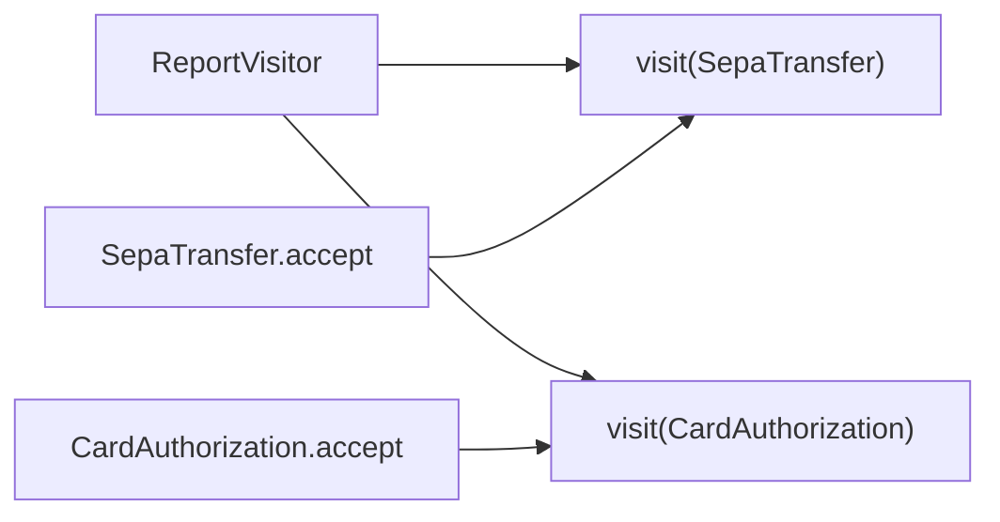
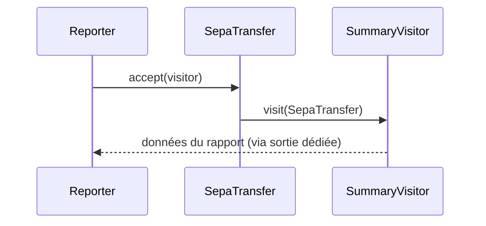

# Cours 73 — Visitor (GoF comportemental)

> Parcours architecture bancaire fictif · Exemple de paiement SEPA 500 EUR · **Cours présenté en synthèse ; exercice individuel à valider.**

## 1. Objectif
Définir une opération externe applicable à plusieurs types d'objets sans modifier leurs classes pour chaque nouvelle opération.

## 2. Situation bancaire
Un outil de reporting doit produire une description homogène d'objets de type `SepaTransfer` et `CardAuthorization`. Un Visitor apporte la logique de rapport en dehors de leurs classes ; cela n'exécute aucun paiement.

## 3. Principe et rôles
Element (`PaymentInstrument`) et `accept` ; ConcreteElements ; Visitor (`ReportVisitor`) avec `visit` pour chaque type ; double dispatch.

### Diagramme logique


## 4. Fragment Java pédagogique
```java
interface PaymentInstrument { void accept(ReportVisitor visitor); }
record SepaTransfer(String reference) implements PaymentInstrument {
    public void accept(ReportVisitor v) { v.visit(this); }
}
record CardAuthorization(String reference) implements PaymentInstrument {
    public void accept(ReportVisitor v) { v.visit(this); }
}
interface ReportVisitor {
    void visit(SepaTransfer transfer);
    void visit(CardAuthorization card);
}
final class SummaryVisitor implements ReportVisitor {
    public void visit(SepaTransfer x) { report("SEPA", x.reference()); }
    public void visit(CardAuthorization x) { report("CARD", x.reference()); }
}
```

**Portée de l'exemple :** les types `PaymentOrder`, `PaymentView`, services, politiques, exceptions, objets de résultat et éventuelles méthodes auxiliaires sont des contrats fictifs à définir selon le cas ; le fragment illustre le pattern, sans être une application bancaire exécutable autonome.

## 5. Séquence d'interaction


## 6. Invariants, limites et arbitrages
1. Ajouter une nouvelle opération Visitor est facile ; ajouter un nouveau type d'élément oblige à adapter les visiteurs.
2. Éviter que le Visitor contourne l'encapsulation de données bancaires sensibles.
3. Visitor adapté aux structures de types assez stables ; polymorphisme classique peut suffire.
4. Les reporting visitors ne deviennent ni moteur de décision ni source autoritative d'un paiement réglé.

## 7. Tests et preuves d'architecture
- SEPA : la bonne surcharge de `visit` est appelée.
- Carte : le visitor traite la classe correcte.
- Nouveau type : compilation/tests signalent les opérations manquantes.
- Absence de données clients non nécessaires dans les rapports.
- Aucune écriture financière émise par le visitor.

## 8. Exercice corrigé
**Question :** quelle proposition correspond à Visitor dans le scénario décrit ?

- **A.** Placer chaque nouvelle logique de reporting dans les entités.
- **B.** Employer Visitor pour une nouvelle opération sur plusieurs types stables.
- **C.** Utiliser Visitor pour garantir la livraison de messages Kafka.

**Bonne réponse théorique : B.** Visitor déporte les opérations et sélectionne le comportement par double dispatch.

**Statut pédagogique :** corrigé disponible pour l'auto-étude, **pas de réponse individuelle utilisateur enregistrée pour ce quiz**.

## 9. Question d'entretien
Visitor ou Strategy ? Visitor ajoute une opération qui varie avec le type de l'élément visité ; Strategy choisit une implémentation d'algorithme pour un contexte.

[Retour à la formation](README.md) · [Exercices GoF 63–73](exercices-et-corriges/cours-63-73.md) · [Catalogue GoF existant](../../19-java-design-patterns-gof/README.md)
