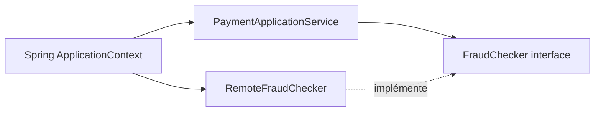
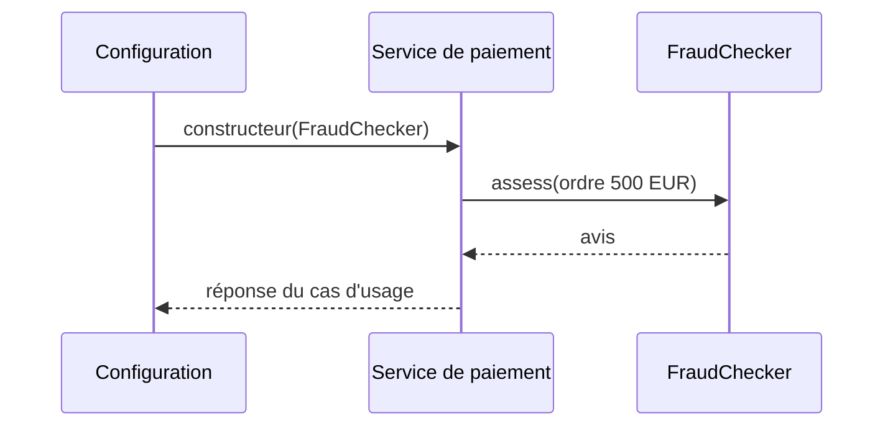

# Cours 74 — Dependency Injection (Java/JEE & Spring)

> Formation bancaire fictive : ordre SEPA de 500 EUR. **Leçon publiée et corrigé théorique disponible ; exercice individuel non encore répondu en session.**

## 1. Objectif
Fournir les dépendances d'un objet depuis l'extérieur, généralement par son constructeur, afin de séparer les règles métier du câblage technique.

## 2. Exemple bancaire
Le cas d'usage reçoit une demande de virement SEPA fictif de 500 EUR. Il doit demander un avis au service antifraude, mais le modèle métier ne doit pas connaître le client HTTP, sa configuration ou sa création.

## 3. Responsabilités
`PaymentApplicationService` consomme l'interface `FraudChecker`. La configuration Spring instancie `RemoteFraudChecker` et injecte cette implémentation dans le constructeur.

### Schéma de structure


## 4. Fragment Java pédagogique
```java
interface FraudChecker {
    FraudVerdict assess(PaymentOrder order);
}
@Service
final class PaymentApplicationService {
    private final FraudChecker fraudChecker;
    PaymentApplicationService(FraudChecker fraudChecker) {
        this.fraudChecker = fraudChecker;
    }
    SubmissionReceipt submit(PaymentOrder order) {
        FraudVerdict verdict = fraudChecker.assess(order);
        if (!verdict.allowed()) throw new PaymentRefusedException();
        return submitAuthorizedOrder(order);
    }
}
```

**Portée :** fragment conceptuel destiné à l'architecte ; les classes de domaine, imports et composants auxiliaires doivent être fournis par le projet. Il ne revendique ni compilation autonome, ni connexion à un SI bancaire réel.

## 5. Séquence principale


## 6. Limites, invariants et décisions
1. Privilégier l'injection par constructeur : dépendances requises explicites et objet correctement initialisé.
2. Une interface permet de remplacer un composant par un faux en test, mais ne garantit pas la sécurité, la disponibilité ou l'idempotence.
3. Si le vérificateur antifraude échoue, ne pas considérer automatiquement le contrôle comme réussi.
4. Ne pas multiplier artificiellement les interfaces pour chaque classe sans besoin réel de substitution.

## 7. Tests et preuves
- Injection d'un faux `FraudChecker` : refus métier propagé et aucune soumission.
- Configuration incomplète : démarrage refusé plutôt que dépendance silencieusement nulle.
- Échec du service antifraude : statut non accepté par défaut sauf politique métier explicite.
- La logique de paiement est testée sans réseau, base de données ni serveur Spring.

## 8. Exercice corrigé
**Quelle conception recommander ?**

- **A.** Instancier `new RemoteFraudChecker()` dans chaque méthode métier.
- **B.** Passer `FraudChecker` au constructeur du service.
- **C.** Stocker un client HTTP mutable dans une variable globale.

**Bonne réponse : B.** L'injection par constructeur isole les dépendances et simplifie les tests.

> Le corrigé est fourni pour réviser ; la réponse n'a pas encore été validée individuellement en session.

## 9. Point à défendre devant un comité d'architecture
Expliquer la responsabilité du framework, celle du domaine bancaire, le périmètre exact de la garantie et un scénario d'échec démontrable. Aucun mécanisme Spring présenté ici ne transforme un simple accusé de transport en preuve de règlement.

## 10. Documentation éditeur
[Spring — documentation de référence](https://docs.spring.io/spring-framework/reference/core/beans/dependencies/factory-collaborators.html)

[Programme des cours](README.md) · [Exercices 74–83](exercices-et-corriges/cours-74-83.md) · [Architecture de synthèse](schemas/spring-paiement-74-83.md)
