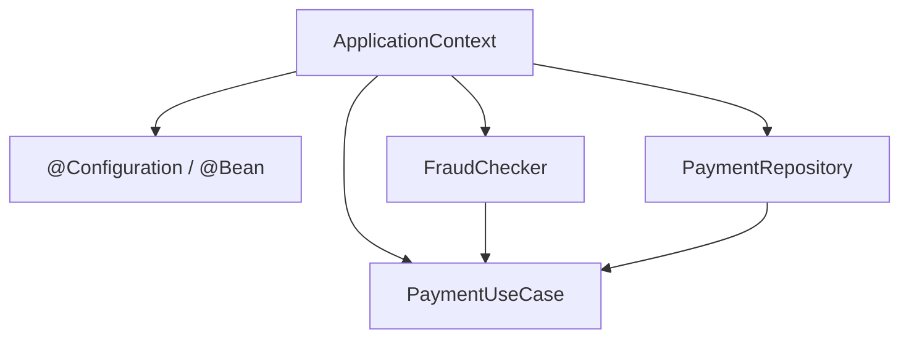
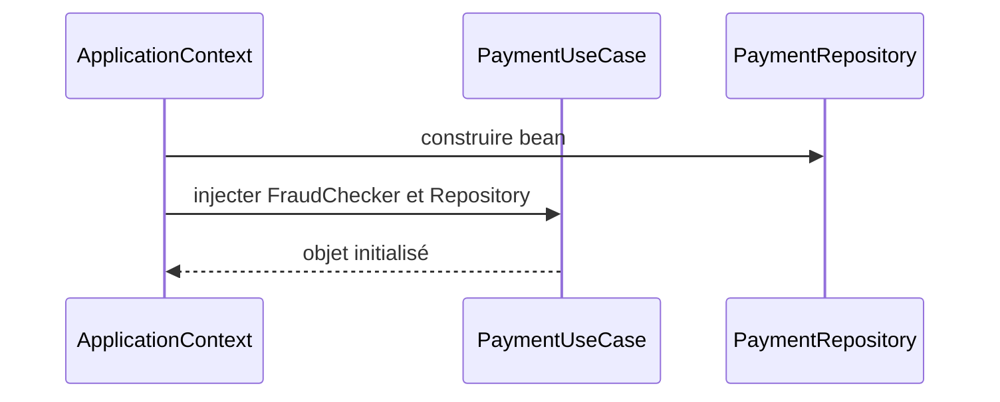

# Cours 75 — Inversion of Control (IoC) (Java/JEE & Spring)

> Formation bancaire fictive : ordre SEPA de 500 EUR. **Leçon publiée et corrigé théorique disponible ; exercice individuel non encore répondu en session.**

## 1. Objectif
Confier à un conteneur la responsabilité d'assembler et de gérer les objets applicatifs au lieu de laisser chaque objet contrôler lui-même ses dépendances.

## 2. Exemple bancaire
Le service de paiement dépend de `FraudChecker`, `PaymentRepository` et `Clock`. Le conteneur Spring fournit un assemblage adapté à l'environnement et s'assure que les dépendances nécessaires existent.

## 3. Responsabilités
`ApplicationContext` gère les définitions de beans et leur composition ; `@Configuration` et `@Bean` décrivent une partie du câblage ; DI est un mécanisme concret au service d'IoC.

### Schéma de structure


## 4. Fragment Java pédagogique
```java
@Configuration
class PaymentWiring {
    @Bean
    PaymentUseCase paymentUseCase(FraudChecker fraud,
                                  PaymentRepository repository,
                                  Clock clock) {
        return new PaymentUseCase(fraud, repository, clock);
    }
}
// Le cas d'usage ne demande pas lui-même au conteneur
// de rechercher ses collaborateurs.

```

**Portée :** fragment conceptuel destiné à l'architecte ; les classes de domaine, imports et composants auxiliaires doivent être fournis par le projet. Il ne revendique ni compilation autonome, ni connexion à un SI bancaire réel.

## 5. Séquence principale


## 6. Limites, invariants et décisions
1. IoC est le principe général ; DI est une façon de le réaliser. Dependency Inversion est un principe de direction des dépendances : les trois notions ne sont pas synonymes.
2. Éviter le Service Locator (`context.getBean()` partout dans le métier), qui cache les dépendances.
3. Surveiller dépendances circulaires, configuration ambiguë et surcharge du contexte.
4. Le conteneur ne remplace ni les règles métier ni les transactions distribuées.

## 7. Tests et preuves
- Le contexte démarre avec tous les collaborateurs attendus.
- Une implémentation manquante ou ambiguë provoque une erreur explicite.
- Les modules métier peuvent être assemblés sans `ApplicationContext`.
- Les configurations de test n'ont accès à aucun service bancaire réel.

## 8. Exercice corrigé
**Quelle conception recommander ?**

- **A.** Laisser chaque objet fabriquer toutes ses dépendances.
- **B.** Appeler `getBean` depuis chaque règle métier.
- **C.** Faire assembler les objets par le conteneur, en gardant les dépendances explicites.

**Bonne réponse : C.** Avec IoC le conteneur gère l'assemblage, mais la conception du domaine reste indépendante.

> Le corrigé est fourni pour réviser ; la réponse n'a pas encore été validée individuellement en session.

## 9. Point à défendre devant un comité d'architecture
Expliquer la responsabilité du framework, celle du domaine bancaire, le périmètre exact de la garantie et un scénario d'échec démontrable. Aucun mécanisme Spring présenté ici ne transforme un simple accusé de transport en preuve de règlement.

## 10. Documentation éditeur
[Spring — documentation de référence](https://docs.spring.io/spring-framework/reference/core/beans/introduction.html)

[Programme des cours](README.md) · [Exercices 74–83](exercices-et-corriges/cours-74-83.md) · [Architecture de synthèse](schemas/spring-paiement-74-83.md)
