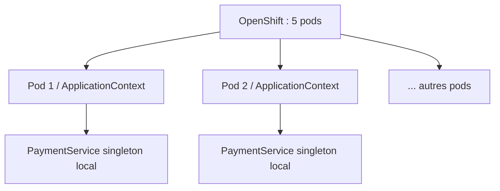
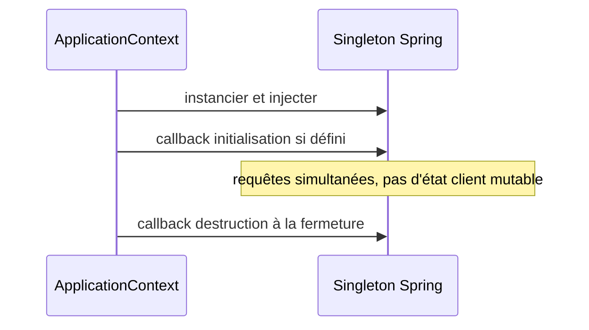

# Cours 76 — Bean Scopes et Lifecycle (Java/JEE & Spring)

> Formation bancaire fictive : ordre SEPA de 500 EUR. **Leçon publiée et corrigé théorique disponible ; exercice individuel non encore répondu en session.**

## 1. Objectif
Choisir la portée d'un bean et maîtriser son initialisation, sa sûreté en concurrence et son arrêt.

## 2. Exemple bancaire
Cinq pods OpenShift hébergent chacun une application Spring. `PaymentService` est un bean singleton Spring dans chaque conteneur d'application. Il ne doit conserver dans des champs ni montant courant ni données d'un client.

## 3. Responsabilités
Scopes `singleton`, `prototype`, `request` selon contexte ; `@PostConstruct` / `@PreDestroy` pour certains callbacks ; `ObjectProvider` peut aider à obtenir des prototypes à la demande.

### Schéma de structure


## 4. Fragment Java pédagogique
```java
@Service
final class PaymentService {
    private final PaymentRepository repository;
    PaymentService(PaymentRepository repository) {
        this.repository = repository;
    }
    SubmissionReceipt submit(PaymentOrder order) {
        // Variables locales, aucune donnée client dans un champ.
        return repository.saveOrder(order);
    }
}
// Bean singleton par définition et par ApplicationContext,
// pas global au cluster.

```

**Portée :** fragment conceptuel destiné à l'architecte ; les classes de domaine, imports et composants auxiliaires doivent être fournis par le projet. Il ne revendique ni compilation autonome, ni connexion à un SI bancaire réel.

## 5. Séquence principale


## 6. Limites, invariants et décisions
1. `singleton` est une seule instance par définition de bean et par conteneur Spring, non un leader unique multi-pods.
2. Un bean `prototype` injecté directement dans un singleton n'est pas recréé automatiquement à chaque méthode.
3. Spring ne pilote pas automatiquement toute la destruction d'un objet `prototype`.
4. Les callbacks de destruction ne doivent pas être la seule protection contre les pertes de paiements à l'arrêt d'un pod.

## 7. Tests et preuves
- Plusieurs injections du même singleton dans un contexte renvoient la même instance.
- Deux contextes distincts ont leurs propres beans.
- Appels concurrents ne partagent aucun état transactionnel mutable.
- Arrêt contrôlé : traitement des requêtes en cours vérifié sans dépendre seulement de `@PreDestroy`.

## 8. Exercice corrigé
**Quelle conception recommander ?**

- **A.** Un singleton Spring est unique dans tous les pods.
- **B.** Un bean singleton est local au conteneur ; aucun montant de client ne doit y être stocké.
- **C.** Un prototype injecté dans un singleton se renouvelle à chaque appel de méthode.

**Bonne réponse : B.** La portée singleton Spring est celle d'une définition dans un ApplicationContext.

> Le corrigé est fourni pour réviser ; la réponse n'a pas encore été validée individuellement en session.

## 9. Point à défendre devant un comité d'architecture
Expliquer la responsabilité du framework, celle du domaine bancaire, le périmètre exact de la garantie et un scénario d'échec démontrable. Aucun mécanisme Spring présenté ici ne transforme un simple accusé de transport en preuve de règlement.

## 10. Documentation éditeur
[Spring — documentation de référence](https://docs.spring.io/spring-framework/reference/core/beans/factory-scopes.html)

[Programme des cours](README.md) · [Exercices 74–83](exercices-et-corriges/cours-74-83.md) · [Architecture de synthèse](schemas/spring-paiement-74-83.md)
