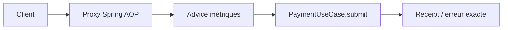
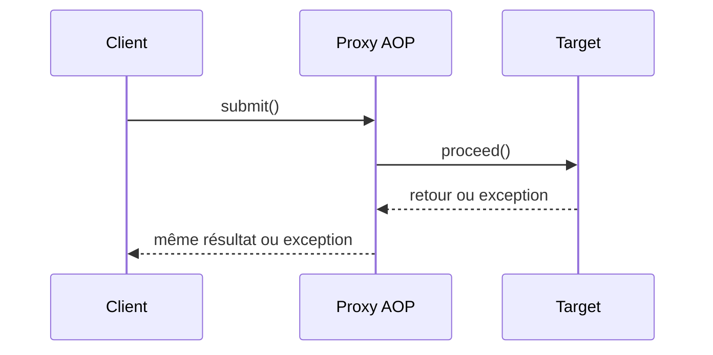

# Cours 77 — Spring AOP (Java/JEE & Spring)

> Formation bancaire fictive : ordre SEPA de 500 EUR. **Leçon publiée et corrigé théorique disponible ; exercice individuel non encore répondu en session.**

## 1. Objectif
Isoler certains traitements transversaux par des conseils (`advice`) appliqués à des points d'interception (`pointcuts`) sans modifier chaque méthode métier.

## 2. Exemple bancaire
Nous mesurons la latence des appels au cas d'usage de paiement et produisons des métriques sans dupliquer ce code dans tous les services. Un aspect doit préserver les exceptions et éviter de journaliser des références sensibles.

## 3. Responsabilités
`@Aspect`, `@Around`, `ProceedingJoinPoint` et proxy AOP ; distinction entre l'appel externe via proxy et l'auto-appel `this.method()`.

### Schéma de structure


## 4. Fragment Java pédagogique
```java
@Aspect
@Component
class PaymentMetricsAspect {
    private final MeterSink meters;
    PaymentMetricsAspect(MeterSink meters) { this.meters = meters; }
    @Around("execution(* example.payment.PaymentUseCase.submit(..))")
    Object measure(ProceedingJoinPoint point) throws Throwable {
        long start = System.nanoTime();
        try {
            return point.proceed(); // exactement une délégation
        } finally {
            meters.recordBestEffort("payment.submit",
                System.nanoTime() - start);
        }
    }
}
```

**Portée :** fragment conceptuel destiné à l'architecte ; les classes de domaine, imports et composants auxiliaires doivent être fournis par le projet. Il ne revendique ni compilation autonome, ni connexion à un SI bancaire réel.

## 5. Séquence principale


## 6. Limites, invariants et décisions
1. En AOP par proxy, l'auto-invocation `this.autreMethode()` ne passe pas par l'advice.
2. Un aspect ne doit pas lancer une deuxième opération de paiement ni masquer un succès déjà committé en cas d'échec de métrique.
3. L'aspect ne remplace ni l'audit financier durable ni la persistance des décisions métier.
4. La portée des pointcuts, la latence et la sûreté concurrente doivent être testées. Le fragment suppose un `MeterSink` best effort.

## 7. Tests et preuves
- Appel externe via proxy : un `proceed`, une mesure, réponse inchangée.
- Auto-invocation : vérifier explicitement si l'advice est exécuté ; ne jamais le supposer.
- Exception métier : même exception propagée, métrique enregistrée en best effort.
- Données personnelles : aucun contenu de paiement dans les labels de métrique.

## 8. Exercice corrigé
**Quelle conception recommander ?**

- **A.** Compter sur `this.submit()` pour traverser systématiquement le proxy Spring.
- **B.** Utiliser un aspect pour instrumenter les appels externes et préserver les résultats.
- **C.** Retenter automatiquement le paiement dans un `@Around` après toute erreur.

**Bonne réponse : B.** AOP modularise une préoccupation transverse avec les contraintes des proxies.

> Le corrigé est fourni pour réviser ; la réponse n'a pas encore été validée individuellement en session.

## 9. Point à défendre devant un comité d'architecture
Expliquer la responsabilité du framework, celle du domaine bancaire, le périmètre exact de la garantie et un scénario d'échec démontrable. Aucun mécanisme Spring présenté ici ne transforme un simple accusé de transport en preuve de règlement.

## 10. Documentation éditeur
[Spring — documentation de référence](https://docs.spring.io/spring-framework/reference/core/aop/proxying.html)

[Programme des cours](README.md) · [Exercices 74–83](exercices-et-corriges/cours-74-83.md) · [Architecture de synthèse](schemas/spring-paiement-74-83.md)
