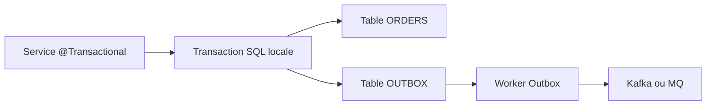
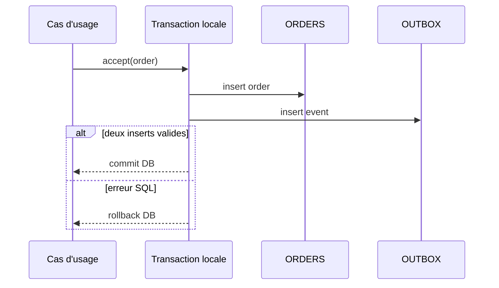

# Cours 78 — Spring Transactions (Java/JEE & Spring)

> Formation bancaire fictive : ordre SEPA de 500 EUR. **Leçon publiée et corrigé théorique disponible ; exercice individuel non encore répondu en session.**

## 1. Objectif
Délimiter un ensemble d'opérations persistées atomiquement par un gestionnaire transactionnel local approprié.

## 2. Exemple bancaire
Pour soumettre un ordre fictif de 500 EUR, la base PostgreSQL doit enregistrer l'ordre et une ligne Outbox dans la même transaction locale. Un processus indépendant publiera ensuite l'événement vers Kafka ou MQ.

## 3. Responsabilités
`@Transactional`, gestionnaire de transaction, repository des ordres, repository Outbox ; publication asynchrone post-commit.

### Schéma de structure


## 4. Fragment Java pédagogique
```java
@Service
class PaymentSubmissionService {
    private final PaymentRepository orders;
    private final OutboxRepository outbox;
    @Transactional
    public SubmissionReceipt accept(PaymentOrder order) {
        orders.insert(order); // contrainte unique sur clé métier/idempotence
        outbox.insert(OutboxEvent.forAcceptedOrder(order));
        return SubmissionReceipt.accepted(order.reference());
    }
}
// Un worker distinct publie les lignes Outbox committées.
// Ce code est un exemple de structure, pas un service complet.

```

**Portée :** fragment conceptuel destiné à l'architecte ; les classes de domaine, imports et composants auxiliaires doivent être fournis par le projet. Il ne revendique ni compilation autonome, ni connexion à un SI bancaire réel.

## 5. Séquence principale


## 6. Limites, invariants et décisions
1. `@Transactional` protège la ressource gérée ; ne promet aucune atomicité automatique DB + broker externe.
2. En mode proxy, un appel `this.accept()` depuis la même classe ne déclenche pas une nouvelle interception transactionnelle.
3. Par défaut, rollback typique sur `RuntimeException` et `Error` ; définir une politique explicite pour les exceptions vérifiées.
4. Commit DB réussi et réponse HTTP perdue : état du paiement indéterminé du point de vue du client ; vérifier avec clé d'idempotence.
5. Une ligne Outbox peut être publiée plusieurs fois ; consommateurs et exécution doivent tenir compte des doublons.

## 7. Tests et preuves
- Deux inserts DB valides : ordre et Outbox committés ensemble.
- Exception provoquée après l'ordre et avant Outbox : rollback des deux.
- Timeout HTTP après commit : requête identique ne génère pas un second ordre.
- Panne du broker après commit : Outbox persiste et le worker reprend.
- Appel via proxy testé pour vérifier le comportement transactionnel réel.

## 8. Exercice corrigé
**Quelle conception recommander ?**

- **A.** Supposer que `@Transactional` englobe automatiquement PostgreSQL et Kafka.
- **B.** Écrire dans le broker au milieu d'une transaction DB et considérer le tout atomique.
- **C.** Enregistrer ordre et Outbox dans une transaction locale, publier ensuite.

**Bonne réponse : C.** La transaction DB est atomique localement ; Outbox réduit le trou entre DB et publication externe.

> Le corrigé est fourni pour réviser ; la réponse n'a pas encore été validée individuellement en session.

## 9. Point à défendre devant un comité d'architecture
Expliquer la responsabilité du framework, celle du domaine bancaire, le périmètre exact de la garantie et un scénario d'échec démontrable. Aucun mécanisme Spring présenté ici ne transforme un simple accusé de transport en preuve de règlement.

## 10. Documentation éditeur
[Spring — documentation de référence](https://docs.spring.io/spring-framework/reference/data-access/transaction/declarative/annotations.html)

[Programme des cours](README.md) · [Exercices 74–83](exercices-et-corriges/cours-74-83.md) · [Architecture de synthèse](schemas/spring-paiement-74-83.md)
