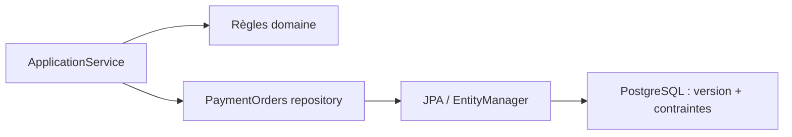
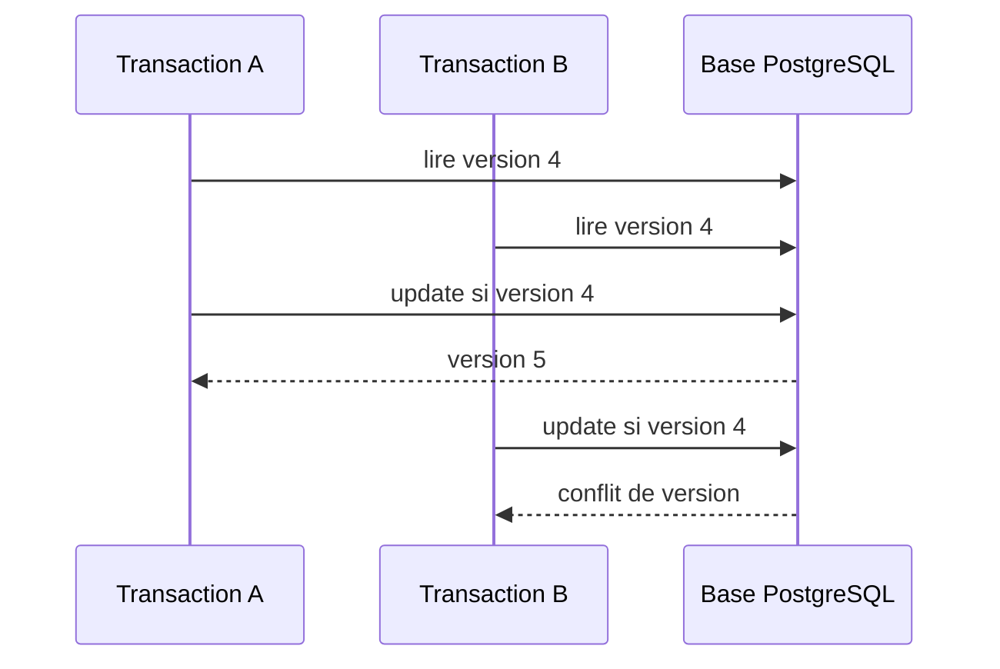

# Cours 79 — Spring Data / JPA (Java/JEE & Spring)

> Formation bancaire fictive : ordre SEPA de 500 EUR. **Leçon publiée et corrigé théorique disponible ; exercice individuel non encore répondu en session.**

## 1. Objectif
Organiser l'accès relationnel avec repositories et entités persistantes, en gérant les transactions, le chargement et la concurrence.

## 2. Exemple bancaire
Le moteur stocke les états de ses ordres SEPA dans PostgreSQL. Deux traitements concurrents tentent de modifier le même ordre ; la version de l'entité et des contraintes SQL doivent éviter des écrasements silencieux.

## 3. Responsabilités
`JpaRepository`, entité JPA, `@Version`, service transactionnel ; la base conserve les contraintes d'unicité et le domaine valide les transitions.

### Schéma de structure


## 4. Fragment Java pédagogique
```java
@Entity
class PaymentOrderEntity {
    @Id String reference;
    @Version Long version;
    @Column(nullable = false, precision = 19, scale = 2)
    BigDecimal amount;
    @Enumerated(EnumType.STRING)
    PaymentStatus status;
    protected PaymentOrderEntity() {}
}
interface PaymentOrders
        extends JpaRepository<PaymentOrderEntity, String> {}
// Contrôle métier des transitions dans le domaine,
// contrainte SQL unique pour l'idempotence et tests concurrence.

```

**Portée :** fragment conceptuel destiné à l'architecte ; les classes de domaine, imports et composants auxiliaires doivent être fournis par le projet. Il ne revendique ni compilation autonome, ni connexion à un SI bancaire réel.

## 5. Séquence principale


## 6. Limites, invariants et décisions
1. `@Version` détecte des modifications concurrentes sur une entité versionnée ; elle ne suffit pas à garantir l'idempotence globale.
2. Utiliser des contraintes en base et une stratégie métier explicite de conflit/reprise.
3. Surveiller N+1, chargement lazy, projections et pagination pour les lectures volumineuses.
4. Ne pas exposer directement les entités JPA aux clients HTTP ; choisir des DTO et éviter des modifications par désérialisation directe.
5. Les transactions financières sont décidées par le domaine et la source autoritative, pas uniquement par une annotation de persistance.

## 7. Tests et preuves
- Deux mises à jour concurrentes sur même version : une échoue avec conflit.
- Contrainte d'unicité : répétition de l'identifiant ne crée pas de doublon.
- Entité chargée avec associations : mesurer les requêtes SQL et les N+1.
- Validation de montant et transitions : refus métier explicite.
- Lecture d'historique : pagination stable et absence d'exposition d'information sensible.

## 8. Exercice corrigé
**Quelle conception recommander ?**

- **A.** Utiliser `@Version` et des contraintes SQL, avec contrôle des transitions dans le domaine.
- **B.** Utiliser `double` pour les montants et ignorer les transactions.
- **C.** Exposer les entités JPA directement dans toutes les réponses publiques.

**Bonne réponse : A.** La persistance doit protéger concurrence et unicité en complément des invariants métier.

> Le corrigé est fourni pour réviser ; la réponse n'a pas encore été validée individuellement en session.

## 9. Point à défendre devant un comité d'architecture
Expliquer la responsabilité du framework, celle du domaine bancaire, le périmètre exact de la garantie et un scénario d'échec démontrable. Aucun mécanisme Spring présenté ici ne transforme un simple accusé de transport en preuve de règlement.

## 10. Documentation éditeur
[Spring — documentation de référence](https://docs.spring.io/spring-data/jpa/reference/)

[Programme des cours](README.md) · [Exercices 74–83](exercices-et-corriges/cours-74-83.md) · [Architecture de synthèse](schemas/spring-paiement-74-83.md)
