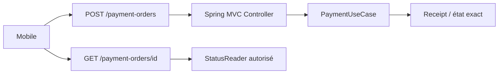
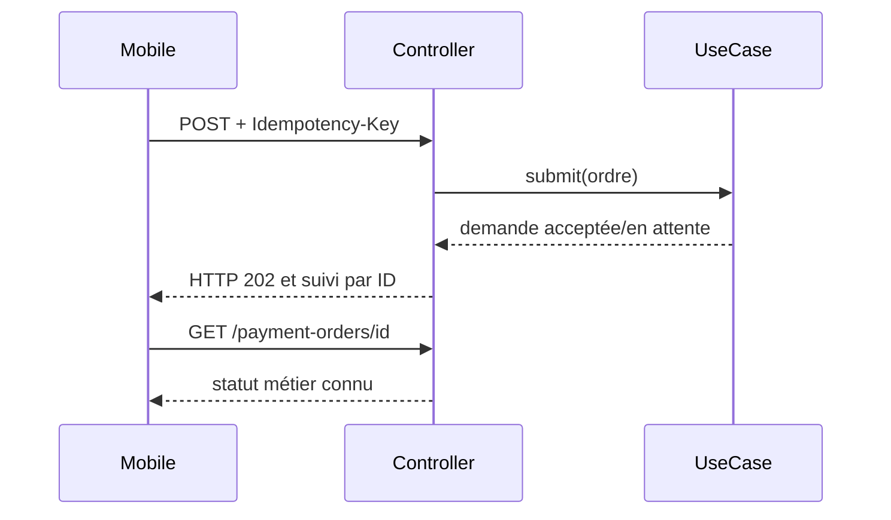

# Cours 80 — Spring MVC / REST (Java/JEE & Spring)

> Formation bancaire fictive : ordre SEPA de 500 EUR. **Leçon publiée et corrigé théorique disponible ; exercice individuel non encore répondu en session.**

## 1. Objectif
Définir des endpoints HTTP stables avec validation d'entrée, séparation contrôleur/service et sémantique exacte des statuts.

## 2. Exemple bancaire
Une application mobile envoie un ordre SEPA de 500 EUR. `POST /payment-orders` soumet une demande idempotente ; `GET /payment-orders/{id}` récupère un état contrôlé. L'accusé HTTP n'est pas un règlement financier.

## 3. Responsabilités
`@RestController`, `@RequestMapping`, `@Valid`, DTO, service de cas d'usage, réponses HTTP, contrôle d'identité/autorisation dans la chaîne.

### Schéma de structure


## 4. Fragment Java pédagogique
```java
@RestController
@RequestMapping("/payment-orders")
class PaymentOrdersController {
    private final PaymentUseCase payments;
    PaymentOrdersController(PaymentUseCase payments) {
        this.payments = payments;
    }
    @PostMapping
    ResponseEntity<SubmissionResponse> create(
       @RequestHeader("Idempotency-Key") String key,
       @Valid @RequestBody SubmitOrderRequest request) {
        SubmissionReceipt result = payments.submit(key, request);
        return ResponseEntity.accepted()
            .body(SubmissionResponse.from(result));
    }
}
// GET : lecture autorisée du statut via un contrat distinct.

```

**Portée :** fragment conceptuel destiné à l'architecte ; les classes de domaine, imports et composants auxiliaires doivent être fournis par le projet. Il ne revendique ni compilation autonome, ni connexion à un SI bancaire réel.

## 5. Séquence principale


## 6. Limites, invariants et décisions
1. `202 Accepted` indique que la demande est acceptée pour traitement, pas un règlement confirmé ; choisir le code HTTP selon le vrai contrat.
2. La clé d'idempotence doit être vérifiée de bout en bout, et pas seulement en mémoire du contrôleur.
3. Valider les DTO, authentifier, autoriser par objet et limiter tailles, taux et surfaces exposées.
4. Les statuts métier (`RECU`, `ACCEPTE`, `TRANSMIS`, `REGLE`) ne sont pas interchangeables.
5. Versionner les contrats API et documenter erreurs, relances, timeout et cohérence des lectures.

## 7. Tests et preuves
- POST valide : réponse contractuelle sans prétention de règlement.
- POST identique clé idem : résultat cohérent et pas de double effet.
- Accès à l'ordre d'un tiers : refus sans divulgation de son existence.
- Corps invalide : rejet avant service métier.
- GET : aucune modification d'état ; délai éventuel de projection documenté.

## 8. Exercice corrigé
**Quelle conception recommander ?**

- **A.** Déclarer HTTP 200 comme preuve de règlement bancaire.
- **B.** Exposer un contrôleur mince et un service métier, avec clé d'idempotence et statuts exacts.
- **C.** Mettre toute la logique antifraude dans les annotations MVC.

**Bonne réponse : B.** Spring MVC transporte la demande ; le service propriétaire reste autoritatif.

> Le corrigé est fourni pour réviser ; la réponse n'a pas encore été validée individuellement en session.

## 9. Point à défendre devant un comité d'architecture
Expliquer la responsabilité du framework, celle du domaine bancaire, le périmètre exact de la garantie et un scénario d'échec démontrable. Aucun mécanisme Spring présenté ici ne transforme un simple accusé de transport en preuve de règlement.

## 10. Documentation éditeur
[Spring — documentation de référence](https://docs.spring.io/spring-framework/reference/web/webmvc/mvc-controller.html)

[Programme des cours](README.md) · [Exercices 74–83](exercices-et-corriges/cours-74-83.md) · [Architecture de synthèse](schemas/spring-paiement-74-83.md)
