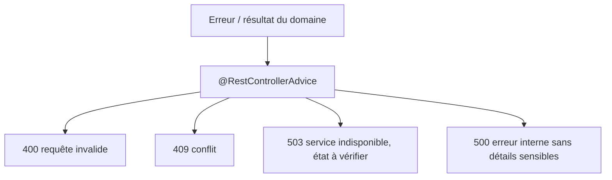
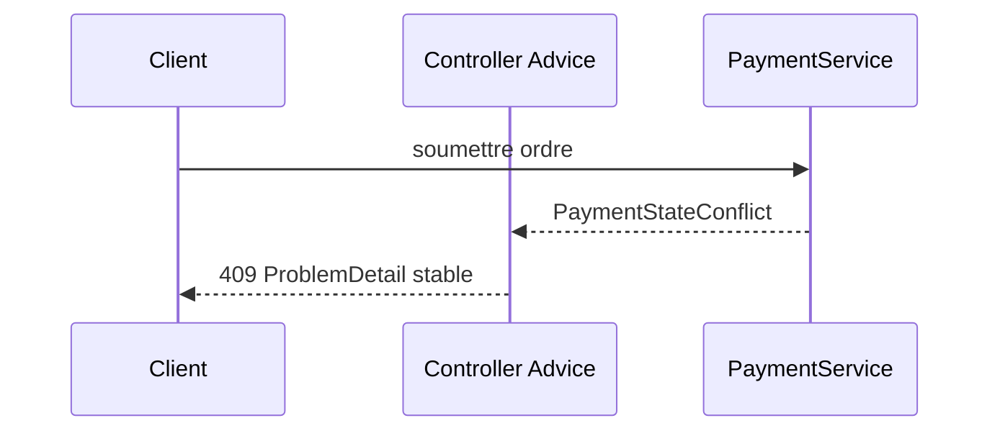

# Cours 81 — Exception Handling Spring (Java/JEE & Spring)

> Formation bancaire fictive : ordre SEPA de 500 EUR. **Leçon publiée et corrigé théorique disponible ; exercice individuel non encore répondu en session.**

## 1. Objectif
Transformer les erreurs applicatives en contrats HTTP compréhensibles sans mentir sur l'état du paiement ni révéler d'informations internes.

## 2. Exemple bancaire
Une saisie invalide est refusée, un paiement déjà connu déclenche une réponse idempotente ou un conflit métier documenté, et un timeout externe laisse parfois le résultat inconnu. Chaque cas doit être représenté distinctement.

## 3. Responsabilités
Exceptions métier typées ; `@RestControllerAdvice` ; `@ExceptionHandler` ; `ProblemDetail` ; identifiant de corrélation exempt de données sensibles.

### Schéma de structure


## 4. Fragment Java pédagogique
```java
@RestControllerAdvice
final class PaymentErrorAdvice {
    @ExceptionHandler(InvalidPaymentRequest.class)
    ResponseEntity<ProblemDetail> invalid(InvalidPaymentRequest ex) {
        ProblemDetail p = ProblemDetail.forStatus(400);
        p.setTitle("Requête de paiement invalide");
        return ResponseEntity.badRequest().body(p);
    }
    @ExceptionHandler(PaymentStateConflict.class)
    ResponseEntity<ProblemDetail> conflict(PaymentStateConflict ex) {
        ProblemDetail p = ProblemDetail.forStatus(409);
        p.setTitle("Conflit d'état de paiement");
        return ResponseEntity.status(409).body(p);
    }
}
```

**Portée :** fragment conceptuel destiné à l'architecte ; les classes de domaine, imports et composants auxiliaires doivent être fournis par le projet. Il ne revendique ni compilation autonome, ni connexion à un SI bancaire réel.

## 5. Séquence principale


## 6. Limites, invariants et décisions
1. Un timeout externe ne prouve pas que la banque n'a rien exécuté ; permettre la recherche d'état via identifiant stable.
2. Ne pas loguer IBAN, identité ou données sensibles dans des erreurs exposées.
3. Ne pas convertir toutes les erreurs techniques en « paiement rejeté ».
4. Décider des codes HTTP selon les contrats : 400, 401/403, 404, 409, 429, 503, etc.
5. Les exceptions ne doivent pas cacher un commit déjà effectué.

## 7. Tests et preuves
- Requête malformée : problème standardisé et absence d'appel métier.
- Conflit d'état : 409 avec code stable.
- Timeout après soumission : résultat inconnu, consultation possible, aucune répétition aveugle.
- Exception inattendue : message neutre, corrélation et observabilité interne.
- Erreurs d'autorisation : aucune divulgation sur les ordres d'un autre client.

## 8. Exercice corrigé
**Quelle conception recommander ?**

- **A.** Transformer tout timeout en paiement échoué.
- **B.** Inclure pile d'appels et secrets dans la réponse HTTP.
- **C.** Normaliser les erreurs et distinguer refus métier, panne technique et état inconnu.

**Bonne réponse : C.** Le contrat d'erreur doit préserver la réalité financière et limiter la divulgation.

> Le corrigé est fourni pour réviser ; la réponse n'a pas encore été validée individuellement en session.

## 9. Point à défendre devant un comité d'architecture
Expliquer la responsabilité du framework, celle du domaine bancaire, le périmètre exact de la garantie et un scénario d'échec démontrable. Aucun mécanisme Spring présenté ici ne transforme un simple accusé de transport en preuve de règlement.

## 10. Documentation éditeur
[Spring — documentation de référence](https://docs.spring.io/spring-framework/reference/web/webmvc/mvc-controller/ann-advice.html)

[Programme des cours](README.md) · [Exercices 74–83](exercices-et-corriges/cours-74-83.md) · [Architecture de synthèse](schemas/spring-paiement-74-83.md)
