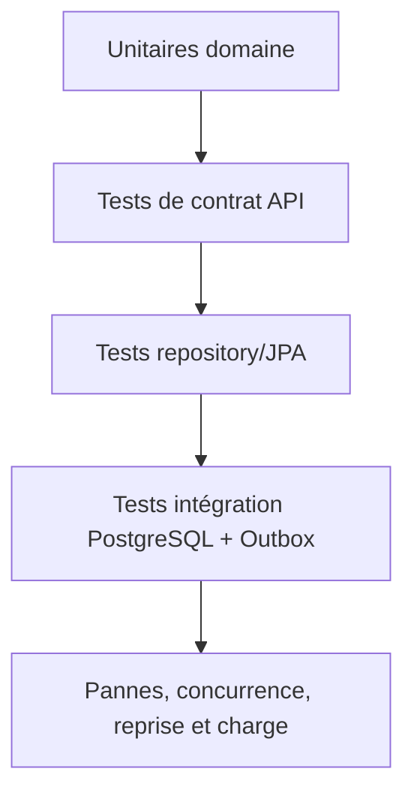
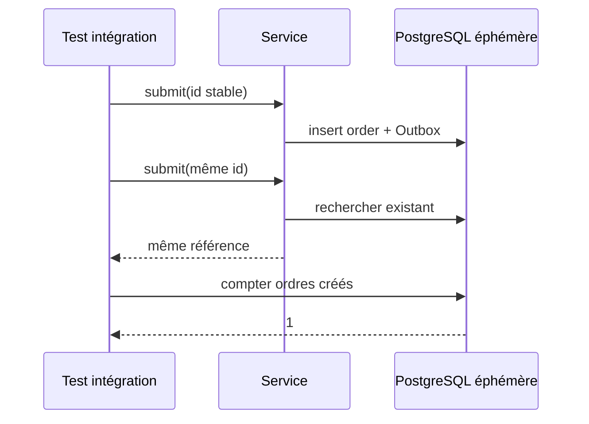

# Cours 82 — Tests unitaires et d'intégration (Java/JEE & Spring)

> Formation bancaire fictive : ordre SEPA de 500 EUR. **Leçon publiée et corrigé théorique disponible ; exercice individuel non encore répondu en session.**

## 1. Objectif
Construire une stratégie de vérification par niveaux, centrée sur les invariants, la concurrence et les pannes.

## 2. Exemple bancaire
Avant de migrer un moteur SEPA vers Spring Boot sur OpenShift, l'équipe vérifie les calculs métiers hors framework, les endpoints HTTP, la persistance réelle et la reprise des événements Outbox.

## 3. Responsabilités
JUnit pour l'unitaire ; tests web ciblés ; `@DataJpaTest` pour persistance ; `@SpringBootTest` pour scénarios d'intégration ; Testcontainers si utile et disponible ; tests de contrat et de charge.

### Schéma de structure


## 4. Fragment Java pédagogique
```java
@Test
void sameRequestIdMustNotExecuteTwice() {
    String key = "request-123";
    SubmissionReceipt first = useCase.submit(key, sampleOrder());
    SubmissionReceipt second = useCase.submit(key, sampleOrder());
    assertEquals(first.reference(), second.reference());
    verify(executionGateway, times(1)).submit(any());
}
// En intégration DB : vérifier contrainte unique,
// concurrence et effet financier via une simulation locale.

```

**Portée :** fragment conceptuel destiné à l'architecte ; les classes de domaine, imports et composants auxiliaires doivent être fournis par le projet. Il ne revendique ni compilation autonome, ni connexion à un SI bancaire réel.

## 5. Séquence principale


## 6. Limites, invariants et décisions
1. Un test unitaire avec mocks ne démontre pas un comportement transactionnel JPA réel.
2. Tester les pannes après commit et réponse perdue, y compris la reprise d'un Outbox publié plusieurs fois.
3. Éviter de connecter les tests aux comptes, brokers ou systèmes bancaires de production.
4. Mesurer N+1, contention et performances sous charge réaliste.
5. Les tests doivent expliciter l'autorité des statuts de paiement et les transitions interdites.

## 7. Tests et preuves
- Unitaires : limite, rejet et transition interdite.
- Web : statut HTTP, idempotence et validation des DTO.
- JPA : version optimiste, unicité et rollback sur échec.
- Intégration : paiement + Outbox atomiques, publication rejouable et déduplication.
- Résilience : perte de réponse, redémarrage, concurrent duplicate et absence de double exécution.

## 8. Exercice corrigé
**Quelle conception recommander ?**

- **A.** Valider seulement les contrôleurs avec des mocks, sans DB.
- **B.** Combiner tests unitaires, contrats, persistance et incidents réels simulés.
- **C.** Utiliser la production pour tester les doubles débits.

**Bonne réponse : B.** Chaque niveau teste une propriété différente et les garanties financières se prouvent avec des scénarios d'échec.

> Le corrigé est fourni pour réviser ; la réponse n'a pas encore été validée individuellement en session.

## 9. Point à défendre devant un comité d'architecture
Expliquer la responsabilité du framework, celle du domaine bancaire, le périmètre exact de la garantie et un scénario d'échec démontrable. Aucun mécanisme Spring présenté ici ne transforme un simple accusé de transport en preuve de règlement.

## 10. Documentation éditeur
[Spring — documentation de référence](https://docs.spring.io/spring-boot/reference/testing/)

[Programme des cours](README.md) · [Exercices 74–83](exercices-et-corriges/cours-74-83.md) · [Architecture de synthèse](schemas/spring-paiement-74-83.md)
