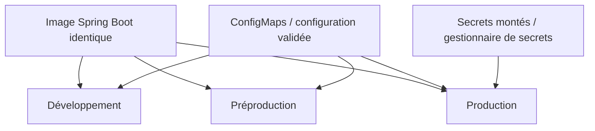
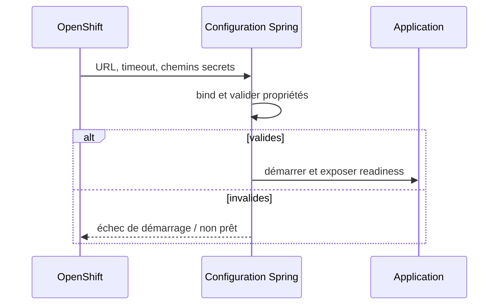

# Cours 83 — Configuration Spring Boot (Java/JEE & Spring)

> Formation bancaire fictive : ordre SEPA de 500 EUR. **Leçon publiée et corrigé théorique disponible ; exercice individuel non encore répondu en session.**

## 1. Objectif
Séparer le code de la configuration d'environnement, valider les paramètres et distribuer secrets et variables sans les placer dans le dépôt Git.

## 2. Exemple bancaire
La même image Spring Boot est déployée en développement, préproduction et production sur OpenShift. Chaque environnement possède ses URL d'API, seuils autorisés, paramètres réseau et secrets, sans reconstruire le code.

## 3. Responsabilités
`@ConfigurationProperties` typées, profils Spring lorsqu'appropriés, variables d'environnement et fichiers montés ; Kubernetes ConfigMaps/Secrets via méthodes de déploiement validées ; health/readiness.

### Schéma de structure


## 4. Fragment Java pédagogique
```java
@ConfigurationProperties(prefix = "payments")
public record PaymentsProperties(
    URI fraudServiceUrl,
    Duration timeout
) {
    public PaymentsProperties {
        if (fraudServiceUrl == null || timeout == null
                || timeout.isZero() || timeout.isNegative()) {
            throw new IllegalArgumentException("Configuration invalide");
        }
    }
}
// Enregistrement via @ConfigurationPropertiesScan
// ou @EnableConfigurationProperties(PaymentsProperties.class).

```

**Portée :** fragment conceptuel destiné à l'architecte ; les classes de domaine, imports et composants auxiliaires doivent être fournis par le projet. Il ne revendique ni compilation autonome, ni connexion à un SI bancaire réel.

## 5. Séquence principale


## 6. Limites, invariants et décisions
1. Les Secrets Kubernetes ne doivent pas être supposés suffisants sans contrôle RBAC, chiffrement approprié et processus de rotation.
2. Ne jamais consigner mots de passe, tokens ou secrets dans les logs, actuators ou messages d'erreur.
3. Liveness ne doit pas redémarrer le pod pour une panne distante temporaire sans stratégie claire ; readiness contrôle la réception du trafic.
4. Les paramètres réglementaires et plafonds relèvent d'une gouvernance métier, pas d'une variable modifiable librement.
5. Documenter l'ordre de priorité des sources de configuration et valider réellement les paramètres au démarrage.

## 7. Tests et preuves
- Même image en trois environnements : propriétés différentes, pas de rebuild.
- Timeout négatif/manquant : démarrage refusé.
- Aucun secret dans dépôt, image, logs ou endpoints actuator accessibles.
- Readiness et arrêt contrôlé qualifiés en conditions de panne.
- Rotation secret et indisponibilité d'une dépendance testées explicitement.

## 8. Exercice corrigé
**Quelle conception recommander ?**

- **A.** Mettre des secrets et les URLs de production directement dans le code Java.
- **B.** Créer trois branches applicatives divergentes pour les environnements.
- **C.** Externaliser les paramètres, valider la configuration, protéger les secrets.

**Bonne réponse : C.** La configuration externalisée permet de promouvoir la même image, sous contrôle des secrets et des paramètres.

> Le corrigé est fourni pour réviser ; la réponse n'a pas encore été validée individuellement en session.

## 9. Point à défendre devant un comité d'architecture
Expliquer la responsabilité du framework, celle du domaine bancaire, le périmètre exact de la garantie et un scénario d'échec démontrable. Aucun mécanisme Spring présenté ici ne transforme un simple accusé de transport en preuve de règlement.

## 10. Documentation éditeur
[Spring — documentation de référence](https://docs.spring.io/spring-boot/reference/features/external-config.html)

[Programme des cours](README.md) · [Exercices 74–83](exercices-et-corriges/cours-74-83.md) · [Architecture de synthèse](schemas/spring-paiement-74-83.md)
