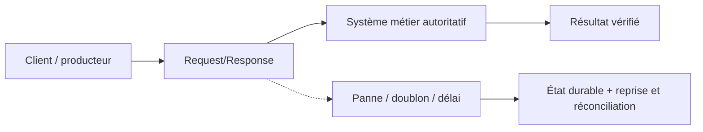
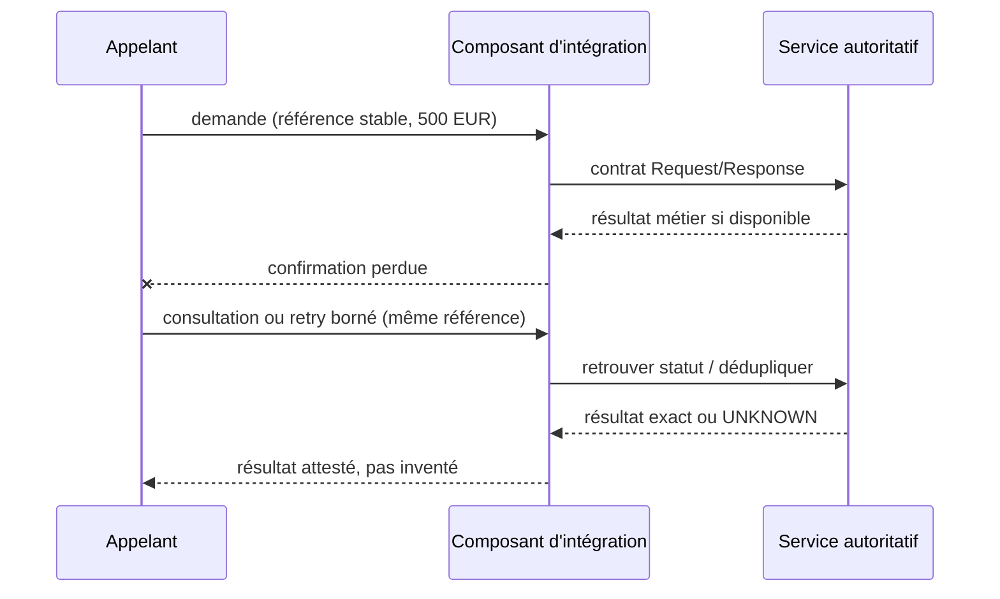

# Cours 84 — Request/Response · Intégration bancaire

> Banque fictive · ordre SEPA de 500 EUR · exercice corrigé théorique, **non validé individuellement en session**.

## 1. Intention
Apprendre pourquoi choisir **Request/Response** dans une architecture entre Java/Spring, API, IBM MQ, Kafka et les systèmes métier. Étudier contrats, frontières de responsabilité, incidents et preuve de non-régression.

## 2. Fil rouge bancaire et règles
Une demande SEPA de 500 EUR possède une **référence métier stable**, distincte du messageId, correlationId et traceId. Les producteurs, intermédiaires et consommateurs peuvent perdre des confirmations ou redélivrer une demande.

1. Décrire ce que prouve chaque accusé technique et ce qui établit un statut bancaire autoritatif.
2. Définir délais, rétention, version du contrat, sécurité, ownership et stratégie de replay.
3. Garantir par une preuve de test que deux messages de même référence ne créent pas deux effets financiers.
4. Ne jamais traduire automatiquement un timeout en rejet métier ni ACK broker en règlement.
5. Vérifier l'échéance métier avant toute reprise d'un ordre de paiement instantané.

## 3. Architecture de décision

## 4. Séquence de panne à expliquer en comité

## 5. Vérifications à réaliser
- Nominal : contrat correct, traitement autorisé et statut exact.
- Doublon concurrent : une seule exécution autoritative malgré redélivrance.
- Panne après écriture : état retrouvé sans double exécution.
- Contrat incompatible : erreur explicite, DLQ/quarantaine si appropriée.
- Sécurité : rejeter accès objet non autorisé, sans fuite d'identifiant ni de contenu.
- Exploitation : mesurer latence, backlog, échéance, retries, disponibilité et preuve de reprise.
- Arbitrage : comparer à un appel direct ou à une conception plus simple si les contraintes le permettent.

## 6. QCM corrigé
**Quelle approche est défendable pour utiliser Request/Response ?**

- **A.** Retenir Request/Response avec un contrat versionné, une clé métier stable et des tests de reprise.
- **B.** Supposer que Request/Response garantit automatiquement l'exécution financière exactement une fois.
- **C.** Exécuter les reprises sans contrôle d'autorisation ni rapprochement.

**Corrigé : A.** Les garanties viennent du contrat, des invariants et des tests ; le mécanisme technique seul ne prouve pas la finalité du paiement.

## 7. Support technique détaillé — fiche existante
Les schémas, exemples de messages, compromis et scénarios d'échec suivants proviennent du référentiel déjà conservé dans le même dépôt.

**[Fiche source originale](https://github.com/zdmooc/enterprise-architecture-patterns-handbook/blob/main/01-integration-patterns/01-request-response/README.md)**

#### Problème et intention
Un consommateur doit obtenir immédiatement une information ou une décision : consultation de statut de virement, vérification d'un droit, validation de données. Le modèle **Request/Response** corrèle une requête et sa réponse. Il n'est pas synonyme de REST : HTTP, gRPC, SOAP et messagerie MQ request/reply peuvent le réaliser. Une API HTTP peut également lancer un traitement **asynchrone** et retourner 202 Accepted.

#### Fonctionnement
~~~mermaid
sequenceDiagram
  participant C as Canal bancaire
  participant G as API Gateway
  participant S as Payment API
  participant D as Référentiel de statut
  C->>G: GET /payments/VIR-001
  G->>S: Requête autorisée (correlation-id)
  S->>D: Lire le statut
  D-->>S: SETTLED
  S-->>G: 200 {status: SETTLED}
  G-->>C: 200 + statut
~~~

La réponse immédiate est adaptée à une **consultation**. Une réponse 200/201 sur une *création* ne doit pas être confondue avec la preuve de règlement. Une création longue peut répondre 202 + paymentId + lien de suivi ; les contraintes du schéma de paiement, notamment instantané, restent prioritaires.

#### Contrat de référence (fictif)
~~~http
GET /api/v1/payments/VIR-001
Authorization: Bearer TOKEN
X-Correlation-ID: trace-001

HTTP/1.1 200 OK
Content-Type: application/json

{"paymentId":"VIR-001","status":"SETTLED"}
~~~
Statuts à préciser contractuellement : RECEIVED, VALIDATING, SUBMITTED, SETTLED, REJECTED, UNKNOWN / TO_RECONCILE. Éviter un statut ambigu « SUCCESS ».

#### Arbitrages de l'architecte
- **SLA / budget de latence** : budget total de bout en bout = réseau + Gateway + service + dépendances + marge ; fixer timeout de connexion, lecture et durée totale.
- **Couplage temporel** : la requête immobilise une ressource jusqu'à la réponse ; prévoir pools et limites de concurrence.
- **Contrats** : OpenAPI, validation de schéma, codes HTTP, compatibilité ascendante et versionnement.
- **Sécurité** : TLS, jeton, scopes, contrôle d'accès objet (un client ne peut pas consulter le paiement d'un autre), filtrage des données personnelles.
- **Résilience** : Circuit Breaker, Bulkhead, cache uniquement pour données non critiques et compatibles avec la fraîcheur exigée.
- **Observabilité** : latences p50/p95/p99, taux d'erreur, saturation, correlation-id et traces distribuées expurgées.

#### Scénarios d'échec
| Incident | Mesure | Risque métier |
|---|---|---|
| Lecture lente | Timeout + Circuit Breaker | Afficher « indisponible », non « paiement rejeté » |
| HTTP 503 | Retry borné pour une lecture idempotente | Tempête de requêtes si pas de backoff |
| Réponse de création perdue | Retrouver l'ordre par idempotency-key | Double ordre lors de répétition |
| Service disponible, DB indisponible | Dégradation contrôlée | Statut non vérifiable |

#### Quand préférer autre chose
Préférer Queue/Event-Driven quand le traitement dépasse le budget de réponse, doit survivre à une indisponibilité ou ne nécessite pas de résultat synchrone. Un parcours peut combiner POST synchrone **d'acceptation technique** et traitement asynchrone.

#### Checklist revue de conception
- Le code HTTP et le **statut métier** sont-ils distincts ?
- Quel est le budget de latence, quels timeouts par saut, que fait le client après un délai dépassé ?
- L'opération est-elle sûre à répéter ? Quels identifiants et clés d'idempotence ?
- AuthZ objet, mTLS interne si requis, audit et protection des logs ?
- Quel état est présenté si la réponse d'une création est perdue ?

#### Entretien
**Q : pourquoi ne pas tout faire en REST synchrone ?** R : cela crée un couplage de disponibilité et de latence, et ne résout ni la reprise durable ni la duplication d'effets métier.

**Q : timeout = transaction annulée ?** R : non, le serveur peut avoir exécuté l'action ; il faut réconcilier.

**À relier :** 06 API Gateway, 09 Circuit Breaker, 10 Retry/Timeout/Idempotency.

---

#### Illustrations complémentaires — le virement fictif de 500 €

#### Consultation synchrone du statut
~~~mermaid
sequenceDiagram
    actor C as Client mobile
    participant G as Passerelle API
    participant S as Service de paiement
    participant D as Stockage de statut
    C->>G: GET /payments/VIR-001
    G->>S: Identité et droits validés
    S->>D: Lire état connu
    D-->>S: SETTLED avec preuve
    S-->>G: HTTP 200 + état métier
    G-->>C: Afficher « virement réglé »
~~~
**Lecture :** seul le statut métier provenant de la bonne source peut être annoncé au client, pas simplement le code HTTP.

#### Timeout d'une création, résultat inconnu
~~~mermaid
sequenceDiagram
    actor C as Client mobile
    participant A as API Paiements
    participant K as Coeur bancaire
    C->>A: POST /payments + clé PAY-001
    A->>K: Demande de traitement VIR-001
    K->>K: Exécute ou accepte la commande
    K--xA: Réponse perdue
    A-->>C: Délai dépassé : statut inconnu
    C->>A: Même demande, même clé PAY-001
    A-->>C: Même paymentId VIR-001, à vérifier
~~~
**Erreur à éviter :** interpréter le timeout comme un rejet définitif, ou générer un second ordre.

#### Mini-exercice
Pour une consultation de statut de 500 €, une réponse lente peut conduire à « statut indisponible ». Pour un **POST d'exécution**, la réponse lente exige **idempotence et réconciliation**. Le point clé n'est pas seulement la synchronisation : c'est la nature **avec ou sans effet de bord** de l'opération.

[Retour à l'index](README.md)
