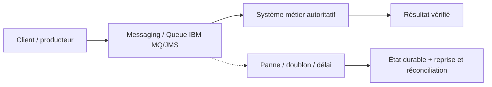
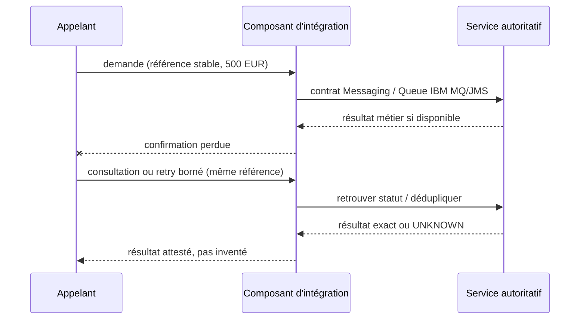

# Cours 85 — Messaging / Queue IBM MQ/JMS · Intégration bancaire

> Banque fictive · ordre SEPA de 500 EUR · exercice corrigé théorique, **non validé individuellement en session**.

## 1. Intention
Apprendre pourquoi choisir **Messaging / Queue IBM MQ/JMS** dans une architecture entre Java/Spring, API, IBM MQ, Kafka et les systèmes métier. Étudier contrats, frontières de responsabilité, incidents et preuve de non-régression.

## 2. Fil rouge bancaire et règles
Une demande SEPA de 500 EUR possède une **référence métier stable**, distincte du messageId, correlationId et traceId. Les producteurs, intermédiaires et consommateurs peuvent perdre des confirmations ou redélivrer une demande.

1. Décrire ce que prouve chaque accusé technique et ce qui établit un statut bancaire autoritatif.
2. Définir délais, rétention, version du contrat, sécurité, ownership et stratégie de replay.
3. Garantir par une preuve de test que deux messages de même référence ne créent pas deux effets financiers.
4. Ne jamais traduire automatiquement un timeout en rejet métier ni ACK broker en règlement.
5. Vérifier l'échéance métier avant toute reprise d'un ordre de paiement instantané.

## 3. Architecture de décision

## 4. Séquence de panne à expliquer en comité

## 5. Vérifications à réaliser
- Nominal : contrat correct, traitement autorisé et statut exact.
- Doublon concurrent : une seule exécution autoritative malgré redélivrance.
- Panne après écriture : état retrouvé sans double exécution.
- Contrat incompatible : erreur explicite, DLQ/quarantaine si appropriée.
- Sécurité : rejeter accès objet non autorisé, sans fuite d'identifiant ni de contenu.
- Exploitation : mesurer latence, backlog, échéance, retries, disponibilité et preuve de reprise.
- Arbitrage : comparer à un appel direct ou à une conception plus simple si les contraintes le permettent.

## 6. QCM corrigé
**Quelle approche est défendable pour utiliser Messaging / Queue IBM MQ/JMS ?**

- **A.** Supposer que Messaging / Queue IBM MQ/JMS garantit automatiquement l'exécution financière exactement une fois.
- **B.** Retenir Messaging / Queue IBM MQ/JMS avec un contrat versionné, une clé métier stable et des tests de reprise.
- **C.** Exécuter les reprises sans contrôle d'autorisation ni rapprochement.

**Corrigé : B.** Les garanties viennent du contrat, des invariants et des tests ; le mécanisme technique seul ne prouve pas la finalité du paiement.

## 7. Support technique détaillé — fiche existante
Les schémas, exemples de messages, compromis et scénarios d'échec suivants proviennent du référentiel déjà conservé dans le même dépôt.

**[Fiche source originale](https://github.com/zdmooc/enterprise-architecture-patterns-handbook/blob/main/01-integration-patterns/02-messaging-queue/README.md)**

#### Problème
Une commande ne doit pas se perdre lorsque l'application destinataire est momentanément arrêtée. Une file découple le producteur et le consommateur dans le temps, sous réserve d'une configuration de durabilité correcte. « Déposé dans MQ » **ne signifie pas** « paiement exécuté ».

#### Architecture pédagogique
~~~mermaid
sequenceDiagram
  participant API as Payment API
  participant DB as DB + Outbox
  participant R as Relais Outbox
  participant MQ as messagerie MQ PAYMENT.REQUEST
  participant L as Cœur bancaire
  API->>DB: Transaction ordre + message Outbox
  DB-->>API: Commit
  R->>DB: Lire événements à publier
  R->>MQ: PUT persistent + syncpoint
  MQ-->>R: Confirmé par broker
  MQ->>L: GET sous syncpoint
  L->>L: Dédupliquer et appliquer l'ordre
  L-->>MQ: Commit consommation
  Note over L,MQ: Une réponse métier distincte reste nécessaire
~~~

#### messagerie MQ : notions
- **Queue manager** : gère les files, canaux et unités de travail.
- **PUT / GET / syncpoint** : envoi et consommation transactionnels ; COMMIT et BACKOUT.
- **Persistent message** : message inscrit dans journaux/fichiers pour reprise après redémarrage ; disponibilité dépend aussi de l'architecture HA/DR.
- **Backout queue / poison message** : isoler un message métier non traitable après un nombre raisonnable de tentatives. Une **DLQ** messagerie MQ est d'abord conçue pour les messages non acheminables ; ne pas confondre avec la quarantaine applicative.
- **Correlation ID / Message ID / business payment ID** : relier commande et réponse ; ne pas confondre identifiants techniques et référence métier stable.
- **MQ Request/Reply** : réponse via autre queue ; peut être synchrone à l'application malgré l'usage du broker.

#### Exemple virement 500 €
Commande fictive PAYMENT.REQUEST : paymentId=VIR-001, amountMinor=50000, currency=EUR, deadlineUtc, schemaVersion=1, correlationId. Le consommateur n'exécute pas si l'instruction est expirée sans appliquer la politique métier et la réconciliation adaptées. Il retourne un accusé métier ACCEPTED / REJECTED / SETTLED avec une référence immuable et un horodatage.

#### Garanties et limites
La persistance et l'accusé de consommation donnent de bonnes garanties de transport, **pas une garantie universelle exactly-once des effets financiers**. Si un consommateur traite l'ordre puis meurt avant commit MQ, le broker peut redélivrer : il faut dédupliquer dans le système d'exécution. Si le producteur perd la confirmation d'envoi MQ, il doit pouvoir republier la même commande avec le même identifiant métier.

Transaction DB + MQ : ne présumer aucune atomicité entre deux ressources indépendantes. Choisir explicitement **Outbox + consommateur idempotent** ou un protocole transactionnel supporté et justifié.

#### Exploitation / sécurité
- Séparer comptes de service et habilitations sur chaque queue ; TLS/mTLS et CHLAUTH/CONNAUTH selon contexte.
- Suivre queue depth, oldest-message-age, backout count, reconnects, channels, queue manager HA, latence fin à fin.
- Définir backpressure et une échéance métier : de la durabilité sans limite d'âge est dangereuse pour un SCT Inst.
- Protéger les messages et la DLQ contre la fuite de données sensibles ; rétention/purge/audit maîtrisés.
- Exercices : arrêter le consommateur, redémarrer queue manager, injecter redélivrance, simuler coupure après application métier.

#### Quand l'utiliser / éviter
Choisir une queue pour commande de travail devant survivre à une panne temporaire, ou pour intégrer le legacy. Ne pas imposer MQ si une consultation doit réellement retourner un résultat immédiat sans tolérance d'attente. Pour plusieurs abonnés indépendants, comparer au Pub/Sub.

#### Checklist d'architecture
- Que prouve exactement le ACK MQ ? Comment obtenir la confirmation métier ?
- Quelle limite de rétention, backout policy, DLQ/BOQ, quota et stratégie anti-saturation ?
- Où est **l'idempotence finale** ?
- Quelle décision si le message arrive après la deadline ?
- Quelles preuves de restauration et de reprise en zone de défaillance ?

#### Entretien
**Q : MQ persistant évite-t-il un paiement double ?** R : non, la redélivrance est possible ; la déduplication métier doit être assurée par le système de règlement.

Sources : Documentation du middleware MQ (lien éditeur volontairement omis), Documentation du middleware MQ (lien éditeur volontairement omis), Documentation du middleware MQ (lien éditeur volontairement omis).

---

#### Illustrations complémentaires — files, pannes et reprise

#### Un consommateur indisponible
~~~mermaid
flowchart LR
    P["Producteur : ordres VIR-001/002/003"] --> Q["Queue durable VIR-001 | VIR-002 | VIR-003"]
    Q -.->|Consommateur arrêté| X["Service de traitement : indisponible"]
    Q -->|"Après redémarrage"| R["Reprise contrôlée"]
    R --> D["Déduplication + échéance"]
    D --> CORE["Exécution autoritative si admissible"]
~~~
**Lecture :** les messages attendent dans la file durable. Ils ne sont **pas automatiquement exécutés par le broker**. Leur ancienneté doit être surveillée ; un virement instantané arrivé après la deadline nécessite une décision conforme au scheme.

#### Redélivrance après panne
~~~mermaid
sequenceDiagram
    participant Q as Queue MQ
    participant C as Consommateur
    participant K as Coeur bancaire
    Q->>C: ExecutePayment(VIR-001)
    C->>K: Execute avec référence VIR-001
    K-->>C: Mouvement financier unique
    Note over C: Crash avant ACK à la queue
    Q->>C: Redélivrance du même message
    C->>K: Vérifier référence VIR-001
    K-->>C: Déjà exécuté, même preuve
    C-->>Q: ACK définitif de consommation
~~~
**Différence critique :** ACK transport, ACK de prise en charge et confirmation de règlement représentent trois faits différents.

#### Critères d'acceptation
Tester l'arrêt du consommateur pendant 10 minutes (cas de flux **non instantané**) et l'arrêt pendant l'échéance SCT Inst (cas **instantané**). Dans le second cas, le message ne doit pas simplement être exécuté 10 minutes plus tard.

[Retour à l'index](README.md)
