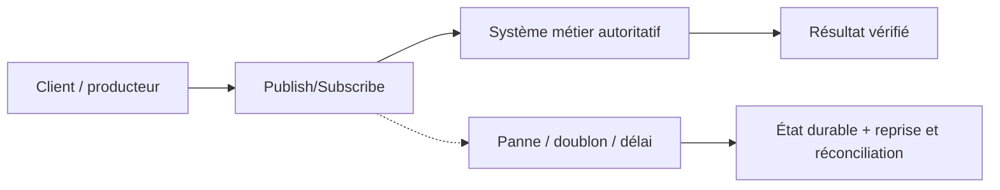
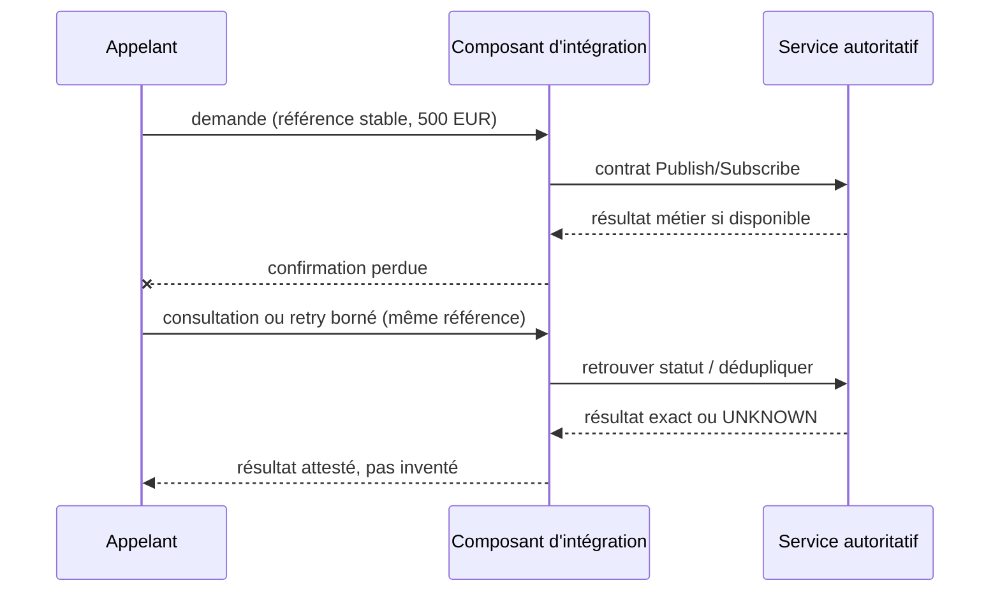

# Cours 86 — Publish/Subscribe · Intégration bancaire

> Banque fictive · ordre SEPA de 500 EUR · exercice corrigé théorique, **non validé individuellement en session**.

## 1. Intention
Apprendre pourquoi choisir **Publish/Subscribe** dans une architecture entre Java/Spring, API, IBM MQ, Kafka et les systèmes métier. Étudier contrats, frontières de responsabilité, incidents et preuve de non-régression.

## 2. Fil rouge bancaire et règles
Une demande SEPA de 500 EUR possède une **référence métier stable**, distincte du messageId, correlationId et traceId. Les producteurs, intermédiaires et consommateurs peuvent perdre des confirmations ou redélivrer une demande.

1. Décrire ce que prouve chaque accusé technique et ce qui établit un statut bancaire autoritatif.
2. Définir délais, rétention, version du contrat, sécurité, ownership et stratégie de replay.
3. Garantir par une preuve de test que deux messages de même référence ne créent pas deux effets financiers.
4. Ne jamais traduire automatiquement un timeout en rejet métier ni ACK broker en règlement.
5. Vérifier l'échéance métier avant toute reprise d'un ordre de paiement instantané.

## 3. Architecture de décision

## 4. Séquence de panne à expliquer en comité

## 5. Vérifications à réaliser
- Nominal : contrat correct, traitement autorisé et statut exact.
- Doublon concurrent : une seule exécution autoritative malgré redélivrance.
- Panne après écriture : état retrouvé sans double exécution.
- Contrat incompatible : erreur explicite, DLQ/quarantaine si appropriée.
- Sécurité : rejeter accès objet non autorisé, sans fuite d'identifiant ni de contenu.
- Exploitation : mesurer latence, backlog, échéance, retries, disponibilité et preuve de reprise.
- Arbitrage : comparer à un appel direct ou à une conception plus simple si les contraintes le permettent.

## 6. QCM corrigé
**Quelle approche est défendable pour utiliser Publish/Subscribe ?**

- **A.** Supposer que Publish/Subscribe garantit automatiquement l'exécution financière exactement une fois.
- **B.** Exécuter les reprises sans contrôle d'autorisation ni rapprochement.
- **C.** Retenir Publish/Subscribe avec un contrat versionné, une clé métier stable et des tests de reprise.

**Corrigé : C.** Les garanties viennent du contrat, des invariants et des tests ; le mécanisme technique seul ne prouve pas la finalité du paiement.

## 7. Support technique détaillé — fiche existante
Les schémas, exemples de messages, compromis et scénarios d'échec suivants proviennent du référentiel déjà conservé dans le même dépôt.

**[Fiche source originale](https://github.com/zdmooc/enterprise-architecture-patterns-handbook/blob/main/01-integration-patterns/03-publish-subscribe/README.md)**

#### Problème
Un événement « paiement réglé » intéresse la notification, le reporting, la supervision et éventuellement des projections indépendantes. Un appel synchrone direct à chaque application multiplie les dépendances : le service émetteur ne doit pas avoir besoin que tous les abonnés soient disponibles.

#### Solution
Un **publisher** publie un événement sur un **topic** ; chaque abonnement indépendant reçoit les événements correspondant à son intérêt. Pub/Sub est un **mécanisme de distribution**, pas à lui seul toute une architecture EDA. messagerie MQ topics et Apache Kafka permettent des usages pub/sub mais n'ont pas exactement les mêmes mécanismes de rétention, offsets et groupes.

~~~mermaid
flowchart TB
  P["Service Paiements : événement confirmé"]
  T["Topic payments.status.v1"]
  N["Groupe notification"]
  R["Groupe reporting"]
  O["Groupe observabilité métier"]
  P --> T
  T --> N
  T --> R
  T --> O
~~~

#### Exemple de contrat événementiel (fictif)
~~~json
{
  "eventId": "evt-001",
  "eventType": "PaymentSettled",
  "schemaVersion": 1,
  "occurredAt": "2026-10-18T10:00:00Z",
  "paymentId": "VIR-001",
  "amountMinor": 50000,
  "currency": "EUR",
  "correlationId": "trace-001"
}
~~~
Ce document ne contient ni données bancaires personnelles ni preuve de règlement réelle. Définir explicitement la source autoritative de l'état et la sémantique de « Settled ».

#### Règles
1. **Fait accompli** : préférer des événements au passé, publiés après validation durable de l'état source. Une commande « ExecutePayment » n'est pas un événement « PaymentSettled ».
2. **Contrat stable** : schema registry, compatibilité des consommateurs, versionnement et propriétaire du schéma.
3. **Idempotent Consumer** : dédupliquer eventId ou identifiant de transition métier. Les transports peuvent livrer plusieurs fois.
4. **Abonnement durable** : configurer rétention/rejeu selon la technologie ; ne pas promettre par défaut que tout abonné hors ligne recevra un événement ancien.
5. **Confidentialité** : minimiser données personnelles, contrôles ACL topic/queue, TLS, politique de rétention et droit à l'accès.
6. **Traçabilité** : journaliser correlationId, métriques de retard par abonné et messages bloqués.

#### Modes de panne
| Situation | Réponse |
|---|---|
| Notification à l'arrêt | Reporting continue ; notification reprend si historique/abonnement disponible |
| Événement redélivré | Déduplication, pas de double SMS sans politique appropriée |
| Publication perdue après commit DB | Transactional Outbox + relais |
| Nouvelle version incompatible | Contrat évolutif, tests de compatibilité et versionnement |
| Abonné trop lent | Backpressure, scaling, alerte de lag, rétention suffisante |

#### Pub/Sub vs Queue vs EDA
- **Queue de travail** : un message traité par un des consommateurs concurrents de la même file (modèle usuel).
- **Pub/Sub** : plusieurs abonnements reçoivent le même fait.
- **EDA** : style de conception où des événements déclenchent les décisions et réactions de plusieurs composants.
- **Event Streaming** : journal partitionné et traitements continus/rejeu, fréquent avec Kafka.

#### Quand l'utiliser
Diffuser des événements déjà confirmés à des fonctions optionnelles et autonomes. Ne pas utiliser Pub/Sub pour déguiser une commande critique en événement ; la responsabilité du traitement et du statut final doit rester claire.

#### Checklist / questions d'entretien
- Le publisher peut-il survivre à la panne d'un abonné ?
- L'événement est-il publié après commit ? Quelles garanties de replay ?
- Qui possède le schéma ? Comment détecter un lag supérieur à la rétention ?
- **Q : 3 consommateurs reçoivent-ils une copie physique chacun ?** Pas nécessairement ; chacun possède une vue logique de l'événement, le mécanisme dépend du broker.
- **Q : Pub/Sub = EDA ?** Non ; Pub/Sub décrit la diffusion, EDA décrit l'organisation du système.

Voir : 04 EDA, 05 Event Streaming, 10 Idempotency.

---

#### Illustrations complémentaires — queue contre publication-abonnement

#### Comparaison de topologie
~~~mermaid
flowchart TB
    A["Ordre : ExecutePayment"] --> Q["Queue de travail"]
    Q --> W1["Consommateur 1"]
    Q -.->|ou, par concurrence| W2["Consommateur 2"]
    B["Fait : PaymentSettled"] --> T["Topic d'événements"]
    T --> S1["Abonnement comptabilité"]
    T --> S2["Abonnement notifications"]
    T --> S3["Abonnement supervision"]
~~~
**Queue :** un traitement logique par message dans le groupe de workers concurrents. **Pub/Sub :** trois abonnements indépendants au fait « virement réglé ». La livraison réelle peut être répétée selon le broker.

#### La notification est en panne
~~~mermaid
sequenceDiagram
    participant P as Émetteur
    participant T as Topic
    participant C as Comptabilité
    participant N as Notifications
    participant S as Supervision
    P->>T: PaymentSettled(VIR-001, 500 EUR)
    T->>C: Event PaymentSettled
    C-->>T: Traité
    T-xN: Indisponible
    T->>S: Event PaymentSettled
    S-->>T: Traité
    Note over N: Rattrapage selon abonnement et rétention
~~~
La comptabilité et la supervision ne doivent pas être bloquées par l'indisponibilité du consommateur de notifications. Le service émetteur ne fait pas trois appels synchrones.

#### Contrat de fait
\`PaymentSettled\` = « règlement attesté ». \`ExecutePayment\` = « commande à réaliser ». Les publier sur un même topic sans distinction rend l'architecture confuse et dangereuse.

[Retour à l'index](README.md)
